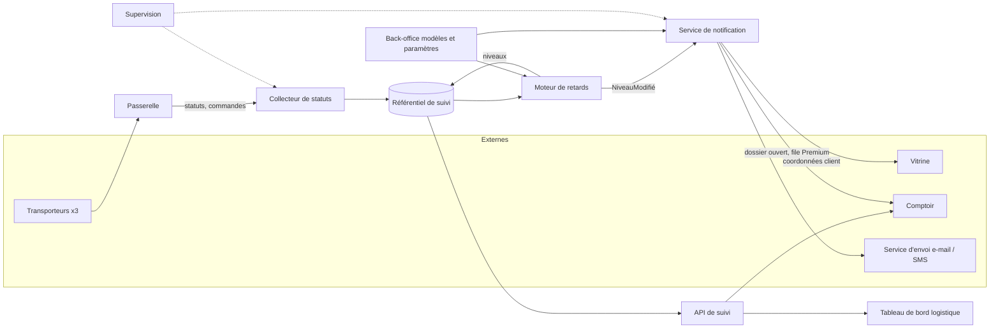
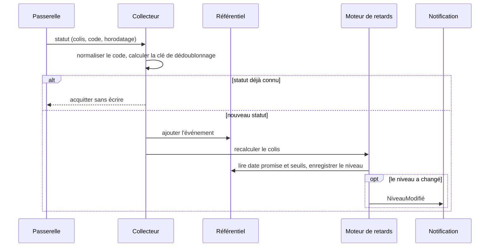
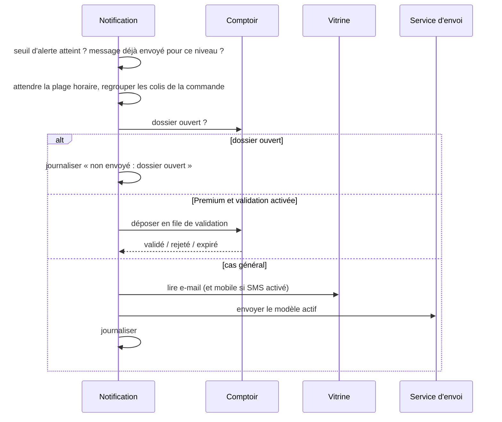

# Conception : détection des retards de livraison, suivi colis dans Comptoir et information du client

## Vue d'ensemble

La solution repose sur un **référentiel de suivi des colis** alimenté par les statuts transporteurs que Passerelle reçoit déjà. Un **moteur de retards** calcule le niveau de chaque colis non livré. Trois usages lisent ce référentiel :

- le **tableau de bord** de la logistique (lot 1) ;
- les **intégrations Comptoir** du service client : suivi dans la fiche commande, liste quotidienne, file de validation (lot 2) ;
- le **service de notification**, qui envoie les messages de retard selon des règles paramétrables (lot 2).

Choix structurants :

| Choix | Raison | Alternative écartée |
|---|---|---|
| Référentiel unique pour les quatre usages | Tableau de bord, Comptoir et messages affichent les mêmes chiffres | Un outil par direction : chiffres divergents |
| Canal, seuils, validation Premium et modèles paramétrables | Les conflits C01, C02 et C04 ne sont pas arbitrés (H01, H02, H03) | Coder une seule des positions |
| Lot 1 sans aucun envoi aux clients | Peut être mis en service avant le pic si une dérogation au gel est accordée (Q03, C03) | Tout livrer au T1 2027 |
| Développement dans le cloud d'Orvanne (UE) | Exigence B01-D9, CT-08 | Produit d'un éditeur |
| Coordonnées lues dans Vitrine au moment de l'envoi, sans copie | Minimisation (CT-01, CT-02) | Copie des e-mails et mobiles dans le référentiel |
| Un seul message par commande (H05) | Évite de multiplier les messages pour une même commande | Un message par colis |

Les technologies citées sont des **propositions** : les sources n'en imposent aucune.

## Architecture

## Composants et interfaces

| Composant | Responsabilité | Interfaces | Exigences | Lot |
|---|---|---|---|---|
| Collecteur de statuts | Consomme les statuts publiés par Passerelle, normalise les codes des 3 transporteurs, dédoublonne | Entrée : flux Passerelle (format à confirmer, Q05). Sortie : écriture dans le référentiel | 1 | 1 |
| Référentiel de suivi | Stocke colis, historique et niveau de retard | Base relationnelle (proposition : PostgreSQL), index par commande, transporteur, entrepôt, région, niveau | 1, 2, 9 | 1 |
| Moteur de retards | Calcule le niveau à chaque statut et lors du recalcul quotidien ; publie les changements | Lit les seuils du back-office ; événement `NiveauModifié` | 2 | 1 |
| API de suivi | Sert agrégats, listes et détail d'un colis | REST en lecture seule, SSO interne, rôles | 3, 4, 5 | 1 et 2 |
| Tableau de bord | Ventilations, descente au colis, code couleur, export CSV, heure de mise à jour | Application web interne | 3 | 1 |
| Intégration Comptoir | Encart de suivi, liste quotidienne, file de validation Premium, historique des messages | Selon les capacités d'extension de Comptoir (composant ou lien contextuel) | 4, 5, 6.8, 7 | 2 |
| Service de notification | Applique les règles d'envoi, construit et envoie le message, le journalise | Consomme `NiveauModifié` ; appelle Comptoir et Vitrine ; appelle le service d'envoi | 6, 7 | 2 |
| Back-office | Modèles versionnés, seuils, canal, plage horaire, délai de validation, conservation, verrou SMS | Application web, rôles `admin-metier` et `service-client` | 2.5, 8, 9.3, 9.4 | 1 (seuils), 2 |
| Supervision | Fraîcheur des flux, files en attente, erreurs d'envoi, indicateurs quotidiens | Alertes de la DSI | 1.6, 9.6 | 1 |

## Flux principaux

### Réception d'un statut et détection du retard

### Envoi d'un message de retard

## Modèle de données

| Entité | Attributs principaux | Donnée personnelle | Durée de conservation |
|---|---|---|---|
| Colis | id colis, n° de suivi, id commande, transporteur, entrepôt, région, date promise, dernier statut, nouvelle date, niveau, livré le | non (aucune identité) | paramétrable, fixée avec la DPO |
| ÉvénementStatut | id colis, code normalisé, code d'origine, horodatage transporteur, horodatage de réception, clé de dédoublonnage | non | paramétrable, fixée avec la DPO |
| Message | id commande, niveau, canal, version du modèle, contenu envoyé, statut, motif, horodatages, conseiller valideur | oui (contenu nominatif) | paramétrable, fixée avec la DPO |
| ModèleMessage | canal, cas, version, texte, auteur, date d'activation | non | conservé (traçabilité) |
| Paramètre | clé, valeur, auteur, date | non | conservé |
| Journal | utilisateur, action, objet, horodatage | oui (identifiant d'employé) | proposition : 1 an, à confirmer avec la DPO |

Les e-mails et numéros de mobile ne sont pas stockés dans le référentiel : ils sont lus dans Vitrine à l'envoi. Les messages sont un nouveau stockage de données clients à intégrer à l'orchestration des droits du projet P05.

## Gestion des erreurs

| Situation | Comportement | Exigence |
|---|---|---|
| Statut reçu en double | Ignoré grâce à la clé (colis, code, horodatage) | 1.5 |
| Code de statut inconnu | Événement stocké avec code d'origine, code normalisé `inconnu`, alerte supervision ; niveau inchangé | 1.1 |
| Aucun statut d'un transporteur au-delà du délai paramétré | Bandeau sur le tableau de bord, alerte supervision | 1.6 |
| Date promise absente | Colis exclu du calcul, compté à part | 2.8 |
| Comptoir indisponible à la vérification du dossier | Envoi reporté (nouvelles tentatives sur 1 h), jamais d'envoi sans vérification | 7.2, 7.3 |
| Service d'envoi en erreur | 3 nouvelles tentatives à délai croissant, puis « non envoyé : erreur technique » dans la liste quotidienne | 6.1, 5.2 |
| E-mail absent ou invalide | « non envoyé : coordonnées », signalé dans la liste | 6.2, 5.2 |
| Suivi trop lent pour Comptoir | Délai de 1,5 s côté Comptoir, fiche sans suivi avec message | 4.4 |
| Commande livrée avant l'envoi | Message annulé | 7.8 |
| Message Premium non traité dans le délai | Signalement au responsable, pas d'envoi par défaut | 7.7 |
| Modèle contenant un contenu commercial | Activation refusée | 8.3 |
| Tentative d'activer le SMS sans avis DPO | Refus, verrou dans le back-office | 9.3 |

## Sécurité et RGPD

- **Avant le développement :** le traitement est soumis à la DPO (CT-01) : base légale du message de service, durée de conservation, usage éventuel du mobile (CT-02).
- **Mobile :** l'activation du SMS est bloquée tant que l'avis de la DPO n'est pas enregistré (exigence 9.3).
- **Contenu :** variables de service seulement et liste de termes interdits à l'activation d'un modèle (CT-03, exigence 8).
- **Minimisation :** le référentiel ne contient ni nom, ni adresse, ni coordonnées.
- **Accès et journalisation :** SSO interne, rôles `logistique`, `entrepot`, `service-client`, `admin-metier`, `dsi` ; actions sensibles journalisées avec preuve d'exécution (CT-10, exigence 9.5).
- **Hébergement :** cloud d'Orvanne dans l'UE (CT-08, exigence 9.2).
- **Données de test :** synthétiques ou anonymisées (CT-04, exigence 9.7).
- **Mise en production :** aucune entre le 16/11 et le 11/01 (CT-07, exigence 9.8).

## Volumétrie et performance

| Grandeur | Normal | Pic | Base |
|---|---|---|---|
| Colis expédiés par jour | 35 000 | 70 000 | B01-N1, B01-N2 |
| Colis en cours de suivi (estimation : 3 jours de transit) | ≈ 105 000 | ≈ 210 000 | estimation |
| Statuts par jour (estimation : 6 par colis) | ≈ 210 000 | ≈ 420 000 | estimation |
| Pointe de réception (estimation) | ≈ 25 / s | ≈ 50 / s | estimation |
| Ouvertures de fiche Comptoir (estimation : 2 par contact) | ≈ 5 200 / jour | ≈ 10 000 / jour | B02-N2, B02-N3 |

Ces volumes sont modestes pour une base relationnelle indexée. L'exigence de 2 s (B02-N4) est tenue en lisant le référentiel, sans appeler les transporteurs. Le test de charge vise 100 statuts par seconde, soit 2 fois la pointe estimée du pic.

## Stratégie de test

| Niveau | Contenu | Exigences |
|---|---|---|
| Unitaire | Niveaux aux bornes (veille, J, J+1, J+2, livré, date modifiée, date absente) ; dédoublonnage ; règles d'envoi (dossier ouvert, Premium, plage horaire, un message par commande) ; contrôle anti-commercial | 1.5, 2, 6.6, 6.7, 7, 8.3 |
| Intégration | Flux Passerelle pour chacun des 3 transporteurs ; Comptoir et service d'envoi avec bouchons puis en recette | 1.1, 1.3, 4.3, 6 |
| Performance | 100 statuts / s pendant 1 h ; 95e centile du suivi sous 2 s avec 210 000 colis en base | 1.4, 4.2, 9.1 |
| Résilience | Coupure de Comptoir et du service d'envoi ; arrêt du flux d'un transporteur | 1.6, 4.4, 7.3 |
| Recette métier | Logistique : journée rejouée. Service client : liste, file Premium, modèles relus par la DPO | 3, 5, 7, 8 |
| Données | Jeux synthétiques uniquement (CT-04) | 9.7 |
