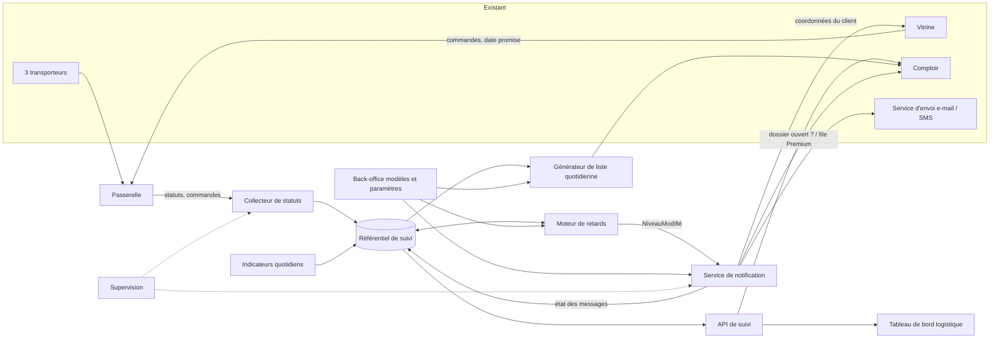
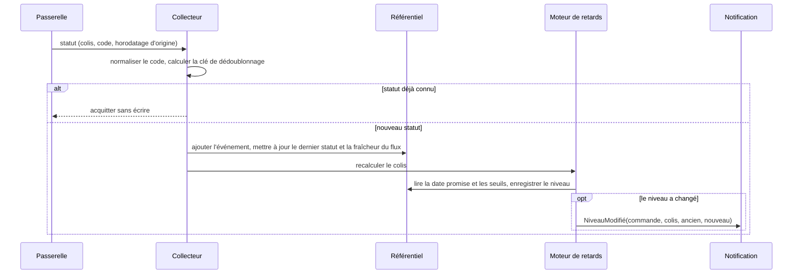
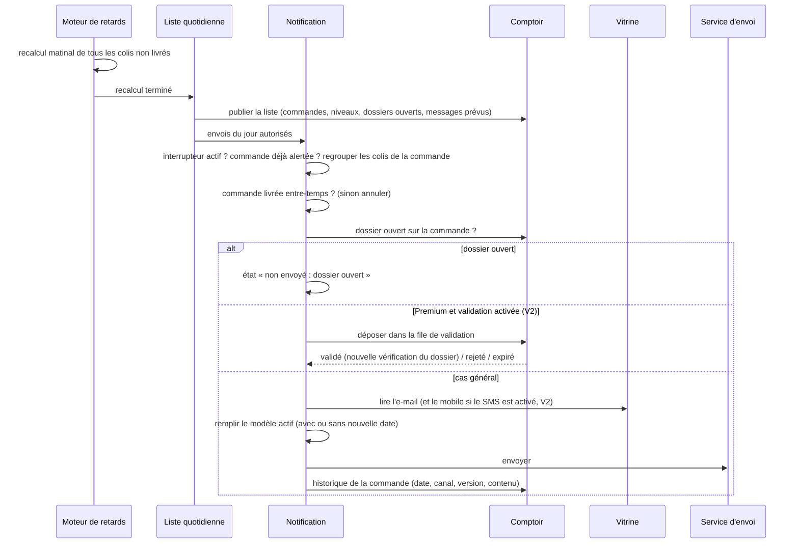

# Conception : détection des retards de livraison, suivi colis dans Comptoir et information du client

## Vue d'ensemble

La solution repose sur un **référentiel de suivi des colis**, alimenté par les statuts transporteurs déjà reçus par Passerelle (B01-D10). Un **moteur de retards** calcule le niveau de chaque colis non livré à partir de la date promise affichée sur Vitrine. Trois usages lisent ce référentiel :

- le **tableau de bord** des équipes transport et des responsables d'entrepôt (lot 1) ;
- les **intégrations Comptoir** du service client : suivi dans la fiche commande, liste quotidienne, historique des messages, puis file de validation Premium (lots 2 et 3) ;
- le **service de notification**, qui envoie les messages de retard aux clients selon des règles paramétrables (lot 2 pour l'e-mail, lot 3 pour le SMS).

### Choix structurants

| Choix | Raison | Alternative écartée |
|---|---|---|
| Un référentiel unique pour les quatre usages | Le tableau de bord, Comptoir, la liste quotidienne et les messages affichent les mêmes niveaux de retard | Un outil par direction : les chiffres divergeraient entre logistique et service client |
| Seuils, niveau d'alerte, canal, horaires et options paramétrables par un administrateur métier | Les conflits C01, C02, C04 et C05 ne sont pas arbitrés (H01 à H04) ; l'arbitrage ne demandera pas de nouveau développement | Coder une des positions |
| Retard calculé par colis, un seul message par commande | H05 : descente jusqu'au colis pour la logistique, un discours unique pour le client | Un message par colis |
| Envois clients derrière un interrupteur global, désactivé à la mise en service | Le lot 1 peut être déployé sans aucun envoi si une dérogation au gel est accordée (Q03, critère 11.7) | Deux applications distinctes |
| Liste quotidienne publiée avant le premier envoi du jour | Répond à « aucun message sans que l'équipe le sache » (B02-D14) sans validation systématique (B01-D8), selon H03 | Validation de chaque message |
| Développement interne dans le cloud d'Orvanne, UE | B01-D9, CT-08 | Produit d'un éditeur de suivi de colis |
| Coordonnées du client lues dans Vitrine au moment de l'envoi, jamais copiées | Minimisation des données personnelles (CT-01, CT-02) | Copie des e-mails et mobiles dans le référentiel |

Les technologies citées ci-dessous sont des **propositions** : les sources n'en imposent aucune.

## Architecture

## Composants et interfaces

| Composant | Responsabilité | Interfaces (entrée / sortie) | Exigences | Lot |
|---|---|---|---|---|
| Collecteur de statuts | Consomme les statuts et les commandes publiés par Passerelle ; normalise les codes des 3 transporteurs ; dédoublonne ; mesure la fraîcheur des flux | Entrée : flux Passerelle (format et fréquence à confirmer, Q05). Sortie : écriture dans le référentiel | 1, 11.1 | 1 |
| Référentiel de suivi | Stocke colis, historique des statuts, niveaux, messages | Base relationnelle (proposition : PostgreSQL), index par commande, transporteur, entrepôt, région, niveau | 1, 2, 11.3 | 1 |
| Moteur de retards | Calcule le niveau à chaque nouveau statut et lors du recalcul matinal ; publie `NiveauModifié` | Lit les seuils du back-office ; tâche planifiée avant l'heure de publication de la liste | 2 | 1 |
| API de suivi | Agrégats, listes, détail d'un colis, suivi d'une commande | REST en lecture seule, authentification par le SSO interne (proposition), rôles | 3, 4 | 1 (tableau de bord), 2 (Comptoir) |
| Tableau de bord | Ventilations, descente jusqu'au colis, rouge et tri, dernière mise à jour, bandeau d'interruption | Application web interne | 3, 1.8, 2.7 | 1 |
| Intégration Comptoir | Encart de suivi dans la fiche commande, liste quotidienne, historique des messages, file de validation Premium | Selon les capacités d'extension de Comptoir (composant intégré, lien contextuel ou API) : à qualifier (tâche 1.4) | 4, 5.4, 6.7, 8 | 2, 3 |
| Générateur de liste quotidienne | Construit la liste du matin après le recalcul, la publie, autorise ensuite les envois du jour | Lit le référentiel et l'état des messages ; interroge Comptoir pour les dossiers ouverts | 5 | 2 |
| Service de notification | Programme, vérifie, construit, envoie, réessaie, annule et journalise les messages | Consomme `NiveauModifié` ; appelle Comptoir (dossier ouvert, file Premium) et Vitrine (coordonnées) ; appelle le service d'envoi (à qualifier, tâche 1.4) | 6, 7, 8, 10 | 2, 3 |
| Back-office | Modèles versionnés, liste des variables de service, liste des termes interdits, seuils, niveau d'alerte, canal, horaires, tentatives, délai et action d'expiration Premium, règle Premium, avis DPO, interrupteur des envois, durée de conservation | Application web, rôles `admin-metier` et `service-client` | 2.5, 6.2, 9, 10.1, 10.3, 11.3, 11.7 | 1 (seuils, interrupteur), 2, 3 |
| Supervision | Fraîcheur par transporteur, codes inconnus, erreurs d'envoi, files en attente | Outils de supervision de la DSI | 1.5, 1.7, 1.8, 6.8 | 1 |
| Indicateurs quotidiens | Compte les messages par état et par motif ; export | Fichier CSV quotidien ou vue dans le Lac (proposition) | 11.5 | 2 |

### Paramètres

Les valeurs initiales marquées « proposition » ne viennent pas des sources ; elles sont à valider par les métiers au paramétrage.

| Paramètre | Valeur initiale | Base |
|---|---|---|
| Seuil `à surveiller` | J+1 | H02 |
| Seuil `en retard` | J+2 | H02 |
| Niveau affiché en rouge | `en retard` | H02, Q02 |
| Niveau d'alerte client | `en retard` | H02 |
| Délai de rafraîchissement du tableau de bord | à fixer après mesure (critère 1.7) | H04, Q05 |
| Seuil d'interruption d'un flux transporteur | à fixer après mesure (critère 1.7) | H04, Q05 |
| Heure du recalcul matinal | 5 h 30 (proposition) | B02-D6 « J+1 matin » |
| Heure de publication de la liste | 7 h 00 (proposition) | B02-D15 « chaque matin » |
| Heure du premier envoi | après publication de la liste (contrôlé) | H03 |
| Canal | e-mail seul | H01 |
| Nombre de tentatives d'envoi | 3 (proposition) | — |
| Validation Premium | désactivée, verrouillée sans règle Premium | H03 |
| Délai et action d'expiration Premium | à fixer (Q04) ; « abandonner » proposé comme valeur prudente | Q04 |
| Interrupteur des envois clients | désactivé | CT-07, critère 11.7 |
| Durée de conservation | à fixer avec la DPO | CT-01 |

## Flux principaux

### Réception d'un statut et détection du retard

### Journée type du service client et envoi des messages

## Modèle de données

| Entité | Attributs principaux | Donnée personnelle | Durée de conservation |
|---|---|---|---|
| Colis | id colis, n° de suivi, id commande, transporteur, entrepôt, région de livraison, date promise, dernier statut, nouvelle date de livraison, niveau, date du changement de niveau, livré le | non (aucune identité, région seulement) | paramétrable, fixée avec la DPO (11.3) |
| ÉvénementStatut | id colis, code normalisé, code d'origine, horodatage d'origine, horodatage de réception, clé de dédoublonnage | non | paramétrable (11.3) |
| FraîcheurFlux | transporteur, dernier statut reçu, médiane et 95e centile quotidiens du délai | non | 13 mois (proposition) |
| Message | id commande, colis concernés, canal, version du modèle, contenu envoyé, état (programmé, en validation, envoyé, non envoyé, annulé, rejeté, expiré), motif, tentatives, horodatages, conseiller valideur | oui (contenu nominatif) | paramétrable, fixée avec la DPO (11.3) ; extractible et supprimable par client (11.6) |
| ModèleMessage | canal, cas (avec / sans date), version, texte, auteur, date d'activation, actif | non | conservé (traçabilité, 9.4) |
| ListeQuotidienne | date, commandes, niveaux, dossier ouvert, état du message | oui (via le n° de commande et le contenu associé) | 30 jours (proposition, à valider par la DPO) |
| Paramètre | clé, valeur, auteur, date de modification ; dont avis DPO sur le mobile | non | conservé |
| Journal | utilisateur, action, objet, horodatage | oui (identifiant de l'employé) | à confirmer avec la DPO |

Les adresses e-mail et numéros de mobile ne sont **pas** stockés dans le référentiel : ils sont lus dans Vitrine au moment de l'envoi.

## Gestion des erreurs

| Situation | Comportement | Exigence |
|---|---|---|
| Statut reçu en double | Ignoré grâce à la clé (colis, code normalisé, horodatage d'origine) | 1.4 |
| Code de statut inconnu | Événement stocké avec le code d'origine et le code `inconnu` ; niveau inchangé ; alerte à la supervision | 1.5 |
| Aucun statut d'un transporteur au-delà du seuil | Bandeau sur le tableau de bord et alerte à la supervision | 1.8 |
| Date promise absente | Colis exclu du calcul, compté à part (« date promise inconnue ») | 2.7 |
| Recalcul matinal non terminé à l'heure de publication | Publication retardée jusqu'à la fin du recalcul ; aucun envoi avant publication ; alerte à la supervision | 2.6, 5.2 |
| API de suivi trop lente pour Comptoir | Délai maximal de 1,5 s côté Comptoir (proposition), puis fiche sans suivi avec un message | 4.2, 4.4 |
| Comptoir indisponible lors de la vérification du dossier ouvert | Envoi reporté et retenté ; jamais d'envoi sans vérification | 7.3 |
| Service d'envoi en erreur | Nouvelles tentatives avec délai croissant, puis « non envoyé : erreur technique » | 6.8 |
| E-mail absent ou invalide | « non envoyé : coordonnées » dans la liste quotidienne | 6.9 |
| Commande livrée avant l'envoi | Message annulé | 6.10 |
| Message Premium non traité dans le délai | Action d'expiration paramétrée et signalement au responsable | 8.5 |
| Modèle contenant un terme commercial | Activation refusée, terme signalé à l'auteur | 9.3 |
| Tentative d'activer le SMS sans avis DPO enregistré | Activation refusée | 10.3 |

## Sécurité et RGPD

- **Avant le développement (CT-01, Q36)** : le traitement est soumis à la DPO. Points à faire valider : base légale du message de service, durée de conservation (11.3), liste des variables de service (9.2), liste des termes commerciaux interdits (9.3), durée de conservation du journal. L'usage du mobile (CT-02) fait l'objet d'un avis distinct avant le lot 3.
- **Usage du mobile (CT-02)** : l'activation du SMS est bloquée tant que l'avis favorable de la DPO n'est pas enregistré dans le back-office (10.3).
- **Contenu des messages (CT-03, H06)** : variables de service uniquement, contrôle des termes commerciaux à l'activation (9.2, 9.3). Le code promo demandé par le marketing (B05-D7) n'est pas réalisable dans ce projet.
- **Minimisation** : le référentiel ne contient ni nom, ni adresse, ni coordonnées.
- **Droits des personnes** : les messages d'un client sont extractibles et supprimables (11.6). Ce nouveau stockage est à déclarer au projet de registre des droits (P05) pour son orchestration.
- **Accès** : SSO interne (proposition), rôles `logistique`, `entrepot`, `service-client`, `admin-metier`, `dsi`. Le tableau de bord est réservé aux rôles du critère 3.5.
- **Traçabilité (CT-10)** : accès au tableau de bord, validations et rejets, modifications de modèles et de paramètres journalisés (8.6, 9.4, 11.4).
- **Hébergement (CT-08)** : cloud d'Orvanne, UE (11.2).
- **Données de test (CT-04)** : jeux synthétiques uniquement, y compris pour la prévisualisation des modèles (9.5, 11.8).

## Volumétrie et performance

| Grandeur | Normal | Pic | Base |
|---|---|---|---|
| Colis expédiés par jour | 35 000 | 70 000 | B01-N1, B01-N2 |
| Colis en cours de suivi (estimation : 3 jours de transit) | ≈ 105 000 | ≈ 210 000 | estimation |
| Statuts reçus par jour (estimation : 6 par colis) | ≈ 210 000 | ≈ 420 000 | estimation |
| Débit moyen, et pointe (estimation : ×10) | ≈ 2,5 / s | ≈ 5 / s, pointe ≈ 50 / s | estimation ; arrivées par fichiers du matin possibles (B01-F1), d'où des rafales |
| Contacts au service client par jour | ≈ 2 600 | > 5 000 | B02-N2, B02-N3 |
| Ouvertures de fiche avec suivi (estimation : 2 par contact) | ≈ 5 200 | ≈ 10 000 | estimation |
| Messages de retard par jour | inconnu | inconnu | dépend du taux de retard, non fourni par les sources |

Ces volumes restent modestes pour une base relationnelle indexée. Le délai de 2 s dans Comptoir (B02-N4) est tenu en lisant le référentiel, sans appeler les transporteurs en direct ; le test vise ce délai au 99e centile (proposition). Si les statuts arrivent en un fichier quotidien, une rafale de l'ordre de 420 000 statuts doit être intégrée avant le recalcul matinal : le test de charge rejoue cette rafale.

## Stratégie de test

| Niveau | Contenu | Exigences |
|---|---|---|
| Unitaire | Calcul des niveaux aux bornes (J, J+1, J+2, livré, date inconnue, seuils modifiés) ; dédoublonnage ; codes inconnus ; règles d'envoi (interrupteur, un message par commande, dossier ouvert, livraison avant envoi, publication de la liste) ; contrôle anti-commercial ; verrous Premium et SMS ; longueur SMS | 1.4, 1.5, 2, 5.2, 6, 7, 8.2, 9.2, 9.3, 10.3, 10.4, 11.7 |
| Intégration | Flux Passerelle de recette pour les 3 transporteurs ; Comptoir (encart, liste, dossier ouvert, file) et service d'envoi, d'abord avec des bouchons puis en recette ; lecture des coordonnées dans Vitrine | 1.1, 1.3, 4.1, 4.3, 5.4, 6.3, 6.7, 8.1 |
| Performance | Injection à 100 statuts / s pendant 1 h et rejeu d'une rafale de 420 000 statuts ; 210 000 colis en base ; 99e centile de l'API de suivi inférieur à 2 s | 1.6, 4.2, 11.1 |
| Résilience | Coupure de Comptoir, du service d'envoi, arrêt du flux d'un transporteur, recalcul en retard | 1.8, 4.4, 6.8, 7.3 |
| Sécurité et RGPD | Contrôle des rôles, journalisation, purge, extraction et suppression par client, absence de coordonnées dans le référentiel | 3.5, 11.3, 11.4, 11.6 |
| Recette métier | Logistique : tableau de bord sur une journée synthétique rejouée. Service client : liste quotidienne, encart Comptoir, modèles relus par la DPO. V2 : file Premium, envoi SMS | 3, 4, 5, 6, 8, 9, 10 |
| Données | Jeux synthétiques uniquement (CT-04) | 11.8 |
