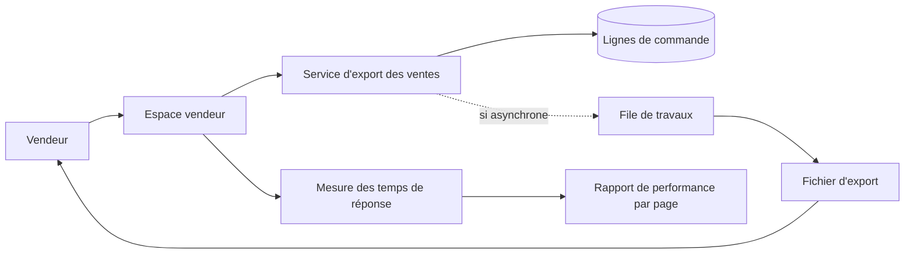

# Conception du correctif : export des ventes en erreur et lenteur de l'espace vendeur

## Analyse de la cause

- **MKP-07 (export)** : la cause n'est pas établie dans les sources. Les pistes de la DSI laissent penser à une requête non indexée sur les lignes de commande et à un export synchrone qui dépasse un délai ou une mémoire au-delà de 50 000 lignes (B09-D9, B09-D10, B09-D11). Hypothèse de travail (H27) à confirmer par reproduction avec un jeu synthétique de plus de 50 000 lignes, plan d'exécution et journaux à l'appui.
- **MKP-11 (lenteur)** : cause inconnue, pages non identifiées (B09-D17, H27). Elle sera établie à partir de la mesure des temps de réponse par page (critères 2.3 et 2.4).

## Architecture

Le système qui porte l'espace vendeur n'est pas nommé dans les sources (B09-F15). La conception ci-dessous reste générique et se rattache à Vitrine pour l'accès marketplace ; ce rattachement est une **proposition**.

| Choix | Raison | Alternative écartée |
|---|---|---|
| Mesurer avant d'optimiser | Le critère « trop lent » n'est pas chiffré (H27) | Optimiser à l'aveugle |
| Index et export asynchrone traités comme pistes, retenus selon la reproduction | Ce sont des propositions de la DSI, pas des exigences (H27) | Imposer les deux solutions d'emblée |
| Livraison en un lot hors gel | Gel du 16/11 au 11/01 (CT-07) | Livraison pendant le pic |
| Hébergement inchangé, dans l'UE | CT-08, Q34 non tranchée | Nouvel hébergement chez un éditeur |

Composants et critères associés :

| Composant | Responsabilité | Critères |
|---|---|---|
| Service d'export des ventes | Produit l'export complet, quel que soit le volume ; mode synchrone sous le seuil, asynchrone au-delà si la reproduction le justifie (proposition) | 2.1, 3.1 |
| Index sur les lignes de commande | Accélère la lecture des ventes d'un vendeur (proposition, B09-D10) | 2.1 |
| Mesure des temps de réponse | Enregistre médiane et 95e centile par page | 2.3, 2.4 |
| Paramètre de seuil | Valeur du 95e centile attendu par page, modifiable sans développement | 2.4 |

Volumétrie : seul le chiffre de 50 000 lignes est connu (B09-N5). Le volume maximal d'un export n'est pas donné : le test de charge retient 500 000 lignes comme **estimation** de marge, à confirmer (Q28).

## Correctif proposé

| Changement | Raison | Critères |
|---|---|---|
| Reproduire l'erreur avec un jeu synthétique, puis corriger la cause constatée (index, pagination/flux de lecture, export asynchrone) | Cause non établie | 2.1 |
| Si export asynchrone : notifier le vendeur et mettre le fichier à disposition dans l'espace vendeur | Évite le délai d'attente d'une requête longue | 2.1, 2.2 |
| Conserver le chemin actuel pour 50 000 lignes ou moins | Aucune régression | 3.1 |
| Instrumenter les pages de l'espace vendeur | Base de la fixation du seuil | 2.3, 2.4 |
| Optimiser les pages dépassant le seuil | Réponse à B09-D17 | 2.4, 3.2 |
| Planifier la mise en production hors gel | CT-07 | 2.5 |

## Gestion des erreurs

| Situation | Comportement | Critère |
|---|---|---|
| Export en échec | Message explicite au vendeur, erreur journalisée avec le volume | 2.2 |
| Export asynchrone interrompu | Reprise ou nouvelle demande proposée, sans fichier partiel livré | 2.2 |
| Mesure indisponible | Alerte de supervision ; aucun seuil appliqué tant que la mesure manque | 2.3 |
| Seuil non encore fixé (Q28) | Le seuil reste un paramètre vide ; la mesure continue | 2.4 |
| Calendrier tombant dans le gel | Report de la mise en production au 12 janvier | 2.5 |

## Sécurité et RGPD

- L'export contient les ventes du vendeur, qui comprennent des données de commande pouvant être personnelles : le correctif n'ajoute aucun champ et conserve les droits d'accès (3.2). Tout nouveau traitement est soumis à la DPO (CT-01).
- Un fichier d'export asynchrone n'est accessible qu'au vendeur demandeur et expire après une durée à fixer avec la DPO (proposition : 7 jours, estimation).
- La mesure de performance ne stocke pas d'identité de vendeur au-delà d'un identifiant technique.
- Hébergement dans l'UE (CT-08).

## Stratégie de test

- **Reproduction** : test qui échoue avant le correctif, export de 50 001 lignes et plus (critère 1.1) ; relevé des temps de réponse actuels des pages (critère 1.2).
- **Correction** : export de 50 001 et 500 000 lignes sans erreur (2.1) ; simulation d'échec et vérification du message et du journal (2.2) ; présence des mesures (2.3) ; temps de réponse sous le seuil (2.4) ; vérification du calendrier hors gel (2.5).
- **Non-régression** : export de 50 000 lignes ou moins identique à la référence (3.1) ; parcours existants et droits d'accès inchangés (3.2) ; déploiement sans dépendance à P07 (3.3).
- **Données de test** : jeu synthétique uniquement, aucune donnée de production sans anonymisation (CT-04).
