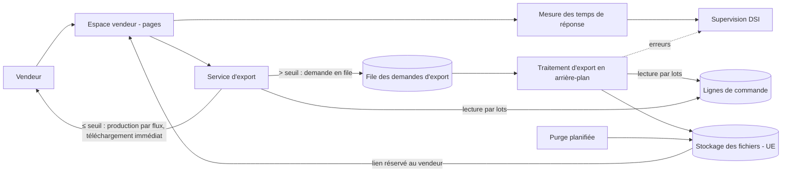
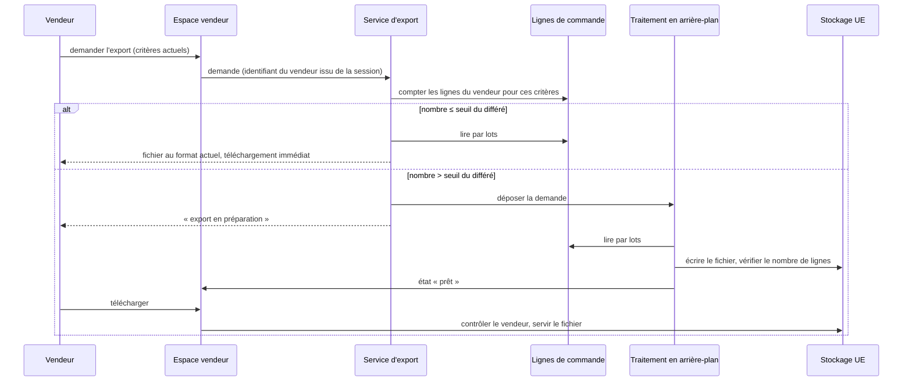
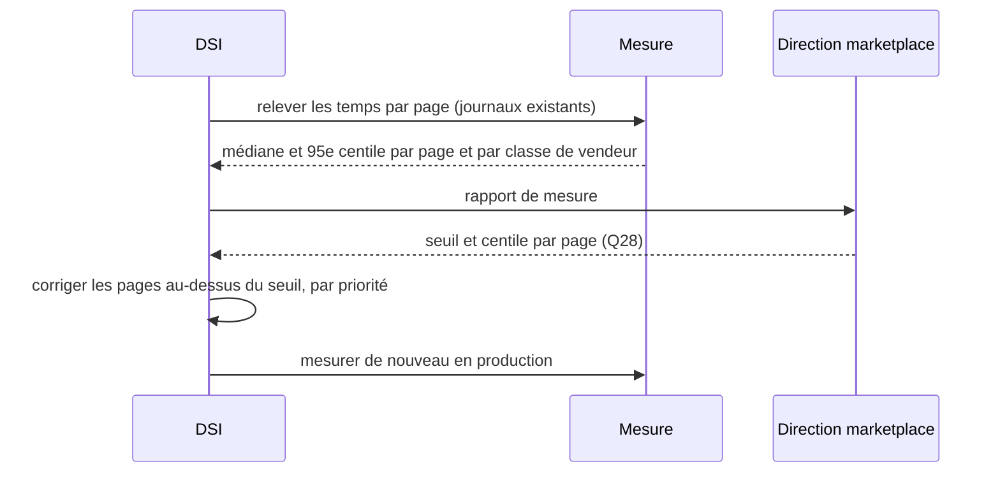

# Conception : correctif de l'export des ventes et des temps de réponse de l'espace vendeur

## Vue d'ensemble

Le correctif traite deux défauts de l'espace vendeur existant :

- **Export des ventes (MKP-07, lot 1)** : l'export tombe en erreur au-delà de 50 000 lignes (`B09-D9`). Le correctif rend la production de l'export indépendante du volume : lecture par lots, écriture progressive du fichier et, au-delà d'un seuil paramétrable, production en différé.
- **Temps de réponse (MKP-11, lot 2)** : la lenteur n'est ni chiffrée ni localisée (`B09-D17`). Le correctif commence par une mesure par page, puis la direction marketplace fixe un seuil par page (H27, Q28). Seules les pages au-dessus de leur seuil sont corrigées.

Les sources ne donnent ni la cause des défauts, ni le système qui porte l'espace vendeur (`B09-F15`), ni le format de l'export. L'analyse de cause ci-dessous est **probable et à confirmer** par la tâche 1.3. Les technologies citées sont des **propositions**.

Choix structurants :

| Choix | Raison | Alternative écartée |
|---|---|---|
| Caractériser le défaut d'export avant de choisir le correctif | Un seuil net et rond (50 000 lignes, `B09-N5`) évoque une limite explicite ; un délai dépassé donnerait un seuil variable selon la charge. Les deux causes n'ont pas le même correctif | Appliquer directement les deux solutions de la DSI (`B09-D10`, `B09-D11`) sans diagnostic |
| Production en flux (lecture par lots, écriture progressive) | Supprime toute dépendance entre le volume et la mémoire, quelle que soit la cause exacte | Relever la limite ou le délai : le défaut réapparaîtrait à un volume plus élevé |
| Différé seulement au-delà d'un seuil paramétrable, 50 000 lignes par défaut (proposition) | Les exports de 50 000 lignes ou moins gardent leur mode de téléchargement actuel (critère 3.1) | Passer tous les exports en asynchrone : change le comportement des petits exports, qui fonctionnent |
| Index sur la table des lignes de commande seulement si le plan d'exécution montre un parcours complet, et après mesure de son coût en écriture | La table sert aussi à d'autres traitements (critère 3.4) ; un index ralentit les écritures | Ajouter l'index sans mesure (piste `B09-D10` appliquée telle quelle) |
| Mesurer d'abord les temps de réponse, à partir des journaux existants si possible | « Trop lent » n'est pas chiffré (H27) ; lire des journaux existants ne demande aucune mise en production et peut se faire pendant le gel (`CT-07`), donc pendant le pic | Optimiser au jugé les pages supposées lentes |
| Correctif indépendant de P07 | Les nouvelles vues de ventes de P07 s'appuient sur les mêmes données et viennent après (dépendance de `work/analyse.json`) | Attendre la refonte de P07 |

## Analyse de cause probable (à confirmer)

### Export des ventes

| Cause possible | Indice dans les sources | Vérification (tâche 1.3) | Correctif associé |
|---|---|---|---|
| A. Limite explicite à 50 000 lignes (paramètre, plafond de requête, limite d'une bibliothèque de génération de fichier) | Seuil exprimé comme net et rond : « au-delà de 50 000 lignes » | Rechercher la valeur 50 000 dans la configuration et le code ; tester 49 999, 50 000, 50 001 lignes | Supprimer la limite et passer en production par flux |
| B. Délai maximal de la requête HTTP dépassé (export produit pendant la requête) | La DSI propose l'asynchrone (`B09-D11`), qui répond à ce cas | Relever dans les journaux le délai écoulé avant l'erreur ; vérifier s'il est constant | Différé au-delà du seuil |
| C. Mémoire saturée (toutes les lignes chargées avant l'écriture) | Aucun ; cause fréquente de ce type de défaut | Mesurer la mémoire du processus pendant un export de 50 001 et 100 000 lignes | Production par flux |
| D. Requête lente sans index adapté sur les lignes de commande | La DSI propose un index (`B09-D10`) | Plan d'exécution de la requête d'export (proposition : `EXPLAIN ANALYZE` si la base est relationnelle) | Index ciblé, après mesure de son coût (critère 3.4) |

Les causes peuvent se cumuler. B et D aggravent aussi les temps de réponse des autres pages pendant un gros export, d'où le critère 2.10.

### Temps de réponse

Aucune cause n'est connue. Deux pistes à vérifier pendant la mesure :
- les pages qui lisent les lignes de commande souffrent de la même absence d'index que l'export (cause D) ;
- les exports volumineux, produits pendant la requête, consomment les ressources partagées avec les autres pages.

La mesure ventile les temps par page et par classe de volume du vendeur (proposition : moins de 10 000, 10 000 à 50 000, plus de 50 000 lignes de ventes) pour distinguer une lenteur générale d'une lenteur liée aux gros vendeurs.

## Correctif proposé

1. **Supprimer la cause de l'erreur** (A, B ou C selon la tâche 1.3) et produire l'export par flux : lecture par lots (proposition : 5 000 lignes, curseur côté base), écriture progressive dans le fichier, même format et mêmes colonnes qu'aujourd'hui (critères 2.1, 2.2, 3.1).
2. **Différé au-delà du seuil paramétrable** : le vendeur voit l'état « en préparation », puis un lien de téléchargement dans l'espace vendeur. Le fichier est stocké dans l'UE, accessible au seul vendeur demandeur, puis supprimé (critères 2.4, 2.5, 2.6).
3. **Index ciblé** sur les lignes de commande (proposition : vendeur et date de vente), seulement si la cause D est confirmée, avec mesure avant et après des traitements qui écrivent dans la table (critère 3.4).
4. **Instrumentation des temps de réponse** par page, conservée après le correctif pour la supervision (critères 2.8, 2.11).
5. **Correction des pages au-dessus de leur seuil**, par ordre de priorité : nombre d'affichages multiplié par le dépassement (critère 2.9). Le contenu exact dépend de la mesure.

## Architecture

## Composants et interfaces

| Composant | Responsabilité | Interfaces (entrée / sortie) | Exigences | Lot |
|---|---|---|---|---|
| Service d'export | Compte les lignes demandées, choisit le mode (immédiat ou différé), produit l'export par flux sous le seuil | Entrée : demande du vendeur (critères d'export actuels). Sortie : fichier au format actuel ou demande en file | 2.1, 2.2, 2.3, 2.7, 3.1, 3.2 | 1 |
| File des demandes d'export | Conserve les demandes différées et leur état | Proposition : table de la base existante ou file de messages de la DSI | 2.4 | 1 |
| Traitement d'export en arrière-plan | Produit le fichier par lots, enregistre l'état et les erreurs | Entrée : file. Sortie : fichier dans le stockage, état « prêt » ou « en échec » | 2.1, 2.2, 2.3, 2.4, 2.7, 2.10 | 1 |
| Stockage des fichiers | Conserve les fichiers différés, sert le téléchargement après contrôle du vendeur | Proposition : stockage objet du cloud d'Orvanne, région UE, liens authentifiés et à durée limitée | 2.5, 2.6, 3.2 | 1 |
| Purge planifiée | Supprime les fichiers à l'échéance de la durée de conservation | Traitement quotidien | 2.5 | 1 |
| Index sur les lignes de commande | Accélère la sélection par vendeur et par période, si la cause D est confirmée | Base de données existante | 3.4 | 1 |
| Mesure des temps de réponse | Enregistre page, horodatage, durée et classe de volume du vendeur | Proposition : journaux d'accès existants, sinon instrumentation applicative | 1.2, 2.8, 2.6 | 2 (mesure initiale avant le lot 1) |
| Supervision DSI | Compare les temps mesurés aux seuils par page, alerte en cas de dépassement et sur les erreurs d'export | Outils de supervision existants de la DSI | 2.7, 2.11 | 2 |
| Paramètres | Seuil du différé, durée de conservation, seuils et centile par page, période d'observation | Fichier ou table de configuration, modifiable sans mise en production | 2.4, 2.5, 2.9, 2.11 | 1 et 2 |

## Flux principaux

### Export des ventes

### Mesure puis correction des temps de réponse

## Modèle de données

| Entité | Attributs principaux | Donnée personnelle | Durée de conservation |
|---|---|---|---|
| DemandeExport | identifiant, identifiant du vendeur, critères d'export, mode (immédiat, différé), nombre de lignes attendu, nombre de lignes écrites, état (en préparation, prêt, en échec, expiré), horodatages, emplacement du fichier | non, sauf si le vendeur est une personne physique (à confirmer) | durée de conservation du fichier, paramétrable (proposition : 7 jours) |
| FichierExport | contenu identique à l'export actuel | à confirmer : oui si l'export contient le nom ou l'adresse des clients (question « à créer » de `bugfix.md`) | paramétrable (critère 2.5), proposition : 7 jours, à valider avec la DPO si le fichier contient des données de clients |
| MesureTempsReponse | identifiant de page, horodatage, durée, classe de volume du vendeur | non (ni identifiant du vendeur, ni adresse IP) | proposition : 13 mois, pour comparer une année sur l'autre, pic compris |
| ErreurExport | identifiant de la demande, nombre de lignes demandé, étape, message technique, horodatage | non | proposition : 90 jours |
| Paramètre | clé, valeur, auteur, date de modification | oui (identifiant de l'employé auteur) | conservé pour la traçabilité |

## Gestion des erreurs

| Situation | Comportement | Exigence |
|---|---|---|
| Erreur technique pendant un export immédiat | Message d'échec invitant à relancer ; erreur enregistrée avec le nombre de lignes demandé | 2.7 |
| Échec du traitement en arrière-plan | 2 nouvelles tentatives automatiques (proposition), puis état « en échec » visible par le vendeur avec invitation à relancer ; alerte à la supervision | 2.4, 2.7 |
| Nombre de lignes écrites différent du nombre attendu | Fichier rejeté, état « en échec », erreur enregistrée ; jamais de fichier incomplet mis à disposition | 2.2, 2.7 |
| Téléchargement demandé par un autre vendeur ou par un lien expiré | Refus d'accès, sans indiquer si le fichier existe | 2.5, 3.2 |
| Stockage indisponible | Export différé en échec, message au vendeur, alerte | 2.6, 2.7 |
| Gros export en cours pendant la navigation d'autres vendeurs | Traitement en arrière-plan avec une concurrence limitée (proposition : 2 exports simultanés), pour préserver les pages | 2.10 |
| Index qui ralentit les écritures au-delà de la référence | Index retiré ou redéfini avant la mise en production | 3.4 |
| Page au-dessus de son seuil sur la période d'observation | Alerte à la supervision | 2.11 |
| Mesure indisponible (journaux absents) | Instrumentation applicative à mettre en production hors gel ; la mesure initiale est décalée d'autant | 1.2, 2.8 |

## Sécurité et RGPD

- **Cloisonnement** : l'identifiant du vendeur vient de la session, jamais d'un paramètre de la demande. Le téléchargement d'un fichier différé contrôle le vendeur à chaque accès (critères 2.5, 3.2).
- **Données personnelles des exports** : le contenu de l'export n'est pas décrit dans les sources. S'il contient des données de clients, la conservation des fichiers différés est un nouveau stockage à soumettre à la DPO (`CT-01`). `CT-01` n'est pas listée dans les contraintes de P08 dans `work/analyse.json` : point à signaler à l'analyste.
- **Mesures** : elles ne contiennent ni identifiant de vendeur ni adresse IP (critère 2.8).
- **Hébergement** : fichiers et mesures sont stockés dans l'Union européenne (`CT-08`) ; l'exigence du cloud d'Orvanne pour ce projet dépend de Q34.
- **Données de test** : tous les tests de volume utilisent un jeu synthétique ; la tâche 1.3 ne relève en production que des comptages, sans extraire de lignes (`CT-04`).
- **Gel** : aucune mise en production du 16 novembre au 11 janvier (`CT-07`) ; la mesure initiale à partir des journaux existants reste possible pendant cette période.

## Volumétrie et performance

| Grandeur | Valeur | Base |
|---|---|---|
| Volume au-delà duquel l'export tombe en erreur | 50 000 lignes | `B09-N5` |
| Plus gros export d'un vendeur en production | inconnu, relevé par la tâche 1.3 | — |
| Nombre de vendeurs, affichages de pages par jour | inconnus, relevés par la tâche 1.1 | — |
| Effet du pic de fin d'année sur la marketplace | inconnu ; le pic double environ les volumes d'Orvanne (glossaire, B01) | estimation à confirmer |
| Volumes de test de l'export | 49 999, 50 000, 50 001, 100 000 lignes, et 2 fois le plus gros export relevé | proposition (le facteur 2 couvre le pic estimé) |
| Seuils de temps de réponse par page | aucune valeur avant la mesure initiale et la réponse à Q28 | H27 |

## Stratégie de test

Les tests suivent trois étapes : reproduire le défaut, vérifier la correction, vérifier l'absence de régression. Tous utilisent le jeu synthétique (`CT-04`).

| Étape | Test | Résultat attendu | Critères |
|---|---|---|---|
| Reproduire | Export de 50 001 lignes sur la version actuelle, en recette | Le test échoue avec l'erreur constatée ; il est conservé dans la suite de tests | 1.1 |
| Reproduire | Mesure initiale des temps de réponse par page | Rapport par page ; base des seuils | 1.2 |
| Corriger | Même test de 50 001 lignes, puis 100 000 lignes et 2 fois le plus gros export relevé | Fichier complet, sans erreur | 2.1, 2.3 |
| Corriger | Comptage des lignes du fichier comparé au comptage en base, contrôle d'absence de doublons | Égalité stricte | 2.2 |
| Corriger | Export au-delà du seuil du différé : état « en préparation », puis fichier disponible | Fichier téléchargeable par le vendeur demandeur | 2.4 |
| Corriger | Téléchargement par un autre vendeur, lien expiré, purge à l'échéance | Accès refusé ; fichier supprimé | 2.5 |
| Corriger | Emplacement du stockage des fichiers et des mesures | Région UE | 2.6 |
| Corriger | Pannes simulées : base, stockage, traitement en arrière-plan | Message d'échec, relance possible, erreur enregistrée | 2.7 |
| Corriger | Contrôle des mesures enregistrées | Page, horodatage, durée, aucune donnée personnelle | 2.8 |
| Corriger | Test de charge des pages corrigées, au double du trafic relevé | Seuils par page respectés | 2.9 |
| Corriger | Test de charge des pages pendant 2 exports simultanés du plus gros volume | Seuils par page respectés | 2.10 |
| Corriger | Dépassement simulé d'un seuil | Alerte reçue par la supervision | 2.11 |
| Non-régression | Exports de 1, 10 000 et 50 000 lignes comparés aux fichiers de référence produits par la version actuelle | Fichiers identiques (contenu, colonnes, format), téléchargement immédiat | 3.1 |
| Non-régression | Export demandé par un vendeur avec des ventes d'autres vendeurs dans la base | Aucune ligne d'un autre vendeur | 3.2 |
| Non-régression | Parcours fonctionnels de l'espace vendeur, avant et après correctif | Mêmes informations et mêmes fonctions | 3.3 |
| Non-régression | Durée des traitements existants qui lisent ou écrivent les lignes de commande, avant et après l'index | Durée au plus égale à la référence | 3.4 |
| Recette | Direction marketplace et vendeurs pilotes en recette, puis mesure en production après mise en service | Validation des critères 2.1, 2.4, 2.9, 3.1, 3.3 | 2.1, 2.4, 2.9, 3.1, 3.3 |
