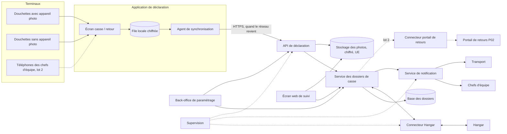
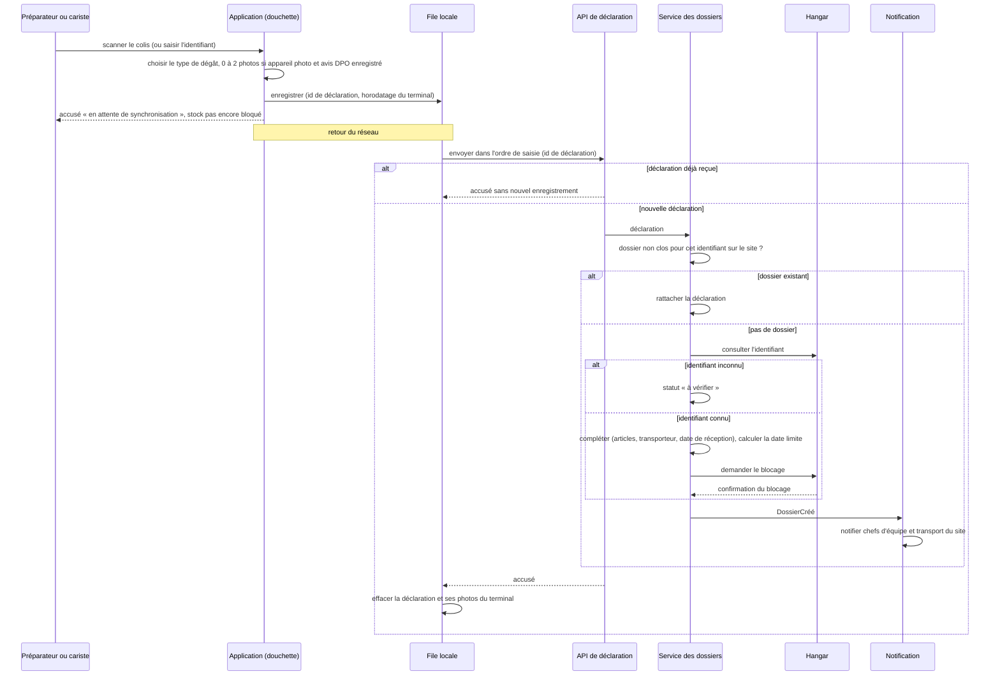
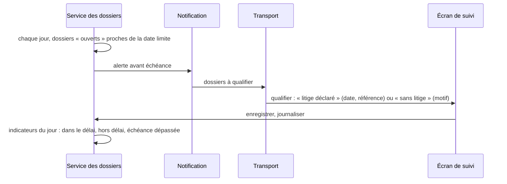

# Conception : déclaration de casse à la douchette, blocage du stock dans Hangar et litiges transporteurs

## Vue d'ensemble

Une **application de déclaration** installée sur les douchettes enregistre la déclaration sur le terminal, puis la transmet au serveur dès que le réseau est disponible. Côté serveur, le **service des dossiers de casse** crée le dossier, le complète avec les données de Hangar, demande le blocage du stock, prévient les chefs d'équipe et le transport, et calcule la date limite de déclaration du litige. Un **écran web de suivi** sert aux chefs d'équipe et au transport. Un **back-office** porte le paramétrage par site.

En lot 2, la même application gagne un mode « retour » qui saisit la note A / B / C et la transmet au portail de retours (P02). Elle peut aussi s'installer sur les téléphones des chefs d'équipe.

Choix structurants :

| Choix | Raison | Alternative écartée |
|---|---|---|
| Application conçue pour fonctionner hors réseau (file locale chiffrée, synchronisation automatique) | Le réseau ne passe pas dans les allées du fond (B06-D8) | Application en ligne seule : inutilisable là où la casse est constatée |
| Identifiant unique de déclaration généré sur le terminal | Une reprise après coupure ne crée pas de doublon (critère 2.6) | Identifiant attribué par le serveur : doublons à chaque nouvelle tentative |
| Dossier créé par le serveur, pas sur le terminal | Le rattachement à un dossier existant et l'appel à Hangar demandent une vue complète du site (3.2, 3.3) | Dossier créé sur le terminal : deux douchettes hors réseau créeraient deux dossiers |
| Photo facultative, proposée selon les capacités du terminal | Deux tiers des douchettes de E2 n'ont pas d'appareil photo (C16, H15) | Photo obligatoire : bloquerait la déclaration sur 40 douchettes |
| Hangar reste le seul système qui gère le stock : le service demande le blocage, Hangar l'applique et le confirme | Évite deux états de stock divergents (B06-D9) | Tenir un stock bloqué en parallèle de Hangar |
| Paramétrage par site (types de dégât, destinataires, délais, granularité du blocage, activation) | Démarrage sur E2, autres sites ensuite (B06-D12) ; valeurs non confirmées (H28) | Valeurs codées pour E2 |
| Photos jamais jointes aux notifications, consultables seulement dans le dossier | Les photos sont des données personnelles (CT-06) | Photos en pièce jointe : copies hors de contrôle dans les messageries |
| Un seul écran pour la casse et les retours, avec deux modes (lot 2) | Demande de l'exploitation (B06-D10, B04-D13) | Deux applications distinctes sur la douchette |
| P03 transmet la note A / B / C sans aucun montant | Le montant selon la note n'est pas arbitré (C12, H11) ; le remboursement relève de P02 (H07) | Calculer un montant réduit pour une note C |

Les technologies citées ci-dessous sont des **propositions** : les sources n'en imposent aucune. Le choix de la technologie du terminal dépend de l'inventaire du parc de douchettes (tâche 1.2).

## Architecture



## Composants et interfaces

| Composant | Responsabilité | Interfaces (entrée / sortie) | Exigences | Lot |
|---|---|---|---|---|
| Application de déclaration | Scan, saisie manuelle de secours, type de dégât, photos selon le terminal, accusé, compteur d'attente, mode « retour » en lot 2 | Entrée : lecteur de codes-barres, appareil photo. Sortie : file locale. Proposition : application Android native si le parc le permet, sinon application web installable avec stockage local ; à trancher après la tâche 1.2 | 1, 2, 5.6, 8, 9.1 à 9.3, 9.6 | 1 (casse), 2 (retour, téléphone) |
| File locale chiffrée | Conserve déclarations et photos jusqu'à l'accusé du serveur ; résiste aux redémarrages | Base locale chiffrée, photos dans l'espace privé de l'application, jamais dans la galerie | 2.3, 2.8, 2.9, 10.5 | 1 |
| Agent de synchronisation | Détecte le retour du réseau, envoie dans l'ordre de saisie, reprend après échec, télécharge le paramétrage du site (types de dégât, activation, avis DPO) | HTTPS vers l'API de déclaration ; envoi idempotent par identifiant de déclaration | 2.2, 2.4, 2.5, 2.6, 1.8 | 1 |
| API de déclaration | Reçoit les déclarations et les photos, vérifie l'activation du site, accuse réception | REST, authentification interne d'Orvanne ; proposition : envoi des photos en plusieurs morceaux pour supporter un réseau instable | 2.6, 3.1, 7.4, 10.2, 10.8 | 1 |
| Service des dossiers de casse | Crée ou complète le dossier, gère les statuts, calcule la date limite, produit les indicateurs | Base relationnelle (proposition : PostgreSQL) ; publie les événements `DossierCréé`, `BlocageÀDemander` | 3, 6 | 1 |
| Connecteur Hangar | Consulte Hangar (articles, quantités, emplacement, transporteur, date de réception) et demande le blocage, puis attend sa confirmation | API de Hangar si elle existe, sinon flux échangé par Passerelle ; à qualifier (tâche 1.3) | 3.3, 3.4, 5.1 à 5.5, 6.2, 6.5 | 1 |
| Service de notification | Prévient les chefs d'équipe et le transport du site, relance avant la date limite, signale les anomalies | Proposition : e-mail interne et liste des notifications dans l'écran de suivi ; jamais de photo jointe | 4, 5.4, 6.7, 9.7 | 1 |
| Écran web de suivi | Liste et détail des dossiers, photos, correction d'un identifiant « à vérifier », qualification du litige, blocages non confirmés, indicateurs | Application web interne, authentification interne, rôles | 3.6, 3.7, 5.5, 6.4 à 6.9 | 1 |
| Back-office de paramétrage | Types de dégât, destinataires, délai par transporteur, point de départ du délai, délai d'alerte, granularité du blocage, activation par site, avis DPO, durées de conservation | Application web, rôle administrateur métier ; chaque modification est journalisée | 1.4, 1.8, 4.3, 5.2, 6.1 à 6.3, 7, 10.4 | 1 |
| Stockage des photos | Conserve les photos chiffrées, sert les consultations autorisées, purge à échéance | Proposition : stockage objet chiffré hébergé dans l'UE ; URL de consultation à courte durée de validité | 10.1, 10.4, 10.5, 10.6 | 1 |
| Connecteur portail de retours | Transmet la note A / B / C, l'identifiant du retour, la date du contrôle, le contrôleur et les photos ; traite les refus | Interface à définir avec l'équipe P02 (tâche 10.1) | 9.4, 9.5, 9.7 | 2 |
| Supervision | Âge de la plus ancienne déclaration reçue non traitée, blocages en attente, échecs de notification, erreurs de synchronisation | Tableaux et alertes de la DSI | 4.5, 5.4, 10.8 | 1 |

## Flux principaux

### Déclaration de casse, hors réseau puis synchronisée



### Suivi du litige transporteur



### Note A / B / C d'un retour (lot 2)

```mermaid
sequenceDiagram
  participant C as Contrôleur qualité
  participant A as Application (mode retour)
  participant D as Service des dossiers
  participant R as Portail de retours (P02)
  C->>A: scanner le retour, choisir A, B ou C, 0 à 2 photos
  A->>D: note synchronisée (même mécanisme que la casse)
  D->>R: note, identifiant du retour, date du contrôle, contrôleur, photos (aucun montant)
  alt retour inconnu du portail
    R-->>D: refus
    D->>D: note en anomalie, signalée aux chefs d'équipe
  else retour reconnu
    R-->>D: accusé ; le portail applique ses règles de remboursement (H07, H11)
  end
```

## Modèle de données

| Entité | Attributs principaux | Donnée personnelle | Durée de conservation |
|---|---|---|---|
| DossierCasse | id, site, identifiant scanné (et valeur d'origine si corrigé), saisie manuelle, articles et quantités issus de Hangar, emplacement, transporteur, date de réception Hangar, date de départ du délai, date limite, statut, blocage (demandé, confirmé, en attente) et horodatages, notifié, date et référence du litige, motif « sans litige » | non pour le dossier lui-même ; les liens vers les déclarants relèvent de Déclaration | paramétrable, fixée avec la DPO (critère 10.4) |
| Déclaration | id généré par le terminal, id du dossier, type de dégât, déclarant (identifiant employé), terminal, horodatage du terminal, horodatage de réception | oui (identifiant de l'employé) | identique au dossier |
| Photo | id, id de la déclaration ou de la note, auteur, horodatage, empreinte, référence de stockage | oui, dans tous les cas (CT-06, critère 10.1) | paramétrable, plus courte ou égale à celle du dossier, fixée avec la DPO |
| NoteRetour (lot 2) | id, identifiant du retour, note A / B / C, contrôleur, date du contrôle, statut de transmission au portail, anomalie | oui (identifiant de l'employé) | paramétrable, alignée sur la conservation des retours dans P02, à fixer avec la DPO |
| TypeDégât | site, libellé, ordre, actif | non | conservé (historique des libellés) |
| Paramètre | site, clé, valeur, auteur, date | oui (auteur) | conservé pour la traçabilité, durée à confirmer avec la DPO |
| Notification | dossier, destinataire (adresse professionnelle), motif, statut d'envoi, horodatage | oui (adresse professionnelle) | paramétrable, fixée avec la DPO |
| Journal | utilisateur, action, objet, horodatage | oui (identifiant de l'employé) | 1 an proposé, à confirmer avec la DPO |
| Déclaration en attente (terminal) | mêmes champs que Déclaration, photos | oui | jusqu'à l'accusé du serveur, puis effacée (critère 2.8) |

## Gestion des erreurs

| Situation | Comportement | Exigence |
|---|---|---|
| Code du colis illisible | Saisie de l'identifiant au clavier, déclaration marquée « saisie manuelle » | 1.2 |
| Pas de réseau au moment de la validation | Déclaration conservée dans la file locale ; accusé « en attente » ; message rappelant que le stock n'est pas encore bloqué | 1.9, 2.1, 5.6 |
| Terminal éteint ou batterie vide avant la synchronisation | File locale persistante, reprise au redémarrage sans perte | 2.3 |
| File locale pleine | Proposition : à 80 % de la capacité, alerte sur le terminal invitant à rejoindre une zone couverte ; la capacité minimale reste de 80 déclarations avec 2 photos | 2.3, 2.7 |
| Coupure pendant l'envoi | Nouvel envoi avec le même identifiant de déclaration ; le serveur ne l'enregistre qu'une fois | 2.6 |
| Horloge du terminal décalée | L'horodatage du terminal reste la date de la déclaration ; proposition : écart de plus d'une heure avec l'heure du serveur signalé dans le dossier et à la supervision | 2.5 |
| Deux déclarations pour le même colis | Rattachement au dossier non clos existant, sans nouvelle notification | 3.2 |
| Identifiant inconnu de Hangar | Dossier « à vérifier », signalé aux chefs d'équipe ; pas de demande de blocage avant correction de l'identifiant | 3.4, 3.7 |
| Hangar indisponible ou refus de blocage | Nouvelles tentatives (proposition : toutes les 5 minutes pendant 1 heure), dossier « blocage en attente », alerte aux chefs d'équipe à l'issue du délai paramétré | 5.4, 5.5 |
| Transporteur inconnu de Hangar | Saisie par le transport ; la date limite est calculée dès que le transporteur est connu, avec le délai par défaut en attendant | 6.3, 6.5 |
| Date de réception inconnue de Hangar | Date de la déclaration prise comme date de départ du délai | 6.2 |
| Échec d'envoi d'une notification | Nouvelles tentatives, puis dossier « non notifié » dans l'écran de suivi et alerte à la supervision | 4.5 |
| Déclaration venant d'un site non activé | Refus par l'API ; la déclaration reste sur le terminal avec un message explicite | 7.4 |
| Avis de la DPO non enregistré | Prise de photo masquée sur tous les terminaux ; la déclaration reste possible sans photo | 1.6, 1.8 |
| Retour inconnu du portail de retours (lot 2) | Note en anomalie, signalée aux chefs d'équipe | 9.7 |
| Portail de retours indisponible (lot 2) | Note conservée côté serveur et renvoyée ; supervision alertée au-delà de 1 heure (proposition) | 9.4 |

## Sécurité et RGPD

- **Avant le développement :** le traitement est soumis à la DPO (CT-01, Q36). Points à faire valider :
  - les photos, traitées comme des données personnelles dans tous les cas, car une étiquette avec le nom et l'adresse d'un client peut y être visible (CT-06) ;
  - l'identifiant des employés déclarants et contrôleurs ;
  - les durées de conservation des photos, des dossiers, des notifications et du journal ;
  - l'usage éventuel des téléphones des chefs d'équipe en lot 2 (Q16).
- **Verrou sur les photos :** la prise de photo n'est proposée qu'une fois l'avis de la DPO enregistré dans le back-office (critère 1.8). La déclaration sans photo reste possible avant cet avis (H15).
- **Sur le terminal :** les photos restent dans l'espace privé de l'application, chiffrées, hors de la galerie, et sont effacées après l'accusé du serveur (critères 2.8, 2.9, 10.5).
- **Diffusion des photos :** aucune photo n'est jointe aux notifications (critère 4.4). La consultation passe par l'écran de suivi, avec des URL à courte durée de validité, et chaque consultation est journalisée (critère 10.3).
- **Accès :** l'authentification interne d'Orvanne est utilisée, avec les rôles `declarant`, `chef-equipe`, `transport`, `exploitation-site` et `admin-metier`. Les droits sont limités au site de l'utilisateur. Proposition pour la douchette : reprendre la session de l'opérateur déjà connecté au terminal, sinon une connexion par badge mémorisée pour fonctionner hors réseau.
- **Photos transmises au portail de retours (lot 2) :** le transfert est à décrire dans l'avis de la DPO, avec la conservation côté P02.
- **Hébergement :** la solution est hébergée dans l'Union européenne (CT-08). L'hébergement dans le cloud d'Orvanne dépend de la réponse à Q34.
- **Données de test :** jeux synthétiques uniquement, y compris des photos fabriquées sans étiquette réelle (CT-04, critère 10.7).
- **Orchestration des droits :** les photos et les dossiers sont de nouveaux stockages à déclarer au registre des droits (dépendance P05).

## Volumétrie et performance

| Grandeur | Valeur | Base |
|---|---|---|
| Cas de casse déclarés par jour à E2 | ≈ 40 | B06-N6 |
| Cas réels par jour à E2 | ≈ 80 | B06-N7, estimation de l'émetteur |
| Dimensionnement des déclarations | 160 par jour sur E2 | 2 × 80, marge couvrant le pic (≈ ×2 sur les volumes, glossaire) ; estimation |
| Photos par déclaration | 1 à 2 quand le terminal le permet | B06-N3 |
| Douchettes à E2 | ≈ 60, dont ≈ 40 sans appareil photo | B06-N4, B06-N5 |
| Volume de photos | ≤ 160 Mo par jour au pire (160 déclarations × 2 photos × 500 Ko) | estimation ; proposition : compression à 500 Ko au plus par photo sur le terminal |
| Capacité de la file locale d'un terminal | 80 déclarations avec 2 photos, soit ≈ 80 Mo | critère 2.3 ; estimation |
| Litiges déclarés hors délai aujourd'hui | 1 sur 2 | B06-N2, base de l'indicateur 6.9 |
| Délai de déclaration d'un litige | 7 jours, non confirmé | B06-N1, H28 |
| Retours reçus par jour à E2 (lot 2) | ≈ 1 100 | B04-N1, approximatif |
| Retours non conformes à l'ouverture (lot 2) | 1 sur 5, soit ≈ 220 par jour | B04-N2 ; estimation |
| Dimensionnement des notes (lot 2) | 2 200 par jour sur E2 | 2 × 1 100 ; tient compte du retard de contrôle de janvier (10 jours, B04-N9) ; estimation |

Ces volumes sont faibles pour le serveur. Les points sensibles sont ailleurs :
- **Rafales de synchronisation :** plusieurs douchettes reviennent en zone couverte au même moment (fin de tournée, changement d'équipe). Le test de charge rejoue la synchronisation simultanée de 60 terminaux portant chacun 10 déclarations avec photos (critère 10.8).
- **Délai de traitement côté serveur :** les sources ne le chiffrent pas. Proposition à valider avec l'exploitation E2 : dossier créé, notifications envoyées et blocage demandé moins de 5 minutes après la réception de la déclaration par le serveur. Cette valeur n'est pas reprise en exigence (voir « Points non couverts » dans requirements.md).
- **Terminaux anciens :** leurs capacités (système, mémoire) ne sont pas connues. L'inventaire (tâche 1.2) peut imposer une application web légère sur ces terminaux.

## Stratégie de test

| Niveau | Contenu | Exigences |
|---|---|---|
| Unitaire | Calcul de la date limite (délai par transporteur, point de départ, réception inconnue, J-1, J, J+1, modification du paramètre) ; rattachement au dossier existant ; idempotence de la réception ; statuts ; verrou DPO ; absence de montant dans la note transmise | 2.6, 3.2, 3.5, 1.8, 6.1 à 6.3, 6.7, 9.5 |
| Terminal | Sur chaque modèle de douchette de E2 (avec et sans appareil photo) : scan, saisie manuelle, types de dégât, 0 à 2 photos, accusé, compteur ; photos absentes de la galerie ; effacement après accusé | 1, 2.7 à 2.9 |
| Hors réseau | En conditions réelles dans les allées sans réseau de E2 : saisie de 80 déclarations avec photos, redémarrage forcé, batterie retirée, retour du réseau, ordre d'envoi, horodatage conservé | 2.1 à 2.6 |
| Intégration | Hangar en recette : consultation, blocage, confirmation, refus, indisponibilité ; service de notification ; portail de retours en lot 2 ; bouchons pour les premiers tests | 3.3, 3.4, 4, 5, 9.4, 9.7 |
| Performance | 60 terminaux qui se synchronisent en même temps ; 160 déclarations par jour avec photos ; 2 200 notes par jour en lot 2 | 10.8, 9.8 |
| Résilience | Coupure de Hangar, du service de notification, de l'API pendant un envoi, du portail de retours | 2.6, 4.5, 5.4, tableau des erreurs |
| Sécurité et RGPD | Droits par rôle et par site, journal des consultations de photos, purge à échéance, chiffrement sur le terminal, refus d'un site non activé | 7.4, 10.1 à 10.5 |
| Recette métier | Lot 1 : une semaine de cas rejoués à E2 avec préparateurs, caristes, chefs d'équipe et transport, sur données synthétiques, dont des scénarios hors réseau et un litige proche de sa date limite. Lot 2 : contrôle qualité de retours avec l'équipe du portail de retours | 1 à 7, 8, 9 |
| Données | Jeux synthétiques uniquement, photos fabriquées sans étiquette réelle (CT-04) | 10.7 |
