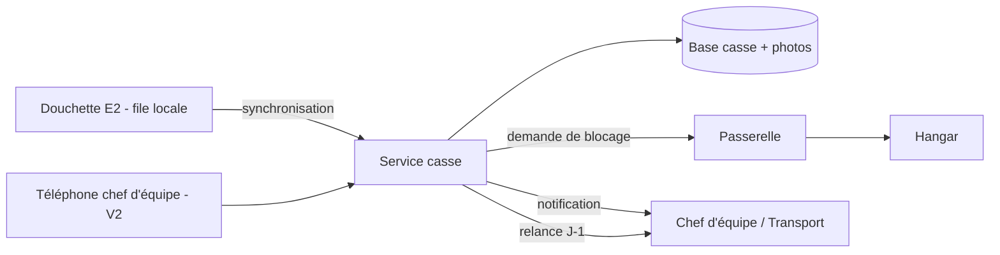
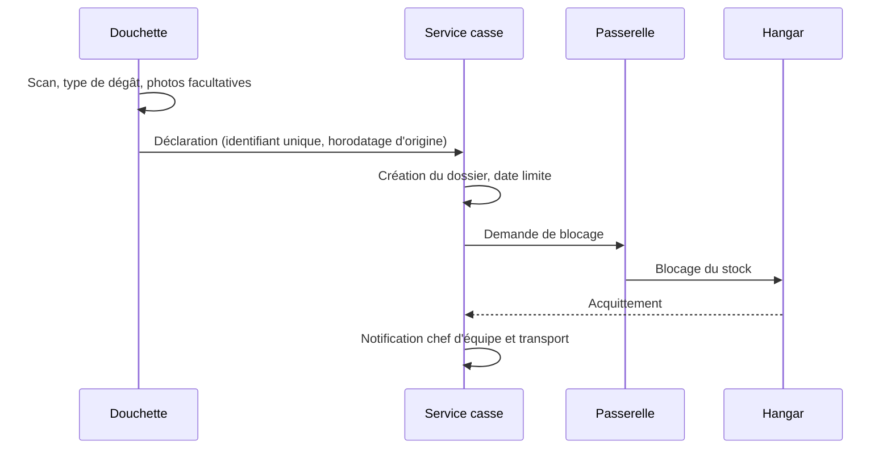

# Conception : Déclaration de casse à la douchette, blocage du stock dans Hangar et litiges transporteurs

## Vue d'ensemble

Une application douchette (hors ligne d'abord) enregistre les déclarations dans une file locale, puis les envoie à un service de casse. Ce service crée le dossier, notifie, demande le blocage dans Hangar via Passerelle et calcule la date limite du litige. Les technologies citées sont des **propositions**.

| Choix structurant | Raison | Alternative écartée |
|---|---|---|
| File locale sur la douchette, synchronisation ensuite | Réseau absent en zone C (B06-D8) | Saisie en ligne seule |
| Photo facultative (H15) | 2/3 des douchettes sans appareil photo | Photo obligatoire |
| Blocage Hangar par message via Passerelle, rejouable | Hangar peut être indisponible | Appel synchrone |
| Délai litige et liste des dégâts en paramètres | Délai non confirmé (H28), liste non fournie | Valeurs codées |
| Activation par entrepôt | Déploiement E2 d'abord (B06-D12) | Déploiement global |

## Architecture

## Composants et interfaces

| Composant | Responsabilité | Interfaces (entrée / sortie) | Exigences |
|---|---|---|---|
| Application douchette | Scan, type de dégât, photos, file hors ligne | API service casse / stockage local | 1, 2, 4 |
| Service casse | Création du dossier, dédoublonnage, date limite | API REST, base casse | 1, 4, 6 |
| Connecteur Hangar | Demande de blocage, rejeu, état | Passerelle / Hangar | 5 |
| Service de notification | Alerte chef d'équipe et transport, relances | Passerelle ou messagerie interne (à confirmer) | 3, 6 |
| Paramétrage | Types de dégâts, délai litige, destinataires, entrepôts actifs | Écran d'administration | 1.2, 6.1, 7.1 |
| Module V2 | Photo téléphone, retours abîmés, note A / B / C | Même API | 8 |

## Flux principaux

## Modèle de données

| Entité | Attributs principaux | Donnée personnelle | Durée de conservation |
|---|---|---|---|
| DossierCasse | id, colis, entrepôt, type de dégât, horodatage, date limite litige, état blocage | oui (identifiant de l'utilisateur) | à fixer avec la DPO (proposition : 3 ans) |
| Photo | id, dossier, fichier chiffré | oui si étiquette ou personne visible (CT-06) | alignée sur le dossier, effaçable sur demande |
| Notification | destinataire, canal, état, tentatives | oui (destinataire) | 12 mois (proposition) |
| Paramètre | clé, valeur | non | permanente |
| JournalAccès | utilisateur, action, photo | oui | 12 mois (proposition) |

## Gestion des erreurs

| Situation | Comportement | Exigence |
|---|---|---|
| Colis inconnu | Refus et message sur la douchette | 1.4 |
| Pas de réseau | File locale, synchronisation ultérieure | 4.1, 4.2 |
| Déclaration reçue deux fois | Dédoublonnage par identifiant unique | 4.2 |
| Hangar indisponible | Rejeu jusqu'à acquittement, état « en échec » visible | 5.2, 5.3 |
| Échec de notification | Réessais, échec noté dans le dossier | 3.3 |
| Douchette sans appareil photo | Déclaration valide sans photo | 2.2 |

## Sécurité et RGPD

CT-01 : analyse soumise à la DPO avant développement (Q36). CT-06 : les photos sont des données personnelles, chiffrées au repos, accès par rôle et journalisé ; leur stockage doit s'intégrer à l'orchestration des droits (P05). CT-04 : jeux de données synthétiques. CT-08 : hébergement dans l'UE ; cloud d'Orvanne à confirmer (Q34). CT-07 : aucune mise en production du 16/11 au 11/01. Exigences 2.4, 9.1 à 9.4.

## Volumétrie et performance

Environ 40 déclarations par jour, soit environ 80 en estimation réelle (B06-N6, B06-N7), avec 1 à 2 photos (B06-N3) : au plus environ 160 photos par jour. Environ 60 douchettes sur E2 (B06-N4). Charge faible ; dimensionnement à 3 fois l'estimation par prudence (estimation). Exigence 9.5.

## Stratégie de test

- Unitaires : validation de la déclaration, calcul de la date limite, dédoublonnage (1, 4, 6).
- Intégration : Passerelle et Hangar simulés, indisponibilité et rejeu (5), notifications (3).
- Hors ligne : coupure réseau, resynchronisation, ordre et horodatage (4).
- Charge : 240 déclarations par jour avec photos (9.5).
- Recette métier sur E2 avec données synthétiques (CT-04), douchettes avec et sans appareil photo (2), et date de mise en production (7).
