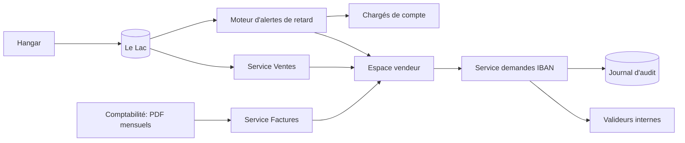
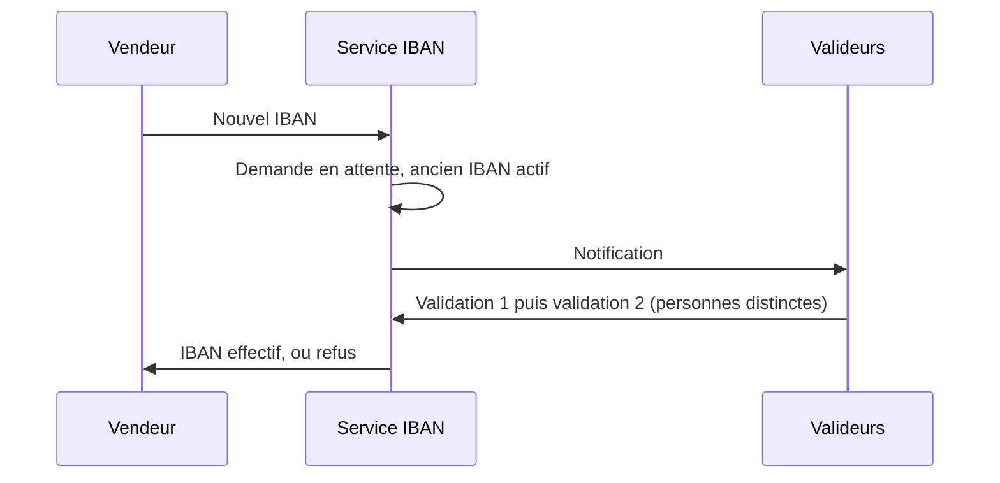

# Conception : Évolutions de l'espace vendeur de la marketplace

## Vue d'ensemble

Les nouvelles fonctions s'ajoutent à l'espace vendeur existant (B09-F15). Les technologies ci-dessous sont des **propositions**, non imposées par les sources.

| Choix structurant | Raison | Alternative écartée |
|---|---|---|
| Vues de ventes lues dans le Lac, sans requête sur la base transactionnelle | Éviter de ralentir l'espace vendeur (lenteur signalée, P08) | Requêtes directes sur les lignes de commande |
| Moteur d'alertes à règles paramétrables (seuil, fenêtre, destinataire) | Conflit C26 non arbitré (H25) | Deux alertes codées en dur |
| Flux de demande de modification d'IBAN avec états et deux validateurs | Concilie MKP-04 et MKP-05 (H24) | Modification directe, ou maintien de l'e-mail |
| Factures en PDF déposées par la comptabilité, servies sans régénération | La comptabilité produit déjà les PDF (B09-D3) | Génération des factures dans l'espace vendeur |
| Site adapté (responsive) par défaut pour le mobile | Une seule base de code ; application à arbitrer | Application native |
| Livraison en deux lots autour du gel (CT-07) | Échéances 15/01/2027 et T1 2027 | Livraison unique |

## Architecture

## Composants et interfaces

| Composant | Responsabilité | Interfaces (entrée / sortie) | Exigences |
|---|---|---|---|
| Service Ventes | Agrège ventes jour, semaine, mois par vendeur | Lac / API de l'espace vendeur | 1 |
| Service Factures | Reçoit les PDF mensuels, contrôle l'accès par vendeur | Dépôt comptabilité / téléchargement | 2 |
| Moteur d'alertes de retard | Calcule les taux (30 jours, 7 jours) et émet les alertes | Lac / notifications chargés de compte et vendeur | 3, 4 |
| Service demandes IBAN | Cycle de vie de la demande, deux validations, journal | API vendeur, écran valideur / journal | 5 |
| Messagerie vendeur-client (lot 2) | Échanges, canal à arbitrer (Comptoir ou dédié) | Comptoir / espace vendeur | 6 |
| Gestion des pays et langues (lot 2) | Pays ouverts, langues proposées | Paramétrage | 7 |
| Écran des reversements (lot 2) | Détail du calcul des reversements | Lac | 8 |
| Interface adaptative (lot 2) | Tableau de bord sur mobile, RGAA | Navigateur | 9 |

## Flux principaux

## Modèle de données

| Entité | Attributs principaux | Donnée personnelle | Durée de conservation |
|---|---|---|---|
| Vendeur | identifiant, pays, langue, chargé de compte | oui (contact) | durée du contrat (à confirmer avec la DPO) |
| DemandeIBAN | vendeur, IBAN chiffré, état, validations | oui (coordonnées bancaires) | à fixer avec la DPO et la finance |
| RègleAlerte | seuil, fenêtre, destinataire | non | durée de vie de la règle |
| Alerte | vendeur, taux, date, destinataire | non | 13 mois (estimation) |
| FactureCommission | vendeur, mois, fichier PDF | oui (nom du vendeur) | durée légale comptable (à confirmer) |
| Journal d'audit | auteur, action, horodatage, décision | oui (auteur) | à fixer avec la DPO |
| Échange (lot 2) | vendeur, client, messages | oui | à fixer avec la DPO |

## Gestion des erreurs

| Situation | Comportement | Exigence |
|---|---|---|
| Données de ventes indisponibles | Message d'indisponibilité et heure de dernière actualisation | 1.3 |
| PDF du mois absent | Indication « facture non disponible » | 2.4 |
| Taux resté au-dessus du seuil | Pas de nouvelle alerte identique | 3.5 |
| Validation d'IBAN refusée | Ancien IBAN conservé, vendeur informé | 5.4 |
| Même personne validant deux fois | Seconde validation rejetée | 5.2 |
| Définition du retard non fournie (Q26) | Moteur désactivé par paramètre, aucune alerte émise | 3.4, 4.1 |
| Pays ou langue non paramétré | Accès refusé avec message en français | 7.1, 7.2 |

## Sécurité et RGPD

L'IBAN est chiffré au repos et masqué à l'affichage, sauf pour les valideurs (5.1, 5.5). Les accès sont limités au vendeur connecté (1.2, 2.3). Les actions des collaborateurs sont journalisées (CT-10, 10.4). Le traitement est soumis à la DPO avant développement (CT-01, 10.5). Tests sans donnée de production (CT-04, 10.1). Hébergement dans l'UE (CT-08, 10.3), sous réserve de Q34. Mise en production hors du gel (CT-07, 10.2).

## Volumétrie et performance

Les sources ne donnent aucun volume d'utilisateurs ni de commandes pour ce projet. Les seuls chiffres sont ceux des alertes (2 %, 30 jours ; 5 %, 7 jours), le segment des 20 vendeurs à l'origine de MKP-04 et la limite de 50 000 lignes d'export (B09-N5), traitée par P08. Le dimensionnement est une **estimation** à faire à partir des volumes de la marketplace, fournis par la direction marketplace. Le calcul des taux est quotidien (proposition).

## Stratégie de test

- **Unitaires** : calcul des taux sur 30 et 7 jours, aux bornes (exactement 2 % et 5 %) ; états de la demande d'IBAN ; contrôle des deux valideurs distincts (3, 4, 5).
- **Intégration** : lecture du Lac, dépôt des PDF, notifications (1, 2, 3, 4).
- **Sécurité** : isolement entre vendeurs, IBAN non présent dans les journaux (1.2, 2.3, 5.5).
- **Recette métier** : finance sur le flux d'IBAN, chargés de compte sur l'alerte, vendeurs du top 20 (5, 3, 8.2).
- **Accessibilité et mobile** : contrôle RGAA et écrans de smartphone (9).
- **Données** : jeu synthétique, sans donnée de production (CT-04, 10.1).
