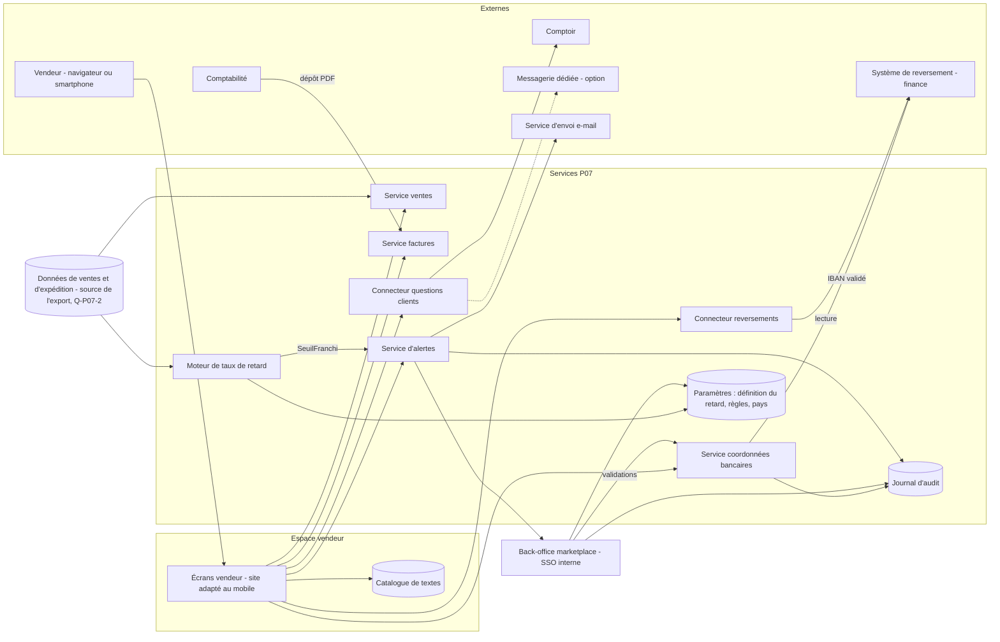
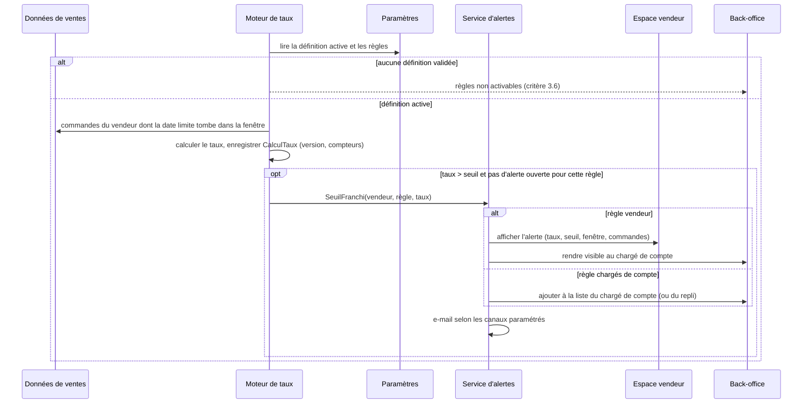

# Conception : évolutions de l'espace vendeur de la marketplace

## Vue d'ensemble

Le projet étend l'espace vendeur existant (système porteur à identifier, `Q-P07-2`) avec des services séparés par domaine :

- un **service ventes** qui calcule les chiffres du jour, de la semaine et du mois à partir des mêmes données que l'export des ventes corrigé par P08 (lot 1b) ;
- un **service factures** qui publie les PDF déposés par la comptabilité (lot 1b) ;
- un **moteur de taux de retard** et un **service d'alertes**, avec une définition unique du retard d'expédition et deux règles paramétrées (lots 1a et 1b) ;
- un **service coordonnées bancaires** qui reçoit les demandes de modification d'IBAN et applique la double validation interne (lot 1a) ;
- des **connecteurs** vers le système de reversement de la finance et vers le canal des questions clients (lot 2) ;
- un **catalogue de textes** et un **paramétrage par pays** pour l'ouverture européenne (lots 1a et 2).

Choix structurants :

| Choix | Raison | Alternative écartée |
|---|---|---|
| Un seul calcul du taux de retard, deux règles d'alerte paramétrées (seuil, fenêtre, destinataire) | C26 n'est pas arbitré ; H25 fait coexister les deux règles sur une même définition | Deux calculs indépendants : les vendeurs et les chargés de compte verraient des taux incohérents |
| Demande d'IBAN par le vendeur, double validation interne, ancien IBAN en vigueur jusqu'à la seconde validation | H24 concilie MKP-04 et MKP-05 (C25) | Modification directe par le vendeur (interdite par MKP-05) ; statu quo par e-mail (MKP-04 non satisfait) |
| Vue des ventes calculée sur la source de l'export des ventes, livrée après P08 | Mêmes chiffres partout (critère 1.4) ; P08 corrige d'abord l'accès à ces données | Nouveau flux de ventes dédié : deux sources à réconcilier |
| Publication des PDF de la comptabilité sans les régénérer | La comptabilité produit déjà les factures (B09-D3) | Génération des factures par l'espace vendeur : double émission comptable |
| Lecture des reversements à la volée dans le système de la finance, sans copie | Source unique pour les montants, moins de données bancaires dupliquées | Copie quotidienne des reversements dans l'espace vendeur |
| Questions clients derrière une interface commune, avec deux adaptateurs possibles (Comptoir ou messagerie dédiée) | Le canal n'est pas arbitré (B09-F10, `Q-P07-1`) | Coder un canal avant la décision |
| Site adapté au mobile plutôt qu'application (proposition) | Une seule base de code et les mêmes chiffres que sur ordinateur (critère 11.1) ; échéance T2 2027 | Application native : deux livraisons à maintenir (`Q-P07-7`) |
| Textes externalisés dès le lot 1a | H26 ; évite de reprendre les écrans du lot 1a à l'ouverture européenne | Traduire plus tard en reprenant le code |

Les technologies citées ci-dessous sont des **propositions** : les sources n'en imposent aucune.

## Architecture



## Composants et interfaces

| Composant | Responsabilité | Interfaces (entrée / sortie) | Exigences | Lot |
|---|---|---|---|---|
| Écrans vendeur | Tableau de bord, factures, alertes, demande d'IBAN, reversements, échanges ; mise en page adaptée au smartphone ; textes lus dans le catalogue | Application web existante étendue ; authentification actuelle de l'espace vendeur | 1, 2, 4.2, 6, 8, 9, 10.3, 11 | 1a, 1b, 2 |
| Service ventes | Agrégats du jour, de la semaine et du mois en cours ; horodatage de la dernière mise à jour | Entrée : source des données de l'export des ventes (à confirmer, `Q-P07-2`). Sortie : API REST en lecture, filtrée par vendeur | 1, 11.1, 12.1 | 1b |
| Service factures | Réception des PDF, rattachement au vendeur, stockage, liste et téléchargement | Entrée : dépôt de la comptabilité (proposition : dossier d'échange sécurisé ou API, nommage `<id vendeur>_<AAAA-MM>.pdf`, à valider, `Q-P07-5`). Stockage objet chiffré dans l'UE. Sortie : API REST | 2, 12.1 | 1b |
| Moteur de taux de retard | Calcul du taux de chaque vendeur sur chaque fenêtre, selon la définition versionnée ; trace de chaque calcul ; publication de l'événement `SeuilFranchi` | Entrée : commandes et dates d'expédition (`DV`), paramètres. Sortie : table `CalculTaux`, événement | 3 | 1a |
| Service d'alertes | Application des règles ; création des alertes ; diffusion dans l'espace vendeur, par e-mail et dans le back-office ; destinataire de repli | Entrée : `SeuilFranchi`. Sortie : alertes, e-mails (service d'envoi à identifier), file des chargés de compte | 4, 5 | 1a (vendeur), 1b (chargés de compte) |
| Back-office marketplace | Paramétrage de la définition et des règles ; liste des vendeurs en alerte ; file de validation des IBAN ; gestion des rôles de valideur ; paramétrage des pays | Application web interne, SSO, rôles `admin-marketplace`, `charge-de-compte`, `valideur-iban` | 3.4, 5.2, 7, 10.5, 12.6 | 1a, 1b, 2 |
| Service coordonnées bancaires | Contrôle de l'IBAN (structure, clé ISO 13616, pays ouvert) ; cycle de vie de la demande ; double validation ; transmission de l'IBAN validé au système de reversement | Entrée : écrans vendeur, back-office. Sortie : API du système de reversement (à identifier avec la finance) | 6, 7, 10.7 | 1a (10.7 en lot 2) |
| Connecteur reversements | Lecture des reversements et de leurs lignes ; contrôle de la somme ; lien vers la facture de commission | Entrée : système de reversement de la finance (`Q-P07-4`). Sortie : API REST en lecture | 8 | 2 |
| Connecteur questions clients | Réception des questions, envoi des réponses, historique ; filtrage des données client selon la liste de la DPO | Interface commune ; adaptateur Comptoir ou adaptateur messagerie dédiée (`Q-P07-1`) | 9 | 2 |
| Catalogue de textes | Textes des écrans, alertes et e-mails par langue ; repli sur le français | Fichiers de ressources versionnés (proposition), chargés sans mise en production de code | 10.1 à 10.4 | 1a, 2 |
| Journal d'audit | Traces des demandes d'IBAN, validations, refus, actions pour le compte d'un vendeur, modifications de paramètres | Écriture seule pour les services ; lecture par la finance et la DSI | 7.6, 12.3, 12.6 | 1a |

### Définition du retard d'expédition : proposition à soumettre (Q26)

La définition appartient à la direction marketplace (H25). En attendant sa réponse, la conception prévoit les champs suivants dans l'entité `DéfinitionRetard`, sans les activer :

- **Date de référence** : date limite d'expédition de la commande (proposition : date de commande plus délai d'expédition annoncé par le vendeur). Sa source reste à identifier (`Q-P07-2`).
- **Commande en retard** : commande expédiée après sa date limite, ou toujours non expédiée à cette date.
- **Dénominateur** : commandes dont la date limite d'expédition tombe dans la fenêtre de calcul.
- **Fenêtre glissante** : les N derniers jours révolus à la date du calcul.

Le moteur refuse l'activation des règles tant qu'aucune version de la définition n'est validée (critère 3.6).

### Paramètres des règles d'alerte

| Paramètre | Règle « vendeur » | Règle « chargés de compte » | Base |
|---|---|---|---|
| Seuil (dépassement strict) | 5 % | 2 % | B09-D12, B09-D4 |
| Fenêtre | 7 jours | 30 jours glissants | B09-D13, B09-D5 |
| Destinataire | vendeur, copie visible du chargé de compte | chargé de compte, repli paramétré | B09-D12, B09-D4, H25 |
| Canaux | espace vendeur (toujours) + e-mail (proposition) | back-office + e-mail (proposition) | `Q-P07-8` |
| Fréquence de calcul | proposition : toutes les heures | proposition : une fois par jour | paramètre, sans source |
| Répétition | proposition : une alerte par franchissement ; nouvelle alerte après retour sous le seuil | idem | `Q-P07-8` |

## Flux principaux

### Calcul du taux et alerte



### Modification de l'IBAN

```mermaid
sequenceDiagram
  participant V as Vendeur
  participant S as Service coordonnées bancaires
  participant B as Back-office (valideurs)
  participant F as Système de reversement
  participant J as Journal
  V->>S: nouvel IBAN
  S->>S: contrôler structure, clé et pays ouvert
  alt IBAN invalide
    S-->>V: refus avec l'erreur (critère 6.2)
  else IBAN valide
    S->>J: saisie (auteur, horodatage, id demande)
    S-->>V: état « en attente de validation » ; IBAN en vigueur inchangé
    B->>S: validation 1 (valideur A)
    S->>J: validation 1
    B->>S: validation 2 (valideur B ≠ A)
    S->>J: validation 2
    S->>F: transmettre le nouvel IBAN
    F-->>S: accusé de prise en compte
    S-->>V: état « validée » ; nouvel IBAN en vigueur
  end
  Note over B,S: un refus à l'une des étapes clôt la demande, motif enregistré, vendeur informé
```

## Modèle de données

| Entité | Attributs principaux | Donnée personnelle | Durée de conservation |
|---|---|---|---|
| AgrégatVentes | id vendeur, période (jour, semaine, mois), nombre de commandes, montant, horodatage de calcul | non (données d'entreprise) | recalculable ; 13 mois proposés, à confirmer |
| FactureCommission | id vendeur, mois, fichier PDF, empreinte SHA-256, date de dépôt, déposant | non, sauf vendeur personne physique (à confirmer avec la DPO) | durée légale de conservation des pièces comptables, à confirmer avec la comptabilité |
| DéfinitionRetard | version, date de référence, règle de retard, dénominateur, auteur, date de validation | non | conservée (traçabilité des calculs) |
| RègleAlerte | id, seuil, fenêtre, destinataire, canaux, fréquence, active, auteur | non | conservée |
| CalculTaux | id vendeur, règle, fenêtre, commandes en retard, commandes prises en compte, taux, version de la définition, horodatage | non | 13 mois proposés, à confirmer |
| Alerte | id vendeur, règle, taux, date de début du dépassement, liste des id commande, destinataire, canaux, statut d'envoi | non (aucune donnée client) | 13 mois proposés, à confirmer |
| DemandeIBAN | id demande, id vendeur, IBAN chiffré, titulaire, pays, état, valideur 1, valideur 2, motif de refus, horodatages | oui si le vendeur est une personne physique ; donnée sensible pour la fraude dans tous les cas | à fixer avec la finance et la DPO (CT-01) |
| ÉchangeClient | id échange, id vendeur, id commande ou article, messages, auteurs, horodatages, statut de transmission | oui (contenu et identité du client) | paramétrable, fixée avec la DPO (critère 9.7) ; intégrée au registre des droits (P05) |
| ParamètrePays | code pays, ouvert, date d'ouverture, langues proposées | non | conservé |
| TexteTraduit | clé, langue, texte, version | non | conservé |
| Journal | auteur, rôle, action, objet, horodatage, ancienne et nouvelle valeur (hors IBAN) | oui (identifiant de l'employé) | 1 an proposé, à confirmer avec la DPO |

Les reversements ne sont pas copiés : ils sont lus dans le système de la finance à chaque consultation.

## Gestion des erreurs

| Situation | Comportement | Exigence |
|---|---|---|
| Source des données de ventes indisponible | Affichage des derniers chiffres calculés avec leur horodatage et un bandeau « données en cours de mise à jour » | 1.3 |
| Écart entre le tableau de bord et l'export sur une même période | Test de cohérence quotidien ; écart signalé à la supervision | 1.4 |
| Facture déposée sans vendeur identifiable | Refus, fichier non publié, signalement à la comptabilité | 2.4 |
| Fichier déposé qui n'est pas un PDF lisible | Refus et signalement à la comptabilité | 2.1 |
| Aucune définition du retard validée | Règles non activables ; message explicite dans le back-office | 3.6 |
| Date d'expédition ou date limite absente pour une commande | Commande exclue du calcul et comptée à part dans `CalculTaux` ; signalement à la supervision | 3.5 |
| Calcul interrompu | Reprise au prochain passage ; aucune alerte émise sur un calcul partiel | 3.3 |
| Échec d'envoi de l'e-mail d'alerte | 3 nouvelles tentatives avec délai croissant ; l'alerte reste affichée dans l'espace vendeur | 4.2 |
| Aucun chargé de compte rattaché au vendeur | Alerte adressée au destinataire de repli | 5.3 |
| IBAN invalide (structure, clé) ou pays non ouvert | Refus à la saisie, message dans la langue du vendeur | 6.2, 10.7 |
| Valideur identique pour les deux validations | Seconde validation refusée | 7.2 |
| Collaborateur sans rôle de valideur | Action refusée et journalisée | 7.3 |
| Système de reversement indisponible après la seconde validation | Demande « validée, en cours d'application » ; l'IBAN en vigueur reste l'ancien jusqu'à l'accusé de prise en compte ; nouvelles tentatives et alerte à la finance | 6.3, 7.4 |
| Somme des lignes d'un reversement différente du montant | Détail masqué au vendeur (montant seul affiché), écart signalé à la finance | 8.4 |
| Canal des questions clients indisponible | Réponse conservée avec le statut « non transmise », nouvelles tentatives, statut visible du vendeur | 9.2 |
| Avis de la DPO absent pour les échanges clients | Fonction désactivée par un verrou du back-office | 9.6 |
| Texte absent dans la langue du vendeur | Texte français affiché ; clé manquante signalée | 10.4 |
| Temps de réponse supérieur au seuil fixé dans P08 | Alerte de supervision | 12.4 |

## Sécurité et RGPD

- **Avant le développement (CT-01, Q36) :** soumettre à la DPO :
  - les coordonnées bancaires et le titulaire du compte, quand le vendeur est une personne physique ;
  - les échanges entre vendeurs et clients, et la liste des données du client visibles par le vendeur (critère 9.5) ;
  - les durées de conservation du modèle de données ;
  - le journal d'audit (identifiants des employés).
- **Coordonnées bancaires (MKP-05) :** propositions à valider avec la finance (`Q25`) :
  - IBAN chiffré au repos, avec des clés gérées par le service de gestion de clés de la plateforme ;
  - IBAN masqué à l'affichage, seuls les 4 derniers caractères étant visibles ;
  - nouvelle authentification du vendeur avant la saisie d'un IBAN ;
  - e-mail au contact connu du vendeur à chaque demande et à chaque application, pour détecter une demande frauduleuse ;
  - authentification à deux facteurs pour les valideurs ;
  - aucun IBAN en clair dans les journaux (critère 7.6).
- **Cloisonnement (critère 12.1) :** l'identifiant du vendeur est lu dans le jeton de session, jamais dans un paramètre de la requête. Des tests d'accès croisé font partie de la recette.
- **Actions pour le compte d'un vendeur (CT-10) :** toute action d'un chargé de compte ou d'un valideur est journalisée (critère 12.3).
- **Hébergement (CT-08) :** dans l'Union européenne ; le choix entre le cloud d'Orvanne et un éditeur hébergé dans l'UE dépend de `Q34`.
- **Accessibilité et mobile (CT-09) :** les nouveaux écrans visent la conformité au RGAA par défaut, en attendant `Q35`.
- **Langues (CT-11) :** textes externalisés dès le lot 1a (H26).
- **Données de test (CT-04) :** jeux synthétiques uniquement, y compris pour les IBAN (IBAN de test valides mais fictifs).
- **Gel (CT-07) :** aucune mise en production du 16 novembre au 11 janvier.
- **Droits des personnes :** les échanges vendeur-client sont un nouveau stockage de données clients, à intégrer à l'orchestration des droits de P05.

## Volumétrie et performance

| Grandeur | Valeur | Base |
|---|---|---|
| Lignes d'un export de ventes qui échoue aujourd'hui | au-delà de 50 000 | B09-N5 |
| Vendeurs à l'origine de MKP-04 | top 20 | B09-N6 |
| Seuils et fenêtres des alertes | 2 % sur 30 jours glissants ; 5 % sur 7 jours | B09-N1 à B09-N4 |
| Part des demandes de retour portant sur la marketplace | 35 % | B04-N7 |
| Effet du pic de fin d'année | environ ×2 sur les volumes | glossaire (B01, B02) |
| Nombre de vendeurs actifs, commandes marketplace par jour | inconnus | `Q-P07-2` |

Les sources ne donnent ni le nombre de vendeurs ni le volume de commandes de la marketplace. Le dimensionnement repose donc sur des **valeurs de travail, sans source**, à remplacer par la réponse à `Q-P07-2` :

- un vendeur « gros volume » avec 100 000 lignes de commande sur 30 jours (2 fois le seuil de B09-N5, pour couvrir le pic) ;
- 10 000 vendeurs pour le calcul des taux, valeur volontairement haute.

Le calcul des taux est linéaire en nombre de commandes sur 30 jours. Il s'appuie sur un index (vendeur, date limite d'expédition) et ne lit que la fenêtre utile. Le service ventes sert des agrégats précalculés, pour ne pas reproduire la lenteur traitée par P08. Le seuil de temps de réponse des nouveaux écrans est celui que fixera P08 (H27).

## Stratégie de test

| Niveau | Contenu | Exigences |
|---|---|---|
| Unitaire | Agrégats jour, semaine, mois aux bornes (minuit, lundi, 1er du mois) ; calcul du taux aux bornes (exactement 5 % et 2 % : pas d'alerte ; 5,01 % et 2,01 % : alerte) ; fenêtres de 7 et 30 jours ; refus sans définition ; contrôle de l'IBAN (clé fausse, pays non ouvert, IBAN allemand et espagnol valides) ; cycle de vie de la demande d'IBAN ; contrôle de somme des reversements ; repli de langue | 1.1, 3, 4.1, 5.1, 6.2, 7, 8.4, 10.4, 10.7 |
| Intégration | Dépôt de factures par la comptabilité (fichier valide, orphelin, non PDF) ; transmission de l'IBAN au système de reversement et indisponibilité de celui-ci ; lecture des reversements ; adaptateur du canal des questions retenu ; envoi des e-mails d'alerte | 2, 4.2, 7.4, 8, 9 |
| Sécurité | Accès croisé entre deux vendeurs sur chaque API ; validation par un collaborateur sans rôle ; double validation par la même personne ; absence d'IBAN en clair dans les journaux et les traces techniques | 7.2, 7.3, 7.6, 12.1, 12.3 |
| Cohérence | Tableau de bord et export des ventes sur 30 périodes tirées au hasard dans le jeu synthétique | 1.4 |
| Performance | Calcul des taux de 10 000 vendeurs, dont un à 100 000 lignes sur 30 jours ; temps de réponse des écrans comparé au seuil de P08 | 3.3, 12.4 |
| Accessibilité et mobile | Audit RGAA des nouveaux écrans ; tableau de bord sur smartphone sans défilement horizontal (proposition : largeur de 360 px) | 11.2, 11.3 |
| Recette métier | Finance : double validation sur une demande synthétique. Chargés de compte : liste des vendeurs en alerte. Vendeurs pilotes : tableau de bord, factures, reversements. Comptabilité : dépôt des factures d'un mois | 1, 2, 4, 5, 6, 7, 8 |
| Données | Jeux synthétiques uniquement (CT-04) | 12.5 |
