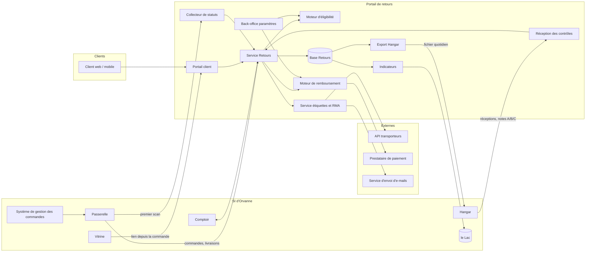
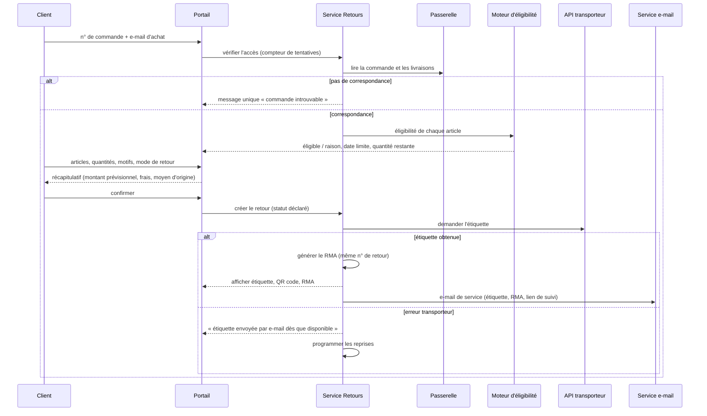

# Conception : portail de retours en libre-service, remboursement et visibilité des entrepôts

## Vue d'ensemble

La solution repose sur un **service Retours** qui porte le cycle de vie d'un retour, de la déclaration au remboursement. Il est utilisé par :

- le **portail client** (web responsive, ouvert depuis Vitrine ou par lien direct), pour l'éligibilité, la déclaration, l'étiquette, le RMA et le suivi ;
- l'**intégration Comptoir**, pour la création et la correction par le service client et le traitement des signalements ;
- les **entrepôts**, par le fichier quotidien vers Hangar et par la recherche d'un retour à partir du RMA ou de l'étiquette ;
- le **moteur de remboursement**, qui applique le déclencheur et les frais paramétrés et appelle le prestataire de paiement.

Toutes les règles non arbitrées (C08 à C14) sont des **paramètres** du back-office, avec les valeurs par défaut des hypothèses H07 à H13. Une décision du codir ou de la direction juridique se traduit par un changement de paramètre, possible même pendant le gel (`CT-07`), sans mise en production.

Choix structurants :

| Choix | Raison | Alternative écartée |
|---|---|---|
| Déclencheur du remboursement, délais, frais et catégories exclues paramétrables | C08, C09 et C10 sont renvoyés au DAF, au codir et à la direction juridique ; les décisions arriveront après le début du développement | Coder une position (premier scan du CDC ou contrôle de la finance) et redévelopper si le codir tranche autrement |
| Valeurs par défaut prudentes : remboursement après contrôle, 14 jours (30 pour Orvanne+), frais à 0 | Limite le risque financier (1 retour sur 5 non conforme, B04-N2) et l'écart avec les CGV ; frais à 0 conformes au CDC et au marketing (H09) | Remboursement au premier scan dès le pilote |
| Un service Retours unique pour le portail et Comptoir | Le client et le conseiller voient le même retour, avec les mêmes règles d'éligibilité (critère 9.1) | Saisie séparée dans Comptoir, comme aujourd'hui |
| Accès sans compte et depuis le compte Vitrine (H12) | Tient l'objectif de 3 minutes (O1) sans supprimer de parcours | Compte obligatoire (EF-03 lu seul) |
| RMA en PDF généré avec l'étiquette, rattaché au même numéro de retour (H13) | L'étiquette transporteur est illisible 1 fois sur 10 (B04-N11) ; le RMA permet de retrouver la commande | Étiquette seule |
| Liste prévisionnelle par fichier quotidien vers Hangar | Interface imposée par le CDC (B03-D28) | API temps réel vers Hangar |
| Lot 2 séparé : photos, marketplace, bon d'achat | V2 de l'analyse ; dépendances non levées (avis DPO sur les photos, circuit vendeur Q11, conditions de la finance) | Tout livrer au pilote |
| Lecture des statuts transporteurs dans Passerelle, partagée avec P01 | Même source pour le premier scan (B03-D15) et les retards (P01) | Appel direct des API de suivi des transporteurs |

Les technologies citées ci-dessous sont des **propositions** : les sources n'en imposent aucune, hormis Passerelle, Hangar, Comptoir, Vitrine, l'API des transporteurs et le prestataire de paiement.

## Architecture



## Composants et interfaces

| Composant | Responsabilité | Interfaces (entrée / sortie) | Exigences | Lot |
|---|---|---|---|---|
| Portail client | Accès sans compte ou depuis Vitrine, affichage de l'éligibilité, déclaration, récapitulatif, étiquette, RMA, suivi. Conforme RGAA, conçu d'abord pour le mobile | HTTPS ; proposition : application web servie par le service Retours, sans application native | 1, 2.1, 2.4, 3, 4.2, 5.1, 5.5, 11.2, 11.4, 11.5 | 1 |
| Service Retours | Cycle de vie du retour, contrôle d'accès à la commande, limitation des tentatives, journal | API REST interne ; lecture des commandes et livraisons via Passerelle (format à confirmer, tâche 1.2) | 1, 5, 9, 11.6, 11.9, 11.10 | 1 |
| Moteur d'éligibilité | Périmètre Orvanne / France métropolitaine / Vitrine, délai par catégorie de client, catégories exclues, marketplace, volumineux, quantités restantes | Lit les paramètres du back-office et les données de commande | 2 | 1 (13.1 en lot 2) |
| Service étiquettes et RMA | Demande d'étiquette à l'API du transporteur, PDF et QR code, génération du RMA avec code-barres, reprises, invalidation lors d'une correction | API des transporteurs (B03-D25) ; service d'envoi d'e-mails transactionnels (même question que Q07 de P01) | 4, 9.3 | 1 (13.2, 13.4 en lot 2) |
| Collecteur de statuts | Consomme les statuts transporteurs des colis retour publiés par Passerelle et détecte le premier scan | Flux Passerelle partagé avec P01 | 5.2 | 1 |
| Réception des contrôles | Reçoit de l'entrepôt la réception du colis et la note A / B / C ; rejette les résultats invalides | Proposition : fichier ou message Hangar via Passerelle ; à défaut, écran de saisie web pour poste fixe en entrepôt, en attendant l'application douchette de P03 (Q37) | 5.3, 6.1, 6.2 | 1 |
| Moteur de remboursement | Déclencheur par catégorie de client, calcul du montant et des frais, appel idempotent au prestataire, reprises, suspension en cas de note C | API du prestataire de paiement (B03-D26), clé d'idempotence par ligne de retour | 6.3, 6.4, 7 | 1 (14.2 en lot 2) |
| Export Hangar | Routage vers l'entrepôt de destination, fichier quotidien de la liste prévisionnelle, suivi de l'acquittement, renvoi | Fichier déposé pour Hangar (format et horaire à fixer, tâche 1.5) | 8.1 à 8.4, 13.3 | 1 |
| Recherche entrepôt | Recherche d'un retour par RMA, numéro de suivi ou commande | Écran web et API en lecture, rôle `entrepot` | 8.5 | 1 |
| Intégration Comptoir | Création et correction pour le compte du client, vue des retours d'une commande, file des signalements (note C, échec de remboursement) | Selon les capacités d'extension de Comptoir : composant intégré ou lien contextuel (question commune avec Q09 de P01) | 6.4, 6.5, 7.10, 9 | 1 |
| Back-office paramètres | Délais, catégories exclues, motifs, frais, déclencheur, routage, heure du fichier, seuils de tentatives, mode pilote, durées de conservation, verrous DPO ; historique de chaque modification | Application web, rôle `admin-metier` | 2.3, 2.5, 3.2, 7.1 à 7.3, 7.6, 7.7, 8.1, 11.6 à 11.9, 12.5 | 1 |
| Indicateurs | Agrégats quotidiens d'usage et de délais | Export quotidien vers le Lac (proposition) | 3.6, 10 | 1 |
| Supervision | Disponibilité, erreurs des API transporteurs et du prestataire, acquittement du fichier Hangar, résultats de contrôle rejetés | Outils de supervision de la DSI | 4.5, 6.2, 8.4, 11.1 | 1 |
| Stockage des photos | Dépôt, contrôle de format et de taille, accès restreint, purge | Stockage objet chiffré dans l'UE (proposition) | 12 | 2 |
| Connecteur espace vendeur | Expose à l'espace vendeur (P07) les retours des articles du vendeur | API en lecture filtrée par vendeur | 13.5 | 2 |
| Bon d'achat | Choix du client, émission du bon au déclencheur | Système d'émission des bons à identifier (Vitrine ou autre, point ouvert) | 14 | 2 |

## Flux principaux

### Déclaration d'un retour sans compte



### Du dépôt au remboursement (déclencheur par défaut : contrôle qualité)

```mermaid
sequenceDiagram
  participant P as Passerelle
  participant R as Service Retours
  participant H as Hangar / entrepôt
  participant RB as Moteur de remboursement
  participant PSP as Prestataire de paiement
  participant CPT as Comptoir
  P->>R: premier scan du colis retour
  R->>R: statut déposé
  opt déclencheur = premier scan pour la catégorie du client
    R->>RB: déclencher
  end
  H->>R: réception du colis (RMA ou n° de suivi)
  R->>R: statut reçu
  opt déclencheur = réception
    R->>RB: déclencher
  end
  H->>R: note A / B / C
  alt note C
    R->>CPT: signalement ; remboursement suspendu s'il n'est pas déjà parti
    CPT-->>R: décision du conseiller (rembourser / bloquer, motif)
  else note A ou B
    opt déclencheur = contrôle qualité
      R->>RB: déclencher
    end
  end
  RB->>RB: montant payé - frais du motif (aucun effet de la note)
  RB->>PSP: remboursement sur le moyen d'origine (clé d'idempotence)
  alt confirmé
    PSP-->>RB: référence de l'opération
    RB->>R: statut remboursé
  else refus ou absence de réponse après reprises
    RB->>CPT: signalement « échec de remboursement »
  end
```

Lecture de H11 retenue pour le critère 6.4 : le « traitement manuel » d'une note C porte sur la décision de rembourser, sans jamais calculer de montant réduit. Si le remboursement est déjà parti (déclencheur au premier scan ou à la réception), le signalement sert seulement d'information au service client.

### Liste prévisionnelle

Chaque jour, à l'heure paramétrée, l'export sélectionne les retours `déclaré` ou `déposé` non encore reçus, hors marketplace, les répartit par entrepôt selon la règle de routage, et dépose un fichier par entrepôt pour Hangar. Un retour reste dans les fichiers suivants tant qu'il n'est pas reçu.

## Modèle de données

| Entité | Attributs principaux | Donnée personnelle | Durée de conservation |
|---|---|---|---|
| Retour | n° de retour, n° de commande, référence client Vitrine (sans copie du nom), canal de création (portail / Comptoir), mode de retour, catégorie de client, statut, horodatages des étapes, entrepôt de destination, vendeur (lot 2) | oui (lié à un client identifiable) | paramétrable, fixée avec la DPO (critère 11.7) |
| LigneRetour | article, quantité, motif, montant payé, frais appliqués, éligibilité au moment de la déclaration | oui (rattachée au retour) | comme le retour |
| Étiquette | transporteur, n° de suivi, PDF, QR code, état (valide / invalidée) | oui (adresse de l'expéditeur imprimée) | paramétrable, courte après la réception (proposition à valider avec la DPO) |
| RMA | n° de RMA, n° de retour, n° de commande, articles, code-barres, PDF | non (aucun nom ni adresse sur le RMA, proposition) | comme le retour |
| ÉvénementRetour | n° de retour, type (premier scan, réception, contrôle…), horodatage source, horodatage de réception, origine | non | comme le retour |
| ContrôleQualité | n° de retour, note A / B / C, destination, date, entrepôt, identifiant de l'opérateur s'il est transmis | oui si l'opérateur est identifié (employé) | comme le retour |
| Remboursement | n° de retour, déclencheur appliqué, montant, frais, clé d'idempotence, référence PSP, statut, tentatives | oui (opération financière d'un client ; aucune donnée de carte stockée) | à fixer avec la DPO et la DAF (obligations comptables) |
| Signalement | n° de retour, type (note C, échec de remboursement, étiquette non obtenue), décision, motif, conseiller | oui | comme le retour |
| TentativeAccès | empreinte du n° de commande, horodatage, résultat | non (aucune adresse IP conservée, proposition) | courte, à fixer avec la DPO (proposition : 30 jours) |
| Paramètre | clé, portée (catégorie de client, motif, entrepôt), valeur, auteur, date, ancienne valeur | non (auteur = identifiant employé) | conservé (traçabilité) |
| Journal | acteur, action, objet, valeurs avant / après, horodatage | oui (identifiant de l'employé, référence client) | paramétrable, fixée avec la DPO |
| Photo (lot 2) | n° de retour, ligne, fichier, taille, format, date | oui (`CT-06`) | paramétrable, supprimée avec le retour au plus tard |
| BonAchat (lot 2) | n° de retour, montant, taux de majoration, référence d'émission | oui | à fixer avec la DPO et la DAF |

L'adresse e-mail du client n'est pas copiée : elle est lue dans la commande au moment de l'envoi. L'adresse d'enlèvement à domicile n'est transmise qu'au transporteur.

## Gestion des erreurs

| Situation | Comportement | Exigence |
|---|---|---|
| Numéro de commande et e-mail sans correspondance | Message unique, compteur de tentatives incrémenté | 1.4, 1.5 |
| Seuil de tentatives dépassé | Refus pendant la durée de blocage, message neutre, alerte à la supervision au-delà d'un volume anormal | 1.5 |
| Passerelle indisponible à la lecture de la commande | Message « service momentanément indisponible », aucune déclaration partielle ; compte dans la disponibilité mensuelle | 1.6, 11.1 |
| Date de livraison absente | Article non éligible en ligne, renvoi vers le service client | 2.9 |
| Catégorie ou vendeur de l'article inconnu | Article non éligible en ligne (choix prudent), compté à part dans les indicateurs | 2.2, 2.5, 2.6 |
| API du transporteur en erreur ou trop lente | Retour enregistré `déclaré`, reprises avec délai croissant ; après la dernière reprise, signalement « étiquette non obtenue » dans Comptoir | 4.5 |
| E-mail non délivré | Étiquette et RMA restent téléchargeables depuis le suivi | 4.2, 5.5 |
| Premier scan reçu pour un retour inconnu | Événement conservé, alerte à la supervision | 5.2 |
| Résultat de contrôle invalide ou sans retour reçu | Rejet, alerte à la supervision | 6.2 |
| Note C reçue après un remboursement déjà parti | Signalement d'information, aucun effet sur le remboursement | 6.3, 6.4 |
| Prestataire de paiement en erreur | Reprises avec la même clé d'idempotence ; après la dernière, signalement « échec de remboursement », statut non `remboursé` | 7.8, 7.10 |
| Fichier Hangar non acquitté | Alerte à la supervision, renvoi manuel ou automatique du fichier ; le fichier suivant reprend les retours non reçus | 8.4 |
| Correction d'un retour déjà `déposé` | Pas de nouvelle étiquette ; la correction porte sur les données du retour et est journalisée | 9.2, 9.3, 9.5 |
| Photo trop lourde ou hors format (lot 2) | Refus avec la raison, les autres photos sont conservées | 12.2 |
| Fonction soumise à avis DPO activée sans avis | Activation refusée par le back-office | 11.6, 12.5 |

## Sécurité et RGPD

- **Avant le développement :** le traitement est soumis à la DPO (`CT-01`, `Q36`), qui n'a pas été consultée sur le portail (B07). Points à faire valider :
  - la base légale et les durées de conservation de chaque entité ;
  - l'accès sans compte et la limitation des tentatives ;
  - les photos du lot 2 (`CT-06`), avec un verrou d'activation dans le back-office (critère 12.5).
- **Ouverture aux clients :** le portail reste fermé tant que l'avis de la DPO n'est pas enregistré (critère 11.6).
- **Accès sans compte :** il ne donne accès qu'à la commande saisie (H12). Les messages d'erreur ne révèlent pas quelle valeur est fausse, et les tentatives sont limitées (critères 1.3 à 1.5). Le lien de suivi de l'e-mail porte un jeton signé à durée limitée (proposition).
- **Minimisation :** la base Retours ne copie ni le nom, ni l'e-mail, ni le moyen de paiement. Le RMA ne porte ni nom ni adresse (proposition). Aucune donnée de carte n'est stockée : le remboursement passe par la référence de transaction du prestataire.
- **Messages de service :** les e-mails du portail ne contiennent aucune offre commerciale (`CT-03`). Le bon d'achat du lot 2 n'est proposé que dans le portail, jamais promu dans les e-mails (critère 14.3) ; la qualification de ce choix au regard de `CT-03` est à confirmer avec la DPO.
- **Accès internes :** les accès passent par le SSO interne, avec les rôles `service-client`, `entrepot`, `admin-metier` et `dsi`. Les actions faites pour le compte d'un client sont journalisées avec les valeurs avant et après (`CT-10`, critère 9.5).
- **Droits des personnes :** les retours, photos et journaux sont de nouvelles données clients à déclarer au registre de P05 pour l'orchestration des droits (dépendance P05).
- **Hébergement :** dans l'Union européenne (`CT-08`). Le choix entre le cloud d'Orvanne et un éditeur hébergé dans l'UE attend `Q34`.
- **Données de test :** jeux synthétiques ou anonymisés uniquement (`CT-04`).
- **Accessibilité :** conformité RGAA et usage sur mobile (`CT-09`), vérifiées par un audit et par les tests utilisateurs.

## Volumétrie et performance

| Grandeur | Valeur | Base |
|---|---|---|
| Demandes de retour traitées aujourd'hui par le service client | ≈ 900 par jour ouvré | B03-N1 |
| Colis retour reçus par E2 | ≈ 1 100 par jour | B04-N1 |
| Part des demandes portant sur des articles marketplace | 35 % | B04-N7 |
| Retours éligibles au portail en lot 1 (hors marketplace) | ≈ 600 à 700 par jour ouvré | estimation : 65 % de 900 à 1 100 |
| Retours en janvier | ≈ 2 fois le volume normal, soit ≈ 1 400 par jour en lot 1 | estimation à confirmer (délai de contrôle à 10 jours en janvier, B04-N9, et pic de fin d'année à environ ×2) |
| Retours non conformes à l'ouverture | 1 sur 5 | B04-N2 |
| Signalements « note C » possibles | jusqu'à ≈ 280 par jour en janvier si tous les non-conformes sont notés C | estimation : 20 % de 1 400 ; charge à valider avec le service client |
| Étiquettes transporteur illisibles | 1 sur 10 | B04-N11 |
| Délai entre réception et contrôle | 3 à 6 jours, 10 en janvier | B04-N8, B04-N9 |
| Utilisateurs simultanés du portail | 300 | B03-N11 |
| Temps d'affichage | < 2 s pour 95 % des requêtes | B03-N9, B03-N10 |
| Disponibilité | 99,5 % par mois, soit environ 3 h 40 d'indisponibilité au plus | B03-N8 |

Ces volumes sont modestes pour une base relationnelle (proposition : PostgreSQL). Les points sensibles sont les appels externes : la lecture de la commande via Passerelle et la demande d'étiquette se trouvent sur le parcours du client et pèsent sur l'objectif de 3 minutes. Le test de charge vise 600 utilisateurs simultanés, soit 2 fois l'exigence, avec des bouchons de Passerelle et des transporteurs aux temps de réponse mesurés en recette.

Le pilote démarre au plus tôt le 12 janvier (H14), au moment où les retours et le délai de contrôle sont les plus élevés. Avec le déclencheur par défaut (contrôle qualité), le client attendra jusqu'à 10 jours après la réception : le suivi (exigence 5) doit le montrer pour éviter un report des contacts vers le service client.

## Stratégie de test

| Niveau | Contenu | Exigences |
|---|---|---|
| Unitaire | Éligibilité aux bornes : jour 14 et 15, jour 30 et 31 pour Orvanne+, catégories exclues, marketplace, volumineux, date de livraison absente, quantités déjà déclarées. Calcul du montant et des frais par motif. Choix du déclencheur par catégorie. Idempotence du remboursement. Limitation des tentatives | 1.3 à 1.5, 2, 7 |
| Intégration | Passerelle (commandes, livraisons, premier scan), API des transporteurs (étiquette, erreur), prestataire de paiement (succès, refus, absence de réponse), fichier Hangar et acquittement, réception des contrôles, Comptoir : avec des bouchons, puis en recette | 1.6, 4, 5.2, 5.3, 6.1, 6.2, 7.4, 7.9, 7.10, 8, 9 |
| Performance | 600 utilisateurs simultanés pendant 1 h ; 95e centile de l'affichage des pages inférieur à 2 s | 11.2 |
| Résilience | Coupure du transporteur, du prestataire de paiement, de Passerelle et de Hangar ; vérification qu'aucun remboursement n'est émis deux fois | 4.5, 7.8, 7.10, 8.4, 11.1 |
| Accessibilité | Audit RGAA du parcours client sur mobile et ordinateur | 11.4 |
| Tests utilisateurs | Clients non accompagnés, sur mobile, retour standard de bout en bout, durée chronométrée sous 3 minutes | 3.5, 11.5 |
| Recette métier | Service client : création, correction, signalements. Entrepôt E2 : liste prévisionnelle, recherche par RMA, transmission des notes. Finance : paramétrage du déclencheur et des frais, contrôle des montants | 6, 7, 8, 9, 11.8 |
| Données | Jeux synthétiques uniquement : commandes, membres Orvanne+, articles marketplace et volumineux, livraisons aux bornes des délais | 11.11 |
