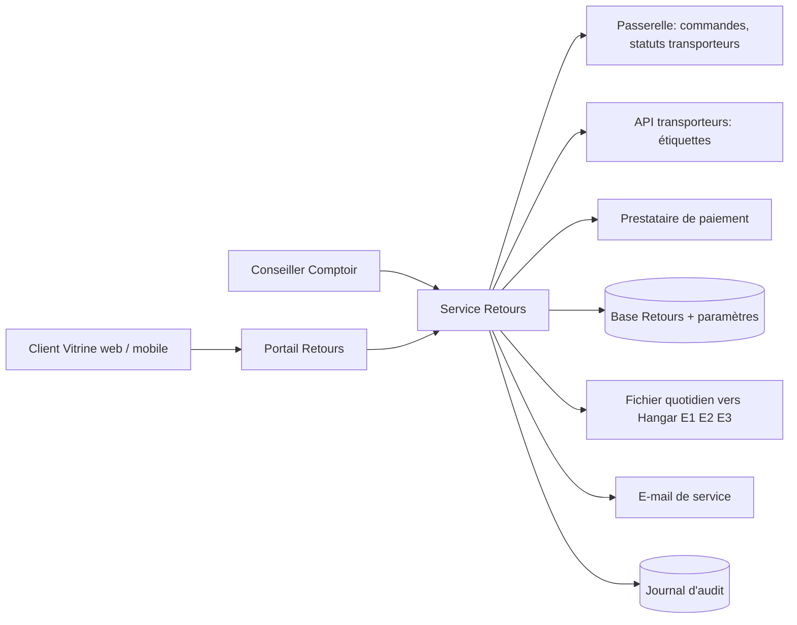
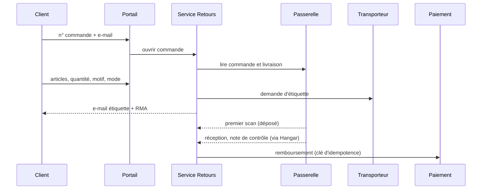

# Conception : Portail de retours en libre-service, remboursement et visibilité des entrepôts

## Vue d'ensemble

Le portail est un module de Vitrine (site et application mobile) adossé à un service « Retours » qui porte les règles (éligibilité, remboursement, frais) sous forme de paramètres. Il lit les commandes et statuts transporteurs via Passerelle, demande les étiquettes aux API transporteurs, rembourse via le prestataire de paiement, expose ses données à Comptoir (service client) et alimente Hangar par un fichier quotidien. Les technologies citées sont des **propositions**.

| Choix structurant | Raison | Alternative écartée |
|---|---|---|
| Règles litigieuses en paramètres (déclencheur, délais, frais) | Cinq conflits non arbitrés (C08, C09, C10, C12, C14) ; changer de règle sans livraison, compatible avec le gel (CT-07) | Coder une règle unique : refonte à chaque arbitrage |
| Service « Retours » distinct de Vitrine | Comptoir et Hangar réutilisent les mêmes règles | Logique dans Vitrine seule : doublons côté service client |
| Remboursement idempotent par ligne de retour | Scans en double, rappels après échec (exigence 6) | Appel direct sans clé : risque de double remboursement |
| Fichier quotidien vers Hangar | Imposé par la source (B03-D28) | Appel temps réel : non demandé |
| Photos et marketplace en V2 | Découpage du CDC et de H10 | Tout en V1 : dépasse le périmètre pilote |

## Architecture

## Composants et interfaces

| Composant | Responsabilité | Interfaces (entrée / sortie) | Exigences |
|---|---|---|---|
| Portail Retours (Vitrine) | Accès avec ou sans compte, sélection, suivi ; RGAA, mobile | HTTPS ; API Service Retours | 1, 2, 3, 5, 12, 14 |
| Moteur d'éligibilité | Délai par catégorie de client, exclusions, périmètre | Données commande via Passerelle ; paramètres | 2, 10 |
| Service Retours | Cycle de vie du retour et statuts | API interne ; base Retours | 3, 5, 6 |
| Adaptateur transporteurs | Étiquette PDF + QR, reprise sur erreur | API transporteurs | 4 |
| Générateur RMA et e-mails | RMA PDF, e-mails sans offre commerciale | Service e-mail | 4 |
| Moteur de remboursement | Déclencheur paramétré, idempotence, reprise, frais | Prestataire de paiement ; événements Passerelle ; note de contrôle | 6, 7 |
| Export Hangar | Fichier quotidien des retours attendus | Fichier déposé (SFTP, proposition) | 8 |
| Extension Comptoir | Création et correction de retours, signalement note C | API Service Retours | 6, 9 |
| Journal d'audit | Actions du service client, preuve d'exécution | Stockage en ajout seul | 9 |
| Module V2 | Photos, retours marketplace, vue vendeur | Stockage objet UE ; espace vendeur (P07) | 10, 11 |

## Flux principaux

## Modèle de données

| Entité | Attributs principaux | Donnée personnelle | Durée de conservation |
|---|---|---|---|
| Retour | id, commande, statut, mode, étiquette, RMA, dates | oui (lien client) | À fixer avec la DPO (proposition : 3 ans, délai à confirmer) |
| Ligne de retour | article, quantité, motif, note A/B/C, remboursement | oui (indirecte) | idem Retour |
| Remboursement | montant, frais, clé d'idempotence, statut | oui | Obligations comptables, à confirmer |
| Paramètres | déclencheur, délais, frais par motif, seuils | non | Historisés |
| Journal d'audit | auteur, action, avant/après, horodatage | oui (conseiller, client) | À fixer avec la DPO |
| Photo (V2) | fichier, retour, date | oui si étiquette ou personne visible (CT-06) | À fixer avec la DPO |
| Tentative d'accès | commande hachée, IP, date | oui | Court (proposition : 30 jours) |

## Gestion des erreurs

| Situation | Comportement | Exigence |
|---|---|---|
| Couple commande/e-mail invalide | Message identique, blocage après 5 échecs en 15 min | 1.4 |
| Quantité supérieure au retournable | Saisie refusée, maximum indiqué | 3.2 |
| Passerelle indisponible | Message, aucun retour partiel | 3.5 |
| API transporteur en panne | Statut « en attente d'étiquette », reprise automatique | 4.4 |
| Scan en double ou rappel | Un seul remboursement par ligne | 6.4 |
| Refus ou absence de réponse du paiement | « remboursement en échec », reprises, alerte après 3 échecs | 6.5 |
| Note C | Signalement Comptoir, pas de réduction | 6.8 |
| Échec du fichier Hangar | Alerte exploitation, renvoi sans doublon | 8.3 |
| Mise en production demandée pendant le gel | Refusée par le calendrier de livraison | 15.1 |

## Sécurité et RGPD

- Consultation de la DPO avant développement (CT-01, 14.3) ; analyse d'impact à évaluer (Q36). Base légale à confirmer avec elle.
- Hébergement dans l'UE (CT-08, 14.2), cloud d'Orvanne à confirmer (Q34).
- Accès sans compte limité à la commande saisie (1.3) ; réponses d'erreur uniformes pour éviter l'énumération (1.4) ; HTTPS, jetons de session courts, secrets dans un coffre.
- Journal d'audit en ajout seul pour les actions Comptoir (9.2, 9.3, CT-10).
- Photos (V2) : accès restreint, purge, suppression des métadonnées (11.3, CT-06).
- E-mails sans offre commerciale (4.5, CT-03).
- Tests avec données synthétiques uniquement (14.4, CT-04).
- Interface RGAA et mobile (14.1, CT-09).
- Intégration du registre des droits RGPD (P05) à prévoir pour les retours et photos.

## Volumétrie et performance

- Source : environ 900 demandes de retour par jour ouvré (B03-N1) ; environ 1 100 colis retour par jour à E2 (B04-N1) ; 300 utilisateurs simultanés, pages sous 2 s pour 95 % des requêtes (B03-N11, B03-N9, B03-N10) ; disponibilité 99,5 % (B03-N8).
- Estimation : un pic de fin d'année multiplie les volumes par environ 2 (glossaire), soit près de 1 800 retours par jour ; le dimensionnement à 300 utilisateurs simultanés couvre ce cas. À valider en test de charge à 450 utilisateurs (marge de 50 %, estimation).
- Fichier Hangar : quelques milliers de lignes par jour, sans contrainte de taille.

## Stratégie de test

- **Unitaires** : calcul de date limite par catégorie de client, exclusions, frais, idempotence du remboursement, machine d'états (statut « reçu » avant « remboursé »). Exigences 2, 5, 6, 7.
- **Intégration** : doubles de Passerelle, transporteur et paiement (pannes simulées) ; fichier Hangar. Exigences 3, 4, 6, 8.
- **Sécurité** : énumération de commandes, blocage des essais, journal d'audit. Exigences 1, 9, 14.
- **Accessibilité** : audit RGAA et tests sur mobiles. Exigence 14.1.
- **Charge** : 300 utilisateurs simultanés, pages sous 2 s pour 95 % des requêtes. Exigence 12.
- **Recette métier** : un client non accompagné déclare un retour sur mobile en moins de 3 minutes ; changement de paramètres sans livraison. Exigences 13, 6.1, 2.2, 7.1.
- Jeu de données synthétique (CT-04), aucune donnée de production.
