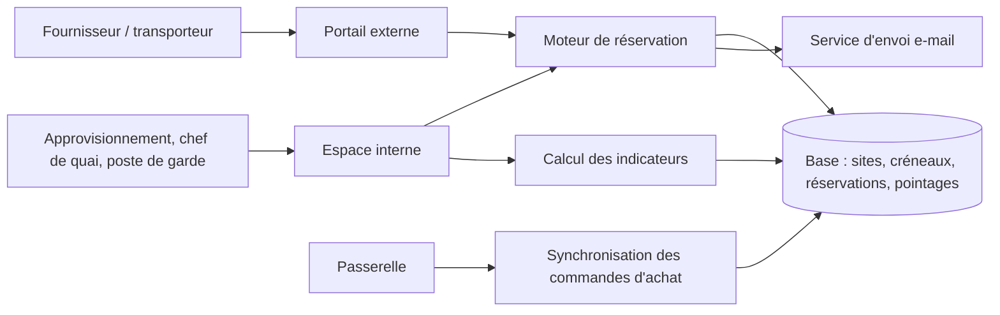
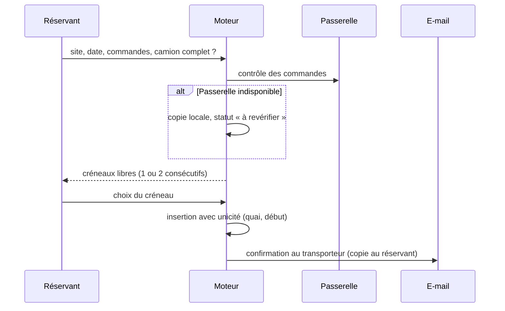

# Conception : prise de rendez-vous des livraisons fournisseurs

## Vue d'ensemble

Une application web unique sert deux publics : un **portail externe** pour les fournisseurs et les transporteurs, et un **espace interne** pour l'approvisionnement, les chefs de quai, le bureau de réception et le poste de garde. Le moteur de réservation s'appuie sur le paramétrage de chaque site et contrôle les commandes d'achat dans Passerelle. Hangar n'est pas relié en V1 (V2, B08-D23).

| Choix | Raison | Alternative écartée |
|---|---|---|
| Durée de créneau, quais, horaires, bornes et heure du rappel paramétrables par site | Les conflits C21 et C22 ne sont pas arbitrés (H20, H21) | Coder 30 minutes et 6 quais |
| Unicité (quai, début de créneau) portée par la base | Aucune double réservation, même en accès simultanés (critère 3.7) | Verrou applicatif seul |
| Copie locale des commandes d'achat rafraîchie depuis Passerelle | Le portail reste utilisable si Passerelle est en panne (critère 4.3) | Appel synchrone seul |
| Messageries : blocage de créneaux par le chef de quai, pas de réservation | H22, en attente de l'arbitrage de C23 | Réservation sans commande d'achat |
| Heures prévues et réelles d'arrivée conservées, sans notation | H23 : constitue l'historique d'un an sans engager de pénalité | Calculer une note dès la V1 |
| Langues gérées par catalogue de traductions, français par défaut | Les langues ne sont pas décidées (Q27, CT-11) | Français seul |

Les technologies sont des **propositions** : application web, comptes locaux avec double facteur pour les tiers, SSO interne pour les employés, base relationnelle (PostgreSQL), file de messages pour les e-mails.

## Architecture

## Composants et interfaces

| Composant | Responsabilité | Interfaces | Exigences |
|---|---|---|---|
| Portail externe | Authentification, rattachement des transporteurs, recherche, réservation, modification, annulation, multilingue, RGAA et mobile | HTTPS, compte individuel | 1, 3, 5 |
| Espace interne | Paramétrage des sites, planning, actions du chef de quai, pointage, saisie du déchargement, indicateurs | SSO interne, rôles `appro`, `chef-quai`, `reception`, `garde` | 2, 7, 8, 9, 10 |
| Moteur de réservation | Calcul des créneaux libres, règles R1 à R7, statuts | Interne | 2, 3, 4, 5, 7, 9 |
| Synchronisation des commandes d'achat | Copie (numéro, fournisseur, site, statut) depuis Passerelle ; contrôle unitaire à la saisie | Passerelle (contrat à établir, B08-D27) | 4 |
| Notifications | Confirmation, rappel, informations liées aux actions du chef de quai, selon la langue du compte | Service d'envoi (proposition : service d'envoi interne d'Orvanne, à confirmer avec la DSI) | 6 |
| Indicateurs | Calcul, historique des heures prévues et réelles, export CSV | Interne | 10, 11.3 |

## Flux principal

Le jour J, le poste de garde pointe le camion. Au-delà de 20 minutes après le début du créneau, le créneau est perdu et libéré. Le devenir du camion (refoulé, remis en file, nouveau créneau) n'est pas décrit par la source (B08-F11) : le chef de quai le voit dans sa liste et décide (critère 9.4).

## Modèle de données

| Entité | Attributs principaux | Donnée personnelle | Durée de conservation |
|---|---|---|---|
| Site | quais, horaires, jours fermés, durée de créneau, bornes, heure du rappel | non | conservé |
| Compte | type, société, nom et e-mail du contact, langue, statut | oui (contact professionnel) | durée du compte, puis à fixer avec la DPO (CT-01) |
| CommandeAchat (copie) | numéro, fournisseur, site, statut, date de synchronisation | non | tant que la commande est active |
| Réservation | site, quai, créneaux, commandes, camion complet, e-mail du transporteur, statut, auteur | oui (e-mail professionnel) | au moins 12 mois pour l'historique de ponctualité (B08-N14), durée finale à fixer avec la DPO |
| Pointage | réservation ou fournisseur déclaré, heure d'arrivée, début et fin du déchargement | non (aucune donnée sur le chauffeur : proposition) | idem réservation |
| Blocage | quai, créneaux, récurrence, motif, auteur | oui (identifiant de l'employé) | idem réservation |
| Journal | auteur, action, objet, motif, horodatage | oui (identifiant) | proposition : 1 an, à confirmer avec la DPO |

## Gestion des erreurs

| Situation | Comportement | Exigence |
|---|---|---|
| Deux réservants valident le même créneau en même temps | La seconde insertion est rejetée par la contrainte d'unicité ; d'autres créneaux sont proposés | 3.7 |
| Commande inconnue, soldée ou étrangère au réservant | Refus avec le motif | 4.2, 4.5 |
| Passerelle indisponible | Contrôle sur la copie locale, statut « à revérifier », nouveau contrôle au retour | 4.3 |
| Commande soldée après la réservation | Alerte au chef de quai et au réservant, sans annulation | 4.4 |
| Réservation hors bornes ou après la clôture | Refus avec les bornes, ou renvoi vers le site | 3.5, 5.2 |
| Service d'envoi en erreur | Nouvelles tentatives avec délai croissant (proposition : 3), puis alerte dans l'espace interne | 6.1, 6.2 |
| Paramétrage incompatible avec des réservations | Refus avec la liste des réservations concernées | 2.5 |
| Camion arrivé après la tolérance | Créneau perdu et libéré, camion signalé au chef de quai | 9.2, 9.4 |
| Blocage d'un créneau réservé | Refus tant que la réservation n'est pas déplacée ou annulée | 7.4 |

## Sécurité et RGPD

- **Avant le développement :** l'analyse du traitement est soumise à la DPO (CT-01) : base légale, durées de conservation, ouverture à des tiers. Les contacts sont à recenser dans le registre du projet P05.
- **Minimisation :** seuls des contacts professionnels sont traités ; aucune donnée sur le chauffeur n'est collectée (proposition).
- **Comptes externes :** comptes individuels, double facteur proposé ; un transporteur n'accède qu'aux commandes des fournisseurs qui l'ont rattaché (critère 1.3). La création des comptes n'est pas décrite par la source (B08-F12) : proposition, l'approvisionnement les crée.
- **E-mails :** informations de service uniquement (CT-03).
- **Hébergement :** Union européenne, cloud d'Orvanne sous réserve de Q34 (CT-08).
- **Accessibilité et langues :** RGAA et mobile pour les écrans externes (CT-09, Q35) ; catalogue de traductions (CT-11).
- **Données de test :** jeux synthétiques (CT-04). **Mise en production :** jamais pendant le gel du 16/11 au 11/01 (CT-07).

## Volumétrie et performance

| Grandeur | Valeur | Base |
|---|---|---|
| Camions par jour, E1 | environ 70 | B08-N1 |
| Camions par jour, E2 | environ 40 | B08-N3 |
| Créneaux par jour, E1, 4 quais, créneaux d'une heure | à calculer avec les horaires fournis (Q22) | B08-N16, B08-N17 |
| Réservations ouvertes dans la fenêtre J-10 à J-1, E1 + E2 | environ 1 100 | estimation : 110 camions × 10 jours |
| Fournisseurs pilotes | environ 20 | B08-N15 |

Ces volumes sont faibles. La difficulté tient aux accès simultanés à l'ouverture des créneaux, pas au débit. Les objectifs de temps de réponse et de disponibilité ne sont pas donnés par la source ; propositions pour la recette : recherche de créneaux sous 2 secondes au 95e centile avec le double des volumes, disponibilité de 99,5 % par mois.

## Stratégie de test

| Niveau | Contenu | Exigences |
|---|---|---|
| Unitaire | Calcul des créneaux, camion complet, bornes J-10 et J-1 midi, tolérance de 20 minutes, définitions des indicateurs | 2, 3, 5, 9, 10 |
| Concurrence | 50 réservations simultanées sur le même créneau : une seule aboutit | 3.7 |
| Intégration | Passerelle en recette, y compris en panne ; service d'envoi, y compris en erreur | 4, 6 |
| Accessibilité et langues | Contrôle RGAA des écrans du portail, affichage mobile, bascule de langue | 1.4, 1.5, 6.5 |
| Performance | Recherche de créneaux avec le double des volumes actuels | 11.1 |
| Recette métier | Pilote E1 rejoué avec le chef de quai et le poste de garde | 7, 8, 9 |
