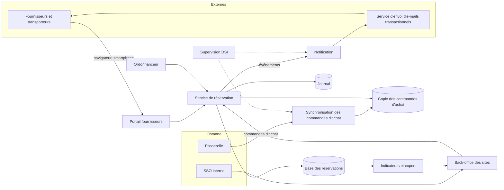
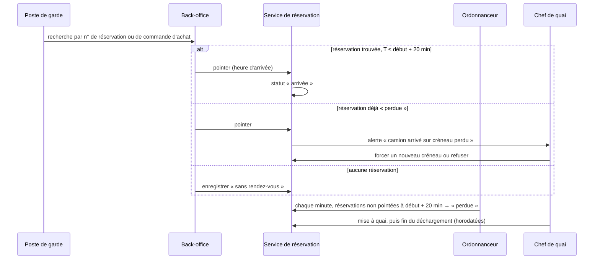

# Conception : prise de rendez-vous de déchargement par les fournisseurs et transporteurs

## Vue d'ensemble

La solution est une application unique avec deux faces :

- le **portail fournisseurs**, ouvert aux contacts externes (fournisseurs et transporteurs), pour réserver, modifier et annuler des créneaux ;
- le **back-office des sites**, réservé aux utilisateurs internes : paramétrage des sites, vue planning, actions du chef de quai, écran du poste de garde, indicateurs et export.

Les deux faces s'appuient sur un même **service de réservation**, qui porte les règles R1 à R7, et sur une **copie locale des commandes d'achat** alimentée par Passerelle. Un **ordonnanceur** déclenche les rappels de la veille et le passage des créneaux non pointés au statut « perdu ». Un **service d'envoi d'e-mails** transactionnels envoie confirmations, rappels et avis de modification.

Choix structurants :

| Choix | Raison | Alternative écartée |
|---|---|---|
| Un seul service de réservation pour le portail et le back-office | Les règles R1 à R7 s'appliquent de la même façon, qu'un fournisseur ou un chef de quai agisse ; seul le forçage lève la capacité et le délai | Deux applications : risque de règles divergentes et de double réservation |
| Capacité matérialisée par créneau et par quai, avec contrainte d'unicité en base | Garantit l'absence de double réservation, y compris pour un camion complet qui occupe deux créneaux consécutifs (critères 3.4, 3.7) | Compteur de places par créneau : verrouillage plus fragile, pas d'attribution de quai |
| Durée de créneau, nombre de quais, horaires et jours fermés paramétrables par site | Les conflits C21 et C22 ne sont pas arbitrés (H20, H21) ; les valeurs relèvent de chaque site | Coder 30 minutes et 6 quais |
| Copie locale des commandes d'achat, mise à jour par un flux Passerelle | La vérification R1 ne dépend pas de la disponibilité de Passerelle au moment de la réservation ; la disponibilité des commandes dans Passerelle reste à vérifier (B08-D27) | Appel synchrone à Passerelle à chaque réservation |
| Comptes nominatifs ouverts par Orvanne, pas d'inscription libre | Pilote limité à une vingtaine de fournisseurs (B08-D28) ; cloisonnement des commandes d'achat par fournisseur | Inscription libre avec validation a posteriori |
| Textes externalisés dans des fichiers de traduction dès la V1 | CT-11 et H26 : environ 15 % des livraisons viennent de fournisseurs étrangers (B08-N13) ; les langues ne sont pas décidées (Q27) | Textes en dur, traduction en V2 |
| Pas de lien avec Hangar en V1 | Classé en V2 par l'atelier (B08-D23) ; le modèle de données garde les numéros de commande d'achat pour le permettre | Préremplissage de la réception dès la V1 |

Les technologies citées ci-dessous sont des **propositions** : B08 n'en impose aucune.

## Architecture



Les utilisateurs internes (chef de quai, poste de garde, bureau de réception, approvisionnement, achats) passent par le back-office ; les utilisateurs externes par le portail. Hangar n'est pas relié en V1.

## Composants et interfaces

| Composant | Responsabilité | Interfaces (entrée / sortie) | Exigences |
|---|---|---|---|
| Portail fournisseurs | Connexion, création, modification et annulation de réservation, consultation des réservations du périmètre ; écrans adaptés au smartphone et conformes au RGAA ; textes traduisibles | Application web (proposition : rendu serveur ou SPA légère, sans dépendance à une application mobile) ; appelle l'API du service de réservation | 1, 3, 4, 10 |
| Back-office des sites | Paramétrage des sites, vue planning, actions du chef de quai, écran du poste de garde, indicateurs | Application web interne derrière le SSO ; rôles `chef-de-quai`, `poste-de-garde`, `bureau-reception`, `approvisionnement`, `achats`, `admin-site` | 2, 6, 7, 8, 9 |
| Service de réservation | Génère les créneaux, applique R1 à R7, attribue le quai, gère les statuts, publie les événements | API REST interne ; écrit dans la base des réservations et le journal | 2.3, 2.4, 3, 4, 6, 7 |
| Synchronisation des commandes d'achat | Reçoit les commandes d'achat (numéro, fournisseur, statut validé / soldé, site de livraison s'il est fourni) et met à jour la copie locale ; mesure la fraîcheur | Entrée : flux Passerelle (format et fréquence à fixer, tâche 1.2) ; sortie : table `CommandeAchat` | 3.2, 3.3, 6.3 |
| Ordonnanceur | Toutes les minutes : passe au statut « perdu » les réservations non pointées 20 minutes après le début du créneau. Chaque jour : déclenche les rappels de la veille, la purge des comptes inactifs | Tâches planifiées, fuseau Europe/Paris | 5.2, 7.4, 11.3 |
| Notification | Construit les e-mails à partir des modèles traduisibles, les envoie, réessaie, signale les échecs | Consomme les événements `RéservationCréée`, `RéservationModifiée`, `RéservationAnnulée`, `Rappel` ; appelle le service d'envoi (à choisir, tâche 1.6) | 5, 10.3 |
| Indicateurs et export | Calcule les quatre indicateurs, produit les exports CSV | Lecture de la base des réservations ; calcul à la demande (volume faible) | 9 |
| Journal | Trace les actions des utilisateurs internes et les connexions | Table append-only, consultable par l'approvisionnement et la DSI | 6.6 |

### Règles du service de réservation

- **Génération des créneaux (R2, R4, H20).** Pour un jour ouvert d'un site, les créneaux commencent à l'heure d'ouverture et se suivent par pas de la durée de créneau du site, tant que le créneau se termine avant l'heure de fermeture. Chaque créneau existe une fois par quai actif.
- **Camion complet (R2).** La réservation occupe deux créneaux consécutifs du même quai. Le dernier créneau de la journée ne peut donc pas accueillir un camion complet.
- **Attribution du quai.** Le service attribue le quai libre de plus petit numéro ; le chef de quai peut le changer (critère 6.1). C'est une **proposition** : B08 ne dit pas si les quais sont interchangeables.
- **Fenêtre de réservation (R3).** Une réservation externe est acceptée si `maintenant ≥ J-10 à 00 h 00` et `maintenant < J-1 à 12 h 00`, heure de Paris. L'interprétation « J-10 à 00 h 00 » est une **proposition** à valider ; les bornes sont des paramètres.
- **Forçage (R7).** Le forçage lève la contrainte de capacité et la fenêtre R3, jamais R1 (H22). Une réservation forcée sur un créneau sans quai libre est rattachée à un quai virtuel « en surnombre » visible dans le planning.
- **Statuts d'une réservation.** `réservée` → `arrivée` → `à quai` → `déchargée` ; `réservée` → `perdue` (non pointée à T+20 min) ; `réservée` → `annulée`. Le pointage d'un camion sur une réservation `perdue` est enregistré sans changer le statut et crée une alerte pour le chef de quai (critère 7.5).

## Flux principaux

### Réservation par un utilisateur externe

```mermaid
sequenceDiagram
  participant U as Fournisseur / transporteur
  participant PF as Portail
  participant R as Service de réservation
  participant CA as Copie des commandes d'achat
  participant N as Notification
  U->>PF: site, jour, commandes d'achat, camion complet, e-mail du transporteur
  PF->>R: demande de créneaux disponibles
  R->>CA: commandes valides, non soldées, rattachées au compte ?
  alt une commande refusée
    R-->>PF: motif « inconnue ou non rattachée » ou « soldée »
  else commandes acceptées
    R->>R: contrôler la fenêtre J-10 / J-1 12 h
    R-->>PF: créneaux avec un quai libre sur toute la durée
    U->>PF: choix du créneau
    PF->>R: réserver
    R->>R: transaction : insérer les occupations (quai, date, début) ; échec si déjà prises
    alt occupation déjà prise (course)
      R-->>PF: créneau indisponible, autres créneaux proposés
    else réservation enregistrée
      R-->>PF: numéro de réservation, quai
      R->>N: RéservationCréée
      N->>U: e-mail de confirmation (transporteur, copie à l'auteur)
    end
  end
```

### Arrivée au poste de garde



## Modèle de données

| Entité | Attributs principaux | Donnée personnelle | Durée de conservation |
|---|---|---|---|
| Site | code (E1, E2…), nom, adresse, fuseau, durée de créneau, ouvert à la réservation (oui / non), heure du rappel | non | durée de vie de l'application |
| Quai | site, numéro, actif | non | durée de vie de l'application |
| HoraireSite | site, jour de la semaine, heure d'ouverture, heure de fermeture | non | durée de vie de l'application |
| JourFermé | site, date, motif | non | 2 ans (proposition) |
| Fournisseur | code fournisseur Orvanne, raison sociale, pilote (oui / non) | non (personne morale) | durée de vie de l'application |
| Transporteur | raison sociale, rattachement à un ou plusieurs fournisseurs | non (personne morale) | durée de vie de l'application |
| CompteExterne | nom, prénom, e-mail professionnel, langue, rattachement (fournisseur ou transporteur), date de dernière connexion | **oui** | jusqu'à la suppression du compte, puis purge après la durée d'inactivité fixée avec la DPO (critère 11.3) |
| CommandeAchat (copie) | numéro, code fournisseur, statut (valide, soldée), site de livraison s'il est transmis, date de mise à jour | non | tant que la commande est ouverte, puis 12 mois |
| Réservation | numéro, site, quai, date, heure de début, nombre de créneaux, camion complet, commandes d'achat, e-mail du transporteur, auteur, statut, forcée (oui / non), heures de pointage, de mise à quai, de fin de déchargement | **oui** (e-mail du transporteur s'il est nominatif, auteur) | 12 mois au moins pour les heures (H23) ; e-mail et auteur pseudonymisés au-delà de la durée fixée avec la DPO |
| Occupation | site, quai, date, heure de début, réservation ou blocage ; contrainte d'unicité (site, quai, date, heure de début) hors surnombre | non | comme la réservation |
| Blocage | site, quai ou tous les quais, plage horaire, récurrence, motif, auteur | oui (identifiant de l'employé) | 12 mois (proposition) |
| ArrivéeSansRendezVous | site, heure d'arrivée, fournisseur ou transporteur s'il est connu | non | 12 mois (H23) |
| E-mailEnvoyé | réservation, type, destinataires, langue, statut, nombre de tentatives | oui (adresses) | 6 mois (proposition, à confirmer avec la DPO) |
| Journal | utilisateur, action, objet, valeurs avant / après, motif, horodatage | oui (identifiant de l'employé) | 1 an (proposition, à confirmer avec la DPO) |

Aucune donnée sur les chauffeurs (nom, téléphone, immatriculation) n'est collectée en V1 : le pointage se fait par numéro de réservation ou de commande d'achat.

## Gestion des erreurs

| Situation | Comportement | Exigence |
|---|---|---|
| Commande d'achat inconnue ou rattachée à un autre fournisseur | Refus avec le motif unique « inconnue ou non rattachée à votre compte », pour ne pas révéler l'existence d'une commande d'un autre fournisseur | 3.3, 1.4 |
| Commande d'achat soldée | Refus avec le motif « soldée » | 3.3 |
| Copie des commandes d'achat non mise à jour depuis plus que le délai paramétré (proposition : 24 h) | Alerte à la supervision de la DSI ; les réservations restent possibles sur la dernière copie connue, avec un bandeau dans le back-office | 3.2 |
| Commande d'achat soldée après la réservation | Réservation conservée, signalée dans la vue planning au chef de quai | 3.2, 8.2 |
| Deux réservations simultanées sur le dernier quai libre | La contrainte d'unicité fait échouer la seconde transaction ; le portail propose d'autres créneaux | 3.7 |
| Camion complet demandé sur le dernier créneau de la journée | Créneau non proposé | 3.4, 3.6 |
| Modification ou annulation externe après J-1 12 h | Refus, avec les coordonnées du site | 4.2 |
| Modification du paramétrage incompatible avec des réservations | Refus, avec la liste des réservations concernées | 2.4 |
| Blocage d'un créneau réservé | Refus tant que la réservation n'est pas déplacée ou annulée | 6.5 |
| Échec d'envoi d'un e-mail | 3 tentatives avec délai croissant (valeur par défaut d'un paramètre, proposition), puis signalement sur la réservation dans la vue planning | 5.6 |
| Ordonnanceur arrêté ou en retard | Au redémarrage, rattrapage de toutes les réservations dont le début + 20 min est dépassé ; le pointage reste possible et fait foi de l'heure d'arrivée | 7.3, 7.4 |
| Panne réseau au poste de garde | Liste du jour imprimable dès l'ouverture du site (proposition) ; saisie a posteriori de l'heure d'arrivée par le chef de quai, journalisée | 7.2, 6.6 |
| Changement d'heure (été / hiver) | Créneaux calculés en heure locale de Paris ; tests aux deux dates de changement | 2.3, 3.5 |
| Camion pointé sur une réservation perdue | Heure enregistrée, statut inchangé, alerte au chef de quai | 7.5 |

## Sécurité et RGPD

- **Avant le développement (CT-01) :** le traitement des contacts fournisseurs et transporteurs est soumis à la DPO (`Q36`). Points à faire valider :
  - la base légale (exécution des relations contractuelles avec les fournisseurs, à confirmer) ;
  - la durée d'inactivité avant suppression d'un compte (critère 11.3) ;
  - la durée de conservation des e-mails envoyés et du journal ;
  - le recensement du traitement dans le registre (dépendance avec P05).
- **Minimisation :** seuls le nom, le prénom, l'e-mail professionnel et la langue des contacts externes sont collectés (critère 11.2). Aucune donnée sur les chauffeurs.
- **Authentification externe (proposition) :** comptes nominatifs créés par l'approvisionnement, activation par lien à usage unique, mot de passe et second facteur par code envoyé par e-mail, verrouillage temporaire après plusieurs échecs. Les comptes partagés entre plusieurs personnes ne sont pas autorisés.
- **Cloisonnement :** chaque requête du portail est filtrée par les fournisseurs rattachés au compte (critère 1.4). Les messages d'erreur ne révèlent pas l'existence d'une commande d'achat d'un autre fournisseur, et le nombre de vérifications de commande par compte et par heure est limité (proposition) pour empêcher l'énumération des numéros.
- **Accès internes :** SSO interne, rôles par site (critères 6.7 et 8.6). Le forçage, le déplacement, le blocage et l'annulation par un utilisateur interne sont journalisés (critère 6.6, `CT-10`).
- **Contenu des e-mails :** modèles de service uniquement, sans offre commerciale (`CT-03`, critère 5.5) ; relecture du texte des modèles lors de la recette.
- **Accessibilité :** le portail vise la conformité RGAA et l'usage sur smartphone (`CT-09`), en attendant la réponse à `Q35`.
- **Hébergement :** Union européenne (`CT-08`, critère 11.1). Le choix entre le cloud d'Orvanne et un hébergeur de l'UE attend la réponse à `Q34`.
- **Données de test :** jeux synthétiques uniquement (`CT-04`, critère 11.4), y compris pour la recette avec les fournisseurs pilotes.
- **Mise en production :** aucune entre le 16 novembre et le 11 janvier (`CT-07`).

## Volumétrie et performance

| Grandeur | Valeur | Base |
|---|---|---|
| Camions reçus par jour sur E1 | ≈ 70 | B08-N1 |
| Camions reçus par jour sur E2 | ≈ 40 | B08-N3 |
| Quais de réception de E1 | 6 aujourd'hui, 4 dans le paramétrage cible | B08-N2, B08-N16 |
| Camions sans rendez-vous ou hors créneau | 1 sur 4, soit ≈ 18 par jour sur E1 | B08-N4 (calcul sur B08-N1) |
| Fournisseurs pilotes | une vingtaine | B08-N15 |
| Part des livraisons par des fournisseurs étrangers | ≈ 15 % | B08-N13 |
| Réservations par jour, E1 et E2 ouverts | ≈ 110 au plus | estimation (B08-N1 + B08-N3) |
| E-mails par jour (confirmation, rappel, copie, modifications) | < 500 | estimation : 110 réservations × 2 à 4 e-mails |
| Utilisateurs simultanés | quelques dizaines | estimation |

Ces volumes sont très faibles ; une base relationnelle (proposition : PostgreSQL) et une seule instance applicative avec redémarrage automatique suffisent. Le seul point sensible est la concurrence sur les derniers créneaux libres, traitée par la contrainte d'unicité.

**Capacité de E1 (estimation à porter à l'arbitrage de C21 et C22).** Avec le paramétrage cible de 4 quais et des créneaux d'une heure, absorber 70 camions par jour demande au moins 70 créneaux-quais, soit 17 h 30 d'ouverture, et davantage pour les camions complets qui consomment deux heures. Avec 6 quais et des créneaux de 30 minutes, 70 camions d'un créneau demandent environ 5 h 50 d'ouverture, et 11 h 40 s'ils sont tous complets. Les horaires d'ouverture de E1 ne sont pas connus ; le paramétrage du 04/12 doit être vérifié contre ce calcul avant le pilote.

**Pilote partiel.** Pendant le pilote, seuls une vingtaine de fournisseurs réservent sur le portail. Les autres continuent d'appeler. Pour que le planning de E1 reste la seule référence, le bureau de réception ou le chef de quai saisit ces rendez-vous par forçage (critère 6.2), ou bien le site bloque une part des quais pour eux (critère 6.4). Le mode retenu est à décider avec le chef de quai E1 avant le pilote.

## Stratégie de test

| Niveau | Contenu | Exigences |
|---|---|---|
| Unitaire | Génération des créneaux (durée 30 min et 1 h, jours fermés, dernier créneau, changement d'heure) ; fenêtre R3 aux bornes (J-10, J-1 11 h 59, J-1 12 h 00) ; camion complet ; forçage sans levée de R1 ; statuts à début + 20 min (19 min 59 s, 20 min 00 s, 20 min 01 s) ; calcul des quatre indicateurs sur un jeu connu | 2.2, 2.3, 3.4, 3.5, 6.2, 6.3, 7.3, 7.4, 9.1 à 9.4 |
| Concurrence | 50 réservations simultanées sur le dernier quai libre : une seule acceptée, aucune occupation en double | 3.7, 3.8 |
| Intégration | Flux Passerelle des commandes d'achat en recette (création, solde, fournisseur) ; envoi d'e-mails via le service choisi, échec simulé | 3.2, 3.3, 5.1 à 5.6 |
| Sécurité | Cloisonnement entre deux fournisseurs ; message d'erreur identique pour une commande inconnue et une commande d'un autre fournisseur ; rôles internes | 1.2, 1.4, 6.7, 8.6 |
| Accessibilité et mobile | Audit RGAA du portail ; parcours de réservation complet sur smartphone | 1.5 |
| Langues | Pseudo-langue générée automatiquement : aucun texte en dur dans les écrans et les e-mails | 10.1, 10.2, 10.3 |
| Recette métier | Journée de E1 rejouée sur données synthétiques (≈ 70 camions, 1 sur 4 sans rendez-vous) avec le chef de quai et le poste de garde ; parcours de réservation avec 2 ou 3 fournisseurs pilotes sur un environnement de recette | 2, 3, 4, 6, 7, 8 |
| Données | Jeux synthétiques uniquement (CT-04) | 11.4 |
