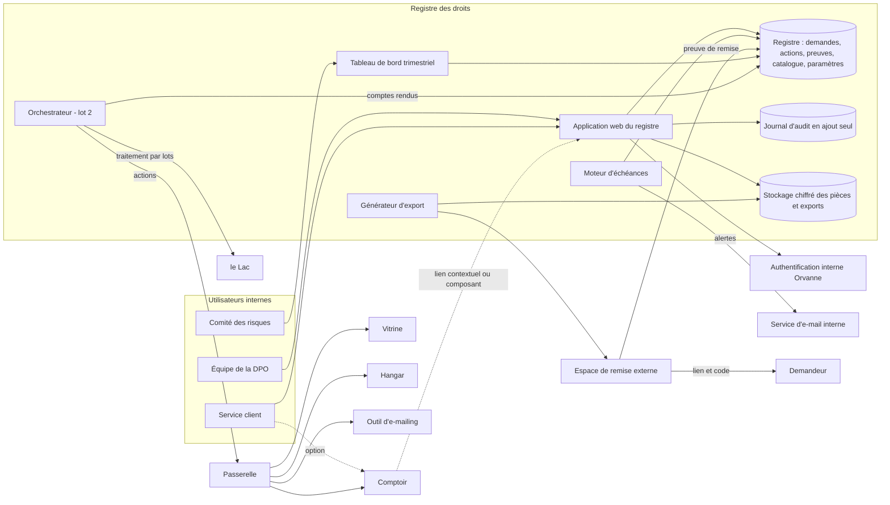
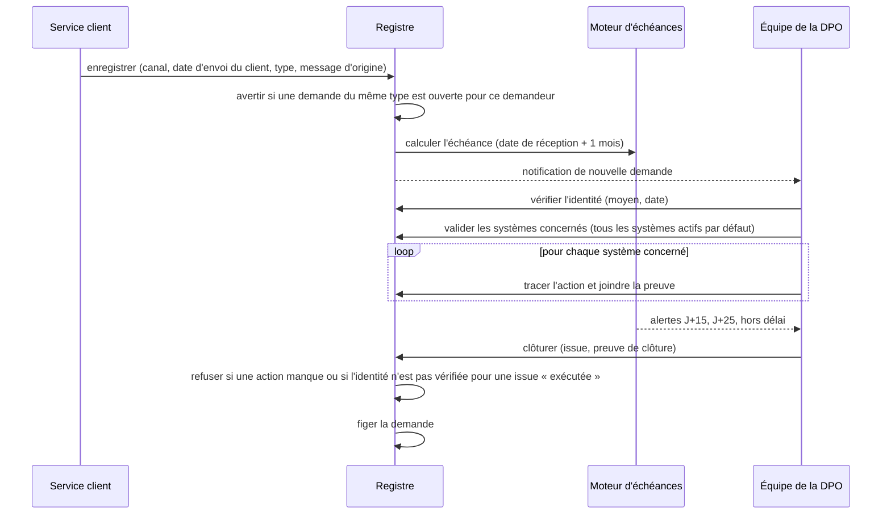
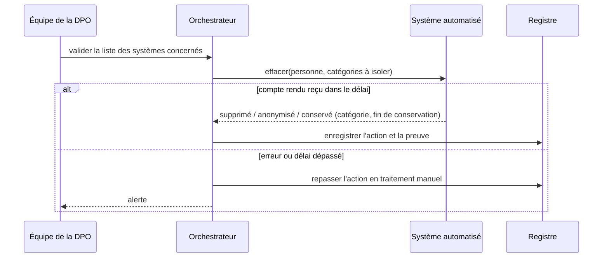

# Conception : registre et traitement des demandes d'exercice de droits RGPD

## Vue d'ensemble

La solution est une **application interne de registre**, hébergée dans l'Union européenne et reliée à l'authentification interne d'Orvanne. Elle remplace le classeur partagé de l'équipe de la DPO. Elle comprend :

- le **registre** des demandes et le **catalogue des systèmes** qui stockent des données clients ;
- un **moteur d'échéances** qui calcule les échéances et émet les alertes J+15, J+25 et « hors délai » ;
- un **écran de saisie** pour le service client, accessible depuis Comptoir si l'intégration est possible ;
- la **traçabilité des actions** par système, avec preuves, et la **clôture** contrôlée ;
- un **générateur d'export d'accès** et un **espace de remise** externe, seul composant exposé au demandeur ;
- un **tableau de bord trimestriel** agrégé pour le comité des risques ;
- au lot 2, un **orchestrateur** qui transmet les actions aux systèmes en mode `automatisé` et recueille leurs comptes rendus.

Choix structurants :

| Choix | Raison | Alternative écartée |
|---|---|---|
| Développement interne sur les composants existants (authentification, hébergement, Comptoir) | Préférence exprimée par la DPO (B07-D20) ; budget non arrêté (B07-F13) | Achat d'un produit de gestion des droits : possible si le comité d'architecture le décide (Q34), la spec fonctionnelle reste valable |
| Lot 1 à traçabilité manuelle, orchestration au lot 2 | Échéance rapprochée (B07-D19) ; la traçabilité manuelle corrige déjà l'absence de preuve (H31) | Orchestration dès la V1 : cinq intégrations à livrer avant le contrôle interne |
| Catalogue des systèmes paramétrable, avec un mode `manuel` ou `automatisé` par système | Les projets P01, P02, P03, P06 et P07 créent de nouveaux stockages ; un système passe en `automatisé` sans refonte du registre (B07-D5) | Liste de systèmes codée en dur |
| Délai, seuils d'alerte et prolongation paramétrables | Point de départ et prolongation non précisés (B07-F5, B07-F6, H29) | Coder J+15 / J+25 / +2 mois en dur |
| Espace de remise séparé de l'application interne | Seul composant accessible depuis Internet ; surface d'exposition réduite (B07-D6) | Envoi de l'export en pièce jointe d'e-mail : pas de contrôle d'accès ni de preuve de remise |
| Registre en écriture seule après clôture, avec compléments datés | Preuve opposable lors d'un contrôle (B07-D1, CT-10) | Modification libre, comme dans le classeur |

Les technologies citées ci-dessous sont des **propositions** : la source B07 n'en impose aucune.

## Architecture



## Composants et interfaces

| Composant | Responsabilité | Interfaces (entrée / sortie) | Exigences | Lot |
|---|---|---|---|---|
| Application web du registre | Création, recherche, instruction et clôture des demandes ; aide intégrée aux écrans ; écrans en français | Navigateur ; authentification interne ; API interne du registre | 1, 4, 6, 7, 10 | 1 |
| Registre | Stocke les demandes, statuts, vérifications d'identité, systèmes concernés, actions, preuves, données isolées, catalogue et paramètres | Base relationnelle (proposition : PostgreSQL) | 1, 2, 6, 7, 11.4 | 1 |
| Import du classeur | Reprise unique des demandes non clôturées du classeur, avec leur date de réception d'origine et leur historique d'actions | Fichier tableur exporté du classeur ; rapport d'import (lignes reprises, rejetées, motif) | 1.8, 9.2 | 1 |
| Catalogue des systèmes | Liste des systèmes stockant des données clients, responsable, mode `manuel` ou `automatisé`, statut actif | Écran d'administration, rôle administrateur DPO | 2, 7.5, 12.8 | 1 |
| Moteur d'échéances | Calcule l'échéance (réception + 1 mois), les alertes J+15, J+25, l'état « hors délai », la prolongation et la fin de conservation des données isolées | Passage quotidien planifié et recalcul à chaque modification ; alertes par le service d'e-mail interne et dans l'application | 3, 4, 7.4 | 1 |
| Écran de saisie du service client | Enregistrement d'une demande, du message d'origine et de la date d'envoi ; consultation du statut et de l'échéance | Application web ; en option, lien contextuel ou composant dans Comptoir (capacités d'extension de Comptoir à vérifier) | 5 | 1 |
| Générateur d'export | Assemble les extractions par système en un document lisible (proposition : PDF avec sommaire et libellés en français, accompagné des données au format CSV) | Lit les pièces d'extraction ; écrit l'export chiffré dans le stockage | 8.1, 12.6 | 1 |
| Espace de remise | Page de téléchargement externe : lien personnel à jeton aléatoire, code de vérification à usage unique, durée de validité, compteur de tentatives, preuve de téléchargement | HTTPS exposé sur Internet ; envoi du lien et du code par deux e-mails distincts ; pas de SMS (CT-02) | 8.2 à 8.7 | 1 |
| Tableau de bord trimestriel | Indicateurs agrégés par type et par canal, sans donnée personnelle ; export PDF | Vue agrégée calculée sur le registre ; rôle comité des risques | 9 | 1 |
| Journal d'audit | Trace en ajout seul de toutes les consultations et opérations | Table ou flux en ajout seul, droits d'écriture réservés à l'application | 11.1 | 1 |
| Stockage des pièces | Pièces jointes, preuves et exports, chiffrés au repos, purgés selon les durées paramétrées | Stockage objet chiffré (proposition) | 8.7, 11.3, 11.4 | 1 |
| Orchestrateur | Transmet les actions aux systèmes `automatisé`, suit les comptes rendus, gère les délais et le repli manuel | Contrat d'interface unique (`rechercher`, `extraire`, `rectifier`, `effacer`, `opposer`) ; messages via Passerelle pour Vitrine, Comptoir, Hangar et l'outil d'e-mailing ; traitement par lots pour le Lac | 12 | 2 |

## Flux principaux

### Enregistrement et instruction d'une demande (lot 1)



### Remise d'un export d'accès (lot 1)

```mermaid
sequenceDiagram
  participant DPO as Équipe de la DPO
  participant G as Générateur d'export
  participant R as Espace de remise
  participant D as Demandeur
  DPO->>G: constituer l'export (toutes les extractions sont tracées)
  G->>G: vérifier que l'identité est vérifiée
  G->>R: déposer l'export chiffré, créer le lien et le code
  R->>D: e-mail 1 : lien personnel
  R->>D: e-mail 2 : code de vérification
  D->>R: ouvrir le lien et saisir le code
  R->>D: télécharger l'export
  R->>G: enregistrer la preuve de remise (date, heure)
  Note over R: à l'expiration du lien ou après le délai paramétré, suppression du fichier ; seules la preuve et l'empreinte restent
```

### Orchestration d'un effacement (lot 2)



## Modèle de données

| Entité | Attributs principaux | Donnée personnelle | Durée de conservation |
|---|---|---|---|
| Demande | identifiant, canal, type, date de réception, date de saisie, auteur de la saisie, origine (`saisie` ou `import`), statut, échéance initiale, échéance prolongée, motif de prolongation, marquage urgent et hors délai, issue, motif de non-exécution | oui (rattachée à un demandeur) | durée paramétrable fixée par la DPO après la clôture (11.4) |
| Demandeur | nom, adresse e-mail, adresse postale si courrier, identifiant client si connu | oui | celle de la demande |
| VérificationIdentité | état, moyen, auteur, date, pièce justificative éventuelle | oui (la pièce d'identité est une donnée sensible pour Orvanne) | pièce supprimée dès la vérification faite (proposition à valider par la DPO), trace conservée avec la demande |
| SystèmeCatalogue | nom, responsable, mode (`manuel` ou `automatisé`), actif, date d'ajout | non (nom du responsable : donnée d'un employé) | conservé |
| SystèmeConcerné | demande, système, retiré oui ou non, motif de retrait | non | celle de la demande |
| Action | demande, système, type d'action, mode d'effacement, auteur, date, preuve, mention « antérieure à l'outil » pour les demandes importées | oui (indirectement) | celle de la demande |
| DonnéeIsolée | action, catégorie, obligation légale, date de fin de conservation | non (référence à la demande) | jusqu'à la date de fin de conservation, puis alerte (7.4) |
| ObligationLégale | libellé, durée (factures : 10 ans) | non | conservé |
| PièceJointe / Preuve | type, empreinte, emplacement chiffré, auteur, date | oui | celle de la demande |
| Export | demande, empreinte, emplacement chiffré, date de création, lien, code (empreinte seulement), validité, date de téléchargement | oui | fichier supprimé après le délai paramétré (8.7) ; preuve et empreinte conservées avec la demande |
| Paramètre | clé, valeur, auteur, date | non | conservé |
| Journal | utilisateur, rôle, action, objet, horodatage | oui (identifiant de l'employé) | durée à fixer par la DPO, au moins égale à celle des demandes |

**Demandes importées du classeur** : une action passée peut être reprise avec la mention « antérieure à l'outil, preuve absente ». Ces demandes sont comptées par le critère 9.2, qui rend visible la reprise de l'existant au comité des risques.

## Gestion des erreurs

| Situation | Comportement | Exigence |
|---|---|---|
| Demande en doublon possible | Avertissement avec lien vers la demande existante ; création possible | 1.9 |
| Ligne du classeur incomplète (date de réception absente ou illisible) | Ligne rejetée dans le rapport d'import, à reprendre à la main ; aucune date inventée | 1.8 |
| Date de réception saisie postérieure à la date de saisie | Saisie refusée avec message | 5.2 |
| Échec d'envoi d'une alerte par e-mail | Alerte conservée dans l'application, nouvel essai à chaque passage du moteur, incident signalé à la supervision | 3.3, 3.4, 3.5 |
| Passage quotidien du moteur non exécuté | Rattrapage au passage suivant : toutes les alertes dont le seuil est dépassé partent, avec leur date de seuil | 3.3, 3.4, 3.5 |
| Clôture demandée avec un système sans action | Refus, liste des systèmes manquants | 6.3 |
| Clôture `exécutée` sans identité vérifiée | Refus | 6.5 |
| Retrait du Lac d'une demande d'effacement | Refus ; l'action « aucune donnée trouvée » reste possible | 7.5 |
| Export demandé alors que l'identité n'est pas vérifiée | Refus | 8.2 |
| Code de vérification erroné plusieurs fois | Lien bloqué après un nombre de tentatives paramétrable (proposition : 5), alerte à l'équipe de la DPO | 8.3 |
| Lien expiré sans téléchargement | Lien désactivé, alerte, nouvel envoi possible par l'équipe de la DPO | 8.4 |
| Adresse e-mail du demandeur absente ou invalide | Remise par courrier enregistrée (8.6) ou demande de coordonnées au demandeur | 8.3, 8.6 |
| Système automatisé en erreur ou muet au-delà du délai | Repli en traitement manuel et alerte ; jamais de clôture sans action enregistrée | 12.4, 6.3 |
| Compte rendu d'un système pour une demande déjà clôturée | Ajouté comme complément daté, sans modifier la demande | 6.6, 12.3 |

## Sécurité et RGPD

- **CT-01** : le registre est lui-même un traitement de données personnelles. Son analyse est soumise à la DPO avant le développement (tâche 1.1). Points à faire valider : moyens de vérification de l'identité, durée de conservation des demandes, des pièces d'identité et du journal, mécanisme de remise de l'export, contenu du tableau de bord.
- **Données traitées** : identité et coordonnées du demandeur, pièce d'identité éventuelle, contenu des demandes, extractions de données clients (exports). Les exports regroupent toutes les données d'une personne : ce sont les pièces les plus sensibles du registre.
- **Accès** (11.2) : rôles `dpo`, `admin-dpo`, `service-client` et `comite-risques`. Le service client crée et consulte le statut, sans accès aux pièces, exports ni preuves (5.4). Le comité des risques ne voit que des agrégats (9.3, 9.4).
- **Journalisation** (CT-10, 11.1) : toutes les consultations et opérations sont tracées dans un journal en ajout seul.
- **Chiffrement** (11.3) : TLS en transit, chiffrement au repos du stockage des pièces et exports (proposition : clés gérées par le service de gestion de clés du cloud d'Orvanne).
- **Espace de remise** (8.3) : jeton aléatoire non devinable, code à usage unique stocké sous forme d'empreinte, durée de validité et nombre de tentatives limités. Le code n'est pas envoyé par SMS, pour ne pas utiliser le mobile hors de la livraison (CT-02).
- **Hébergement** (CT-08, 11.5) : Union européenne ; hébergement dans le cloud d'Orvanne à confirmer (Q34).
- **Données de test** (CT-04, 11.7) : jeux synthétiques uniquement, y compris pour la reprise du classeur, qui est répétée sur une copie anonymisée.
- **Gel** (CT-07) : aucune mise en production du 16 novembre au 11 janvier.

## Volumétrie et performance

| Grandeur | Valeur | Base |
|---|---|---|
| Demandes sur 9 mois | 412 | B07-N2 |
| Demandes par mois | ≈ 46 | estimation (412 / 9) |
| Demandes par an | ≈ 550 | estimation |
| Part d'effacements | 61 %, soit ≈ 28 par mois | B07-N3, estimation |
| Demandes hors délai sur 9 mois | 17 (≈ 4 %) | B07-N4 |
| Utilisateurs de l'équipe de la DPO | 2 | B07-N1 |
| Actions par an (5 systèmes initiaux par demande) | ≈ 2 750 | estimation |
| Effet du pic de fin d'année sur les demandes | inconnu | aucune source |

Ces volumes sont faibles. Le dimensionnement vise 10 fois le volume estimé (≈ 500 demandes par mois) pour absorber la hausse attendue avec la meilleure reconnaissance des demandes reçues par le chat et les réseaux sociaux (estimation). La taille d'un export n'est pas connue ; le générateur est testé avec un export de 100 Mo (estimation).

## Stratégie de test

| Niveau | Contenu | Exigences |
|---|---|---|
| Unitaire | Calcul d'échéance (fins de mois, 29 février, réception un samedi), alertes J+15 et J+25, hors délai, prolongation (motif, plafond de deux mois, recalcul), fin de conservation des données isolées | 3.1 à 3.6, 4, 7.4 |
| Unitaire | Règles de clôture (action manquante, identité non vérifiée, issue et motif), gel après clôture, retrait du Lac interdit, détection de doublon | 1.9, 6.3 à 6.6, 7.5 |
| Intégration | Import du classeur sur une copie anonymisée ; saisie depuis Comptoir si l'option est retenue ; envoi des alertes par le service d'e-mail interne | 1.8, 5.5, 3.3 |
| Sécurité | Contrôle des rôles sur chaque écran et chaque API ; espace de remise (jeton, code, expiration, tentatives) ; journal non modifiable ; chiffrement au repos ; absence de donnée personnelle dans le tableau de bord | 5.4, 8.2 à 8.5, 9.3, 11.1 à 11.3 |
| Conservation | Purge des exports et des demandes selon les durées paramétrées, sur une horloge simulée | 8.7, 11.4 |
| Utilisabilité | Les 2 membres de l'équipe de la DPO et 2 conseillers du service client déroulent les scénarios de recette sans assistance, avec la seule aide intégrée | 10 |
| Recette métier | Trimestre fictif rejoué : 150 demandes synthétiques couvrant les 4 types et les 4 canaux, prolongations et dépassements ; contrôle du tableau de bord par l'équipe de la DPO | 1 à 9 |
| Lot 2 | Bouchon du contrat d'interface, puis chaque système en recette : accès, effacement avec isolation, opposition dans l'outil d'e-mailing, erreurs et délais dépassés | 12 |
| Données | Jeux synthétiques uniquement (CT-04) | 11.7 |
