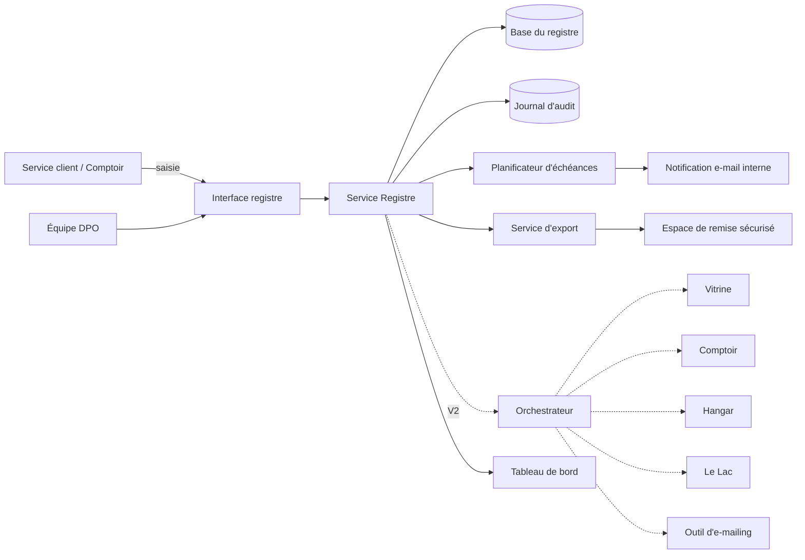
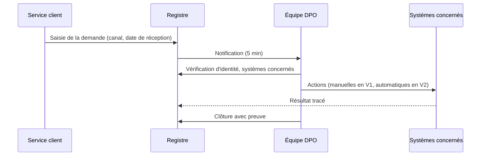

# Conception : Registre et traitement des demandes d'exercice de droits RGPD

## Vue d'ensemble

Le registre est une application interne intégrée au SI d'Orvanne (B07-D20), utilisée par l'équipe DPO (2 personnes) et alimentée par le service client. Elle est livrée en deux lots : V1 (registre, compte à rebours, saisie, preuve de clôture, export d'accès, tableau de bord, actions tracées à la main) et V2 (orchestration automatisée dans les systèmes), selon H31.

Choix structurants (les technologies sont des **propositions**, non imposées par B07) :

| Choix | Raison | Alternative écartée |
|---|---|---|
| Application interne dédiée avec base relationnelle, hébergée dans le cloud d'Orvanne dans l'UE (CT-08) | Intégration à l'existant préférée (B07-D20), faible volume | Achat d'un produit de gestion RGPD : budget non arrêté (B07-F13) |
| Échéances et seuils paramétrables (H29) | Point de départ et prolongation non précisés | Valeurs figées dans le code |
| Orchestration par connecteurs par système, en V2 | Échéance rapprochée, tracer à la main suffit en V1 (H31) | Orchestration complète en V1 |
| Journal d'audit en ajout seul | Preuve d'exécution (CT-10) | Simple historique modifiable |
| Export d'accès déposé sur un espace à lien limité dans le temps | Canal sécurisé non défini (B07-F4) | Envoi de l'export en pièce jointe d'e-mail |

## Architecture

## Composants et interfaces

| Composant | Responsabilité | Interfaces (entrée / sortie) | Exigences |
|---|---|---|---|
| Service Registre | Création, suivi, clôture des demandes, prolongation | API interne ; base du registre | 1, 3, 4 |
| Planificateur d'échéances | Calcul des échéances, jours restants, alertes J+15 et J+25 | Table de paramètres ; e-mail interne | 2, 3 |
| Journal d'audit | Trace des actions et des accès | Ajout seul | 1.3, 3.2, 11.3 |
| Service d'export | Constitution de l'export lisible, remise par lien limité | Extractions par système ; espace de remise | 5 |
| Gestion de l'effacement | Action retenue par système, isolation des données à conserver | Référentiel des catégories de conservation | 6 |
| Suivi par système (V1) puis orchestrateur (V2) | Statut d'action par système ; en V2, appels automatiques | Vitrine, Comptoir, Hangar, Lac, e-mailing ; Passerelle si utile | 7 |
| Tableau de bord | Indicateurs trimestriels et export | Lecture de la base | 8 |
| Interface | Liste triée par échéance, guide d'une page | Navigateur interne | 9 |

## Flux principaux

## Modèle de données

| Entité | Attributs principaux | Donnée personnelle | Durée de conservation |
|---|---|---|---|
| Demande | canal, date de réception, type, identité vérifiée, échéance, statut, preuve de clôture | oui | À fixer avec la DPO (proposition : 5 ans après clôture) |
| ActionSystème | demande, système, action, auteur, date, commentaire | oui | Celle de la demande |
| Prolongation | demande, motif, auteur, date, nouvelle échéance | oui | Celle de la demande |
| Export | demande, emplacement, date de remise, expiration du lien | oui | Suppression à l'expiration du lien (7 jours), trace de remise conservée avec la demande |
| Paramètre | seuils d'alerte, durée de prolongation, durée du lien | non | Durée de vie de l'application |
| JournalAudit | utilisateur, action, objet, horodatage | oui (identifiants des agents) | À fixer avec la DPO (proposition : 5 ans) |
| CatégorieConservation | libellé, durée légale (factures : 10 ans) | non | Durée de vie de l'application |

## Gestion des erreurs

| Situation | Comportement | Exigence |
|---|---|---|
| Clôture sans preuve | Refus et message de motif | 1.4 |
| Clôture avec un système sans action tracée | Refus de la clôture | 7.3 |
| Remise d'export avec identité non vérifiée | Blocage de la remise | 5.3 |
| Prolongation sans motif | Refus | 3.1 |
| Échec d'envoi d'une alerte | Nouvelle tentative, puis alerte d'exploitation ; la demande reste visible en tête de liste | 2.3, 2.4 |
| Échec d'extraction d'un système pour l'export | Export marqué incomplet, système en erreur signalé, demande non clôturée | 5.1 |
| Donnée à effacer soumise à conservation légale | Exclusion de l'effacement, base consignée | 6.3 |
| Échec d'une action d'orchestration (V2) | Statut « en erreur » du système, nouvelle tentative manuelle | 7.4 |
| Indisponibilité de l'espace de remise | Export non remis, demande conservée ouverte | 5.2 |

## Sécurité et RGPD

- **CT-01** : avis de la DPO avant développement, la DPO étant à la fois commanditaire et destinataire de l'analyse.
- **CT-04** : jeux de données de test synthétiques, aucune donnée de production non anonymisée.
- **CT-08** : hébergement dans l'UE ; hébergement dans le cloud d'Orvanne par défaut, en attente de Q34.
- **CT-10** : journal d'audit en ajout seul de toutes les actions et preuves d'exécution.
- Accès par rôles : équipe DPO (lecture et écriture complètes), service client (création et consultation de ses saisies), comité des risques (tableau de bord agrégé seulement). Authentification via l'annuaire interne (proposition).
- Chiffrement des données au repos et en transit ; export remis par lien à durée limitée, protégé par un second facteur à confirmer (B07-F4).
- Minimisation : le tableau de bord ne contient pas de données nominatives.
- Le registre contenant des données personnelles, sa propre durée de conservation est à valider par la DPO.

## Volumétrie et performance

- 412 demandes en 9 mois (B07-N2), soit environ 46 par mois ; 61 % d'effacement (B07-N3). Hypothèse de dimensionnement (estimation) : 3 fois ce volume en pic, soit environ 150 par mois.
- 2 utilisateurs DPO (B07-N1) et quelques dizaines d'agents du service client (estimation).
- Alertes : calcul quotidien des échéances, exécuté avant 8 h (proposition).
- Aucun enjeu de charge ; la contrainte porte sur la fiabilité des échéances (17 dépassements, B07-N4).

## Stratégie de test

- **Unitaires** : calcul d'échéance (un mois, jours calendaires), alertes J+15 et J+25, prolongation de 2 mois, règles de refus de clôture. Exigences 1 à 3.
- **Intégration** : saisie par le service client avec droits restreints, notification, export et remise, journal d'audit, extractions simulées par système. Exigences 4 à 7.
- **Données de test** : jeu synthétique (CT-04) comprenant demandes aux bornes (J+14, J+15, J+25, J+31), demandes prolongées, effacement avec factures conservées.
- **Sécurité** : tests de droits par rôle, accès au journal, expiration du lien. Exigences 5 et 11.
- **Recette métier** : l'équipe DPO traite 10 demandes de bout en bout à partir du guide d'une page. Exigences 8 et 9.
- **Non-régression V2** : chaque connecteur testé sur un environnement hors production avec des données anonymisées. Exigence 7.
