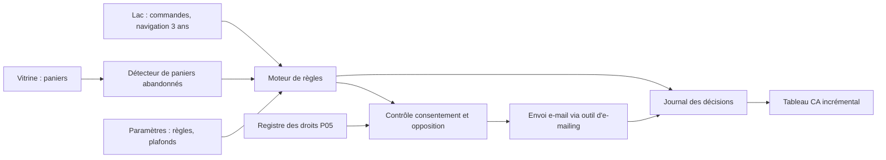
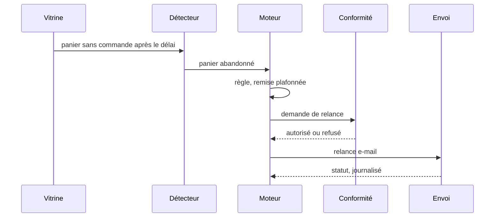

# Conception : relance personnalisée des paniers abandonnés

## Vue d'ensemble

La V1 détecte les paniers abandonnés, choisit message, moment et remise par un moteur de règles paramétrables, vérifie le consentement et l'opposition, puis envoie un e-mail par l'outil d'e-mailing. Une démo hors production tourne sur données synthétiques avant le 8 décembre. Les technologies ci-dessous sont des **propositions**, non imposées par les sources.

| Choix structurant | Raison | Alternative écartée |
|---|---|---|
| Règles paramétrables en V1 (`H30`) | Explicables, donnée utile à la DPO, prêtes pour la démo | Modèle d'IA dès la V1 (`B05-D2`) : données incertaines, avis DPO absent |
| E-mail seul (`H17`) | Seul canal déjà utilisé ; `CT-01`, `CT-02` pour les autres | SMS, notifications, messageries (`B05-D4`) |
| Moteur derrière une interface remplaçable | Brancher une IA en V2 sans toucher à l'envoi | Moteur codé en dur |
| Contrôle conformité avant envoi, par défaut « ne pas relancer » | `CT-01`, opposition de P05 | Envoi puis suppression |
| Démo sur données synthétiques, hors production (`H19`) | `CT-04`, `CT-07` | Démo sur vrais clients (`B05-D11`) |

## Architecture

## Composants et interfaces

| Composant | Responsabilité | Interfaces (entrée / sortie) | Exigences |
|---|---|---|---|
| Détecteur de paniers | Repère les paniers non convertis après le délai d'abandon | Vitrine, Lac / événement `PanierAbandonné` | 1 |
| Moteur de règles | Choisit message, moment, canal, remise ; applique les plafonds | Lac, paramètres / `DécisionRelance` | 2, 3, 5 |
| Contrôle de conformité | Vérifie consentement, opposition, canal autorisé | Registre des droits (P05) / autorisé ou refusé | 4, 6 |
| Service d'envoi | Envoie l'e-mail, gère les échecs | Outil d'e-mailing / statut d'envoi | 1, 9 |
| Paramétrage | Règles, délai, plafonds, critères d'hésitation | Écran d'administration / table de paramètres | 2, 5 |
| Journal et mesure | Trace les décisions, calcule le CA incrémental avec groupe témoin | Lac / tableau agrégé | 2, 6, 8 |
| Environnement de démo | Jeu synthétique, aucun envoi réel | Hors production / écran de démo | 7 |

## Flux principaux

## Modèle de données

| Entité | Attributs principaux | Donnée personnelle | Durée de conservation |
|---|---|---|---|
| PanierAbandonné | panier, client, contenu, date | oui | 3 ans après le dernier contact (`CT-05`) |
| DécisionRelance | panier, règle, canal, moment, remise, consentement vérifié | oui | 3 ans après le dernier contact |
| Paramètre | délai, plafonds, critères d'hésitation, règles | non | durée de vie du paramètre |
| Mesure | groupe (relancé/témoin), CA, période | non (agrégats) | à fixer avec la DPO (`Q36`) |
| JeuDémo | clients synthétiques | non | durée de la démo |

## Gestion des erreurs

| Situation | Comportement | Exigence |
|---|---|---|
| Consentement inconnu ou service indisponible | Pas de relance, journalisation | 6.3 |
| Opposition enregistrée | Exclusion du client | 6.2 |
| Donnée de navigation absente | Décision sur les commandes seules | 3.4 |
| Remise supérieure au plafond | Règle refusée, alerte | 5.5 |
| Échec d'envoi | Journalisation, nouvelles tentatives limitées | 9.3 |
| Commande passée avant l'envoi | Relance annulée | 1.4 |
| Lac indisponible | Report du traitement, aucune relance sans décision | 9.2 |

## Sécurité et RGPD

- Avis de la DPO avant développement et avant mise en production (`CT-01`, exigence 6) ; base légale et portée du consentement à confirmer (`Q18`).
- Le mobile n'est pas utilisé (`CT-02`). Les données sont limitées à 3 ans (`CT-05`, `H18`).
- Aucune donnée de production dans les démos et tests (`CT-04`) ; jeu synthétique.
- Hébergement dans l'UE (`CT-08`), à confirmer par `Q34`.
- Accès aux paramètres et au journal réservés au marketing et à la DSI, avec journalisation des modifications.
- Aucune mise en production du 16 novembre au 11 janvier (`CT-07`).

## Volumétrie et performance

La volumétrie des paniers abandonnés est inconnue (`B05-F5`). Elle doit être mesurée dans le Lac avant dimensionnement (exigence 9.1). Estimation de travail : traitement par lots, avec un pic de fin d'année environ double des volumes habituels. L'e-mail actuel part 24 heures après l'abandon (`B05-N1`).

## Stratégie de test

- **Unitaires** : règles, plafonds 10 % et 15 % (critères 5.3 à 5.5), fenêtre de 3 ans (3.2, 3.3), délai paramétré (1.1).
- **Intégration** : Lac, registre des droits, outil d'e-mailing en bac à sable (4, 6, 9).
- **Conformité** : consentement inconnu, opposition, canal interdit (4.2, 4.3, 6.2, 6.3).
- **Charge** : volume mesuré en 9.1, doublé pour le pic.
- **Recette métier** : démo sur jeu synthétique (7), tableau du CA incrémental (8). Toutes les données de test sont anonymisées ou synthétiques (`CT-04`).
