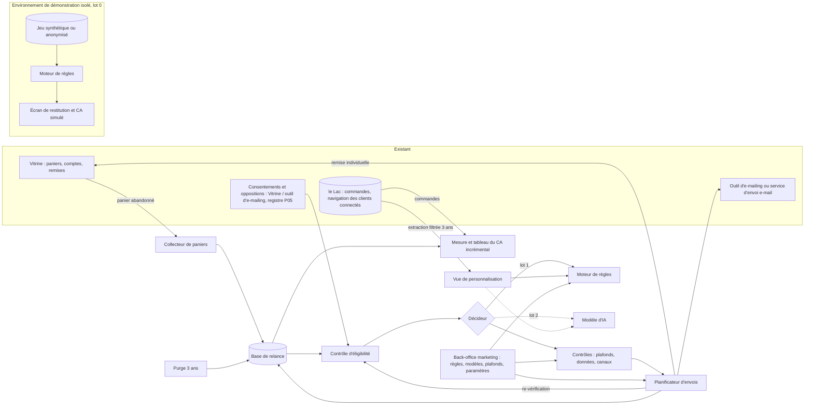
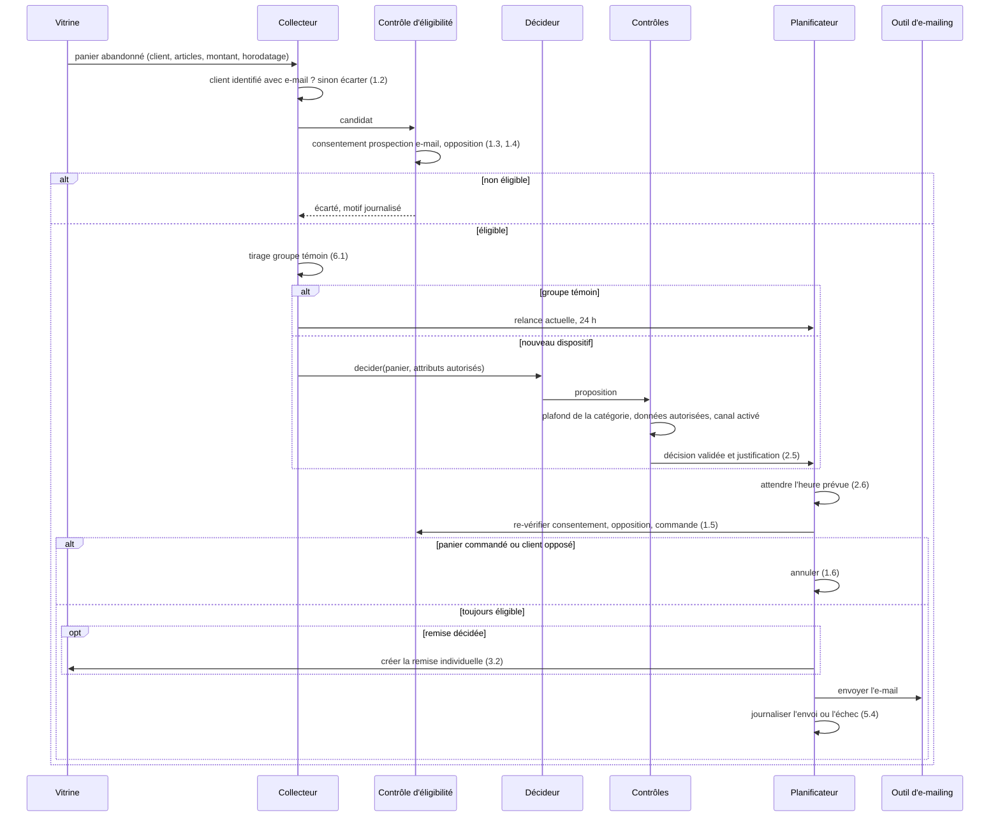
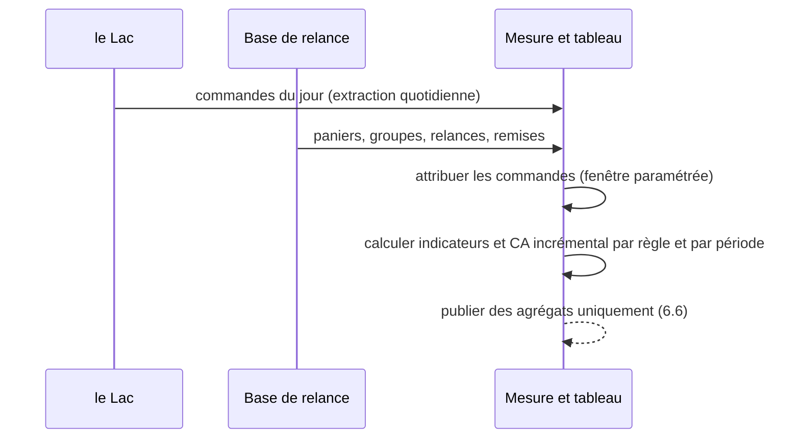

# Conception : relance personnalisée des paniers abandonnés

## Vue d'ensemble

La solution remplace la relance unique (même e-mail à 24 h) par un **moteur de relance** qui, pour chaque panier abandonné éligible, demande à un **décideur** le message, le moment, le canal et la remise, puis programme l'envoi. En lot 1, le décideur applique des **règles paramétrées par le marketing** ; en lot 2, un **modèle d'IA** peut le remplacer derrière la même interface (`H30`). Un **groupe témoin** qui reçoit la relance actuelle permet de mesurer le CA incrémental (exigence 6). Une **démonstration** isolée, sur données fictives, est livrée pour le comité commerce du 8 décembre 2026 (exigence 7, `H19`).

Choix structurants :

| Choix | Raison | Alternative écartée |
|---|---|---|
| Règles paramétrables et explicables en lot 1, modèle d'IA en lot 2 | « L'IA » n'est pas définie (B05-F1), les données disponibles sont incertaines (B05-F2), la démo est à un mois (`H30`) | Modèle d'IA dès le lot 1 : pas de données d'entraînement confirmées, pas d'avis de la DPO, décisions difficiles à expliquer |
| Une seule interface « décideur » pour les règles et le modèle | Le passage au lot 2 ne touche ni l'éligibilité, ni les plafonds, ni l'envoi ; retour aux règles par paramètre (8.5) | Deux chaînes séparées : contrôles dupliqués, risque que le modèle contourne les plafonds |
| Contrôles de conformité hors du décideur (éligibilité, plafonds, données autorisées, canaux) | Ils s'appliquent quel que soit le décideur (8.1) et sont testables isolément | Contrôles codés dans chaque règle |
| E-mail seul en lot 1 | Seul canal déjà utilisé pour la relance ; les autres canaux attendent l'avis de la DPO (`H17`, `CT-02`) | Quatre canaux d'emblée (B05-D4) |
| Groupe témoin recevant la relance actuelle | Mesure le gain par rapport à l'existant sans priver de relance une partie des clients | Témoin sans aucune relance : mesure l'effet total de la relance mais dégrade la conversion actuelle du groupe ; reste possible par paramètre si le marketing le demande |
| Vérifications de consentement, d'opposition et de commande au moment de l'envoi | Le délai entre décision et envoi peut atteindre plusieurs heures (1.5) | Vérification à la seule programmation |
| Lecture des coordonnées et des consentements à la source, sans copie | Minimisation (`CT-01`) ; une seule vérité pour les oppositions (P05) | Copie des e-mails et consentements dans la base de relance |
| Démonstration sur un environnement isolé, sans connecteur d'envoi | Aucune donnée réelle (`CT-04`), aucun message possible (7.5), pas de mise en production pendant le gel (`CT-07`) | Démo sur la production ou sur une copie de production |

Les technologies citées ci-dessous sont des **propositions** : les sources n'en imposent aucune.

## Architecture

## Composants et interfaces

| Composant | Responsabilité | Interfaces (entrée / sortie) | Exigences | Lot |
|---|---|---|---|---|
| Collecteur de paniers | Reçoit les paniers abandonnés, les enregistre comme candidats, écarte les paniers sans client identifié | Entrée : événement ou extraction de Vitrine (mécanisme à confirmer, « Points à remonter »). Sortie : base de relance | 1.1, 1.2 | 1 |
| Base de relance | Stocke paniers candidats, décisions, relances, remises, affectation au groupe témoin | Base relationnelle (proposition : PostgreSQL), hébergée dans l'UE | 2.5, 4.5, 6.1 | 1 |
| Vue de personnalisation | Expose par client des attributs calculés à partir des commandes du Lac et de la navigation des sessions connectées, limités aux 3 ans précédant le dernier contact | Entrée : le Lac (extraction quotidienne proposée). Sortie : attributs lus par le décideur ; liste fermée des attributs autorisés | 2.4, 4.1, 4.2, 4.3, 4.6 | 1 |
| Contrôle d'éligibilité | Vérifie client identifié, consentement à la prospection par canal, absence d'opposition, panier non commandé ; appelé à la programmation et à l'envoi | Entrée : consentements et oppositions (Vitrine ou outil d'e-mailing, registre P05), commandes de Vitrine. Sortie : éligible / motif de refus | 1.2 à 1.6, 4.4 | 1 |
| Décideur : moteur de règles | Évalue les règles actives par ordre de priorité ; applique la relance par défaut si aucune ne s'applique | Interface `decider(panier, attributs) → {modèle, délai, canal, remise, justification}` | 2.1, 2.2, 3.1, 3.2 | 0 (prototype), 1 |
| Décideur : modèle d'IA | Propose les mêmes choix à partir d'un modèle entraîné ; renvoie version et facteurs | Même interface que le moteur de règles | 8.1, 8.3 | 2 |
| Contrôles | Applique plafonds de remise par catégorie, liste des données autorisées, canaux activés ; rejette ou corrige la proposition du décideur | Lit les paramètres du back-office | 3.3, 3.6, 5.2, 5.3, 8.1 | 1 |
| Planificateur d'envois | Programme l'envoi à l'heure décidée, re-vérifie l'éligibilité, demande la remise à Vitrine, envoie, réessaie, journalise | Entrée : décisions. Sortie : API de Vitrine (remise individuelle, à qualifier), API de l'outil d'e-mailing | 1.5 à 1.7, 2.6, 3.2, 5.1, 5.4, 9.6 | 1 |
| Back-office marketing | Règles, modèles de message, plafonds, paramètres, test sur échantillon, versions, avis de la DPO enregistrés | Application web interne, SSO, rôles `crm`, `finance`, `dpo`, `admin` (proposition) | 2.3, 2.7, 3.4, 3.5, 5.2, 8.2, 9.1, 9.4, 9.6 | 1 |
| Mesure et tableau | Affectation au groupe témoin, attribution des commandes, indicateurs agrégés, CA incrémental, export | Entrée : base de relance, commandes du Lac. Sortie : tableau web et export CSV agrégé | 3.7, 6.1 à 6.6, 8.4 | 1 |
| Purge | Supprime ou anonymise les données de relance 3 ans après le dernier contact | Tâche planifiée quotidienne | 4.5 | 1 |
| Environnement de démonstration | Copie isolée du moteur de règles, jeu fictif, écran de restitution, CA simulé, aucun connecteur d'envoi | Hébergé dans l'UE, sans accès réseau aux systèmes de production | 7.1 à 7.6 | 0 |

### Méthode de calcul du CA incrémental (proposition, à valider par le marketing et la finance)

La méthode répond à B05-D12 sans que la source la définisse (B05-F10).

- Chaque panier éligible est affecté au hasard, à sa création, au **groupe nouveau dispositif** ou au **groupe témoin** (part paramétrable, proposition : 10 %).
- Une commande est attribuée à la relance si elle contient au moins un article du panier et si elle est passée dans la fenêtre d'attribution après l'envoi (proposition : 7 jours, paramètre).
- CA par panier d'un groupe = CA attribué du groupe ÷ nombre de paniers éligibles du groupe (relancés ou non, pour ne pas biaiser la comparaison).
- **CA incrémental** = (CA par panier du nouveau dispositif − CA par panier du groupe témoin) × nombre de paniers du nouveau dispositif − montant des remises accordées dans le nouveau dispositif qui ne l'auraient pas été dans le témoin.
- Le tableau affiche aussi l'intervalle de confiance à 95 % de l'écart de conversion, pour signaler les écarts non significatifs (proposition).
- Pour chaque règle de remise, la même comparaison est faite avec son échantillon relancé sans remise (3.7) : un écart nul ou négatif signale une remise donnée à des clients qui auraient acheté sans elle (B05-D5).

## Flux principaux

### Du panier abandonné à l'envoi

### Mesure

## Modèle de données

| Entité | Attributs principaux | Donnée personnelle | Durée de conservation |
|---|---|---|---|
| PanierCandidat | id panier, id client (pseudonyme interne), articles, montant, horodatage d'abandon, groupe (nouveau / témoin), statut d'éligibilité et motif | oui (rattaché à un client) | 3 ans après le dernier contact du client, puis suppression ou anonymisation (4.5, `CT-05`) |
| Décision | id panier, décideur (règles / modèle), règle ou version du modèle, modèle de message, heure prévue, canal, taux de remise, justification | oui (rattachée à un client) | idem PanierCandidat |
| Relance | id panier, canal, version du modèle de message, horodatage d'envoi, statut (programmée, envoyée, annulée, non envoyée), motif, nombre de tentatives | oui | idem PanierCandidat |
| Remise | id panier, id client, taux, référence de la remise dans Vitrine, date de validité, utilisée oui / non | oui | idem PanierCandidat ; les pièces comptables liées à une commande suivent les règles de Vitrine, hors projet |
| AttributsPersonnalisation | id client, attributs calculés (liste fermée), date de calcul, fenêtre de données utilisée | oui (profil) | recalculés chaque jour, version précédente écrasée |
| RègleRelance, RègleRemise | critères, priorité, modèle, délai, canal, taux, version, auteur, date d'activation, statut | non | conservées (traçabilité, 2.7) |
| ModèleMessage | canal, texte, variables, version, auteur, date d'activation | non | conservé |
| Paramètre | clé (plafonds, part du témoin, fenêtre d'attribution, tolérance d'envoi, politique de nouvelles tentatives, définition du dernier contact, avis de la DPO enregistrés, interrupteur général), valeur, auteur, date | non | conservé |
| IndicateurAgrégé | période, règle, groupe, compteurs, CA, remises, CA incrémental | non (agrégats) | conservé |
| Journal | utilisateur, action, objet, horodatage | oui (identifiant de l'employé) | 1 an proposé, à confirmer avec la DPO |

Les adresses e-mail, numéros de mobile et consentements ne sont **pas** copiés dans la base de relance : ils sont lus à la source au moment de l'envoi. La base ne contient ni nom, ni adresse postale.

## Gestion des erreurs

| Situation | Comportement | Exigence |
|---|---|---|
| Panier sans client identifié ou sans e-mail | Écarté à la collecte, compté dans les indicateurs (« non relançable ») | 1.2 |
| Service des consentements ou des oppositions indisponible | Aucun envoi sans vérification : envoi reporté et nouvel essai (proposition : 3 essais sur 1 h), puis relance « non envoyée : vérification impossible » | 1.3, 1.4, 1.5 |
| Panier commandé entre la décision et l'envoi | Relance annulée | 1.6 |
| Deuxième événement d'abandon pour le même panier | Ignoré : une relance au plus par panier | 1.7 |
| Aucune règle ne s'applique | Relance par défaut (e-mail, modèle par défaut, 24 h) | 2.2 |
| Règle qui référence un attribut non autorisé | Enregistrement refusé avec message explicite | 2.4 |
| Proposition de remise au-delà du plafond (règle ou modèle) | Activation refusée pour une règle ; proposition du modèle ramenée sous le plafond et écart journalisé | 3.3, 8.1 |
| Plafond abaissé alors que des règles le dépassent | Règles suspendues, auteur averti | 3.4 |
| Appartenance Orvanne+ invérifiable | Plafond général appliqué | 3.6 |
| Création de la remise refusée par Vitrine | Relance envoyée sans remise si la règle le permet (paramètre), sinon reportée puis « non envoyée : remise » | 3.2, 5.4 |
| Extraction du Lac absente ou en retard | Attributs de la veille utilisés s'ils ont moins de 48 h (proposition), sinon relance par défaut | 4.1, 2.2 |
| Donnée plus ancienne que la fenêtre de 3 ans | Filtrée à l'extraction ; un contrôle quotidien vérifie qu'aucun attribut n'en dépend | 4.2 |
| Échec d'envoi par l'outil d'e-mailing | Nouvelles tentatives selon la politique paramétrée (proposition : 3 essais, délai croissant), puis « non envoyée » avec motif | 5.4 |
| Retard d'envoi supérieur à la tolérance (file saturée au pic) | Alerte à la supervision ; envoi maintenu tant que le panier est éligible | 2.6, 9.5 |
| Dérive constatée (plaintes, désinscriptions, erreur de règle) | Interrupteur général : retour à la relance actuelle sans mise en production | 9.6 |
| Tentative d'envoi depuis l'environnement de démonstration | Impossible : aucun connecteur d'envoi installé, pas de route réseau vers l'outil d'e-mailing | 7.5 |

## Sécurité et RGPD

- **Avant le développement :** l'analyse du traitement est soumise à la DPO (`CT-01`, `Q18`, `Q36`). Points à faire valider :
  - la base légale de la relance et la portée réelle du consentement newsletter (relance personnalisée, remise ciblée, chaque canal) ;
  - la nature de profilage de la personnalisation et la nécessité d'une analyse d'impact ;
  - la définition du « dernier contact » (4.6) et la liste des attributs autorisés (4.1) ;
  - les mentions obligatoires de l'e-mail de relance (proposition : lien de désinscription en un clic, identification d'Orvanne comme émettrice), à confirmer par la DPO.
- **Verrous techniques :** l'envoi en production (9.1), chaque canal autre que l'e-mail (5.2), l'usage du mobile (4.4, `CT-02`) et le modèle d'IA (8.2) restent désactivés tant que l'avis correspondant n'est pas enregistré dans le back-office par le rôle `dpo`.
- **Nature commerciale :** la relance est de la prospection, pas un message de service ; `CT-03` ne s'y applique pas, mais le consentement est vérifié à chaque envoi.
- **Minimisation :** liste fermée d'attributs, fenêtre de 3 ans (`CT-05`), navigation des seules sessions connectées, pas de copie des coordonnées.
- **Conservation :** purge quotidienne des données de relance 3 ans après le dernier contact (4.5). Les données de relance sont un nouveau stockage de données clients, à déclarer au registre des droits (P05) pour les demandes d'accès, d'effacement et d'opposition.
- **Accès :** SSO interne ; rôles `crm` (règles, modèles), `finance` (plafonds, tableau), `dpo` (avis), `admin`. Le tableau ne montre que des agrégats (6.6). Les actions sensibles sont journalisées (9.4).
- **Hébergement :** dans l'UE (`CT-08`), y compris l'environnement de démonstration et le service d'envoi. L'obligation d'utiliser le cloud d'Orvanne pour ce projet est à confirmer (`Q34`).
- **Données de test et de démonstration :** synthétiques, ou anonymisées et validées par la DPO (`CT-04`, `H19`).

## Volumétrie et performance

| Grandeur | Valeur | Base |
|---|---|---|
| Délai de la relance actuelle | 24 h après l'abandon | B05-N1 |
| Conversion de la relance actuelle | « 2 et quelques % » | B05-N2 |
| Paniers abandonnés par jour | **inconnu** (« aucune idée, beaucoup ») | B05-F5 ; mesure à faire au cadrage (tâche 1.2) |
| Effet du pic | ×2 sur les volumes, par analogie avec les colis (35 000 / jour, 70 000 au pic) | B01-N1, B01-N2 ; **estimation** à confirmer pour les paniers |
| Ordre de grandeur indicatif | Si les paniers abandonnés étaient 2 à 3 fois plus nombreux que les colis expédiés, soit environ 200 000 par jour au pic, le débit moyen resterait inférieur à 3 paniers / s | **estimation**, à remplacer par la mesure |
| Historique exploité | 3 ans au plus avant le dernier contact ; navigation des clients connectés, sans doute pas avant 2023 | `CT-05`, B05-N4 |

Ces volumes restent modestes pour une base relationnelle et un planificateur à file de messages. Le point sensible est la concentration des envois sur certaines heures si les règles choisissent les mêmes moments : le planificateur lisse les envois dans la tolérance du critère 2.6 et respecte le débit admis par l'outil d'e-mailing (à qualifier). Le test de charge vise 2 fois le volume de pointe mesuré au cadrage (9.5).

## Stratégie de test

| Niveau | Contenu | Exigences |
|---|---|---|
| Unitaire | Éligibilité (client anonyme, sans consentement, opposé, panier commandé) ; évaluation des règles par priorité et relance par défaut ; plafonds (10 %, 15 % Orvanne+, Orvanne+ invérifiable, plafond abaissé) ; filtre de fenêtre de 3 ans et de navigation connectée ; tirage du témoin ; attribution des commandes | 1, 2.1, 2.2, 2.4, 3, 4, 6.1, 6.2 |
| Calcul | CA incrémental sur un jeu synthétique aux résultats connus d'avance ; vérification des agrégats et de l'absence de donnée nominative dans les exports | 6.3, 6.4, 6.6, 7.4 |
| Intégration | Vitrine (paniers, remise individuelle), le Lac (extraction), consentements et oppositions, outil d'e-mailing, avec des bouchons puis en recette | 1.1, 1.5, 3.2, 4.1, 5.1, 5.4 |
| Verrous de conformité | Envoi en production, canaux, mobile et modèle refusés sans avis de la DPO enregistré ; interrupteur général | 4.4, 5.2, 8.2, 9.1, 9.6 |
| Performance | 2 fois le volume de pointe mesuré, pendant 1 h ; écart d'envoi inférieur à la tolérance | 2.6, 9.5 |
| Démonstration | Vérification qu'aucun connecteur d'envoi n'existe et que le jeu ne contient aucune donnée réelle ; répétition avec le marketing | 7 |
| Recette métier | Marketing : création, test sur échantillon et activation de règles et de modèles ; finance : plafonds et tableau | 2.3, 3.3, 3.5, 6.3, 6.5 |
| Lot 2 | Modèle soumis aux contrôles, comparaison aux règles, retour aux règles par paramètre | 8 |
| Données | Jeux synthétiques uniquement dans tous les environnements hors production (`CT-04`) | 9.3 |
