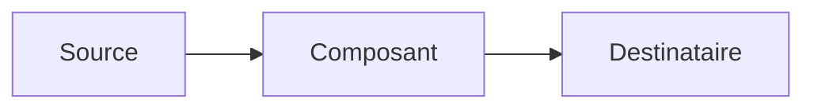
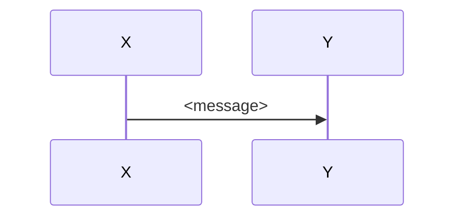

# Conception : <Titre du projet>

## Vue d'ensemble

<Solution en quelques phrases ; choix structurants et alternatives écartées.>

## Architecture

## Composants et interfaces

| Composant | Responsabilité | Interfaces (entrée / sortie) | Exigences |
|---|---|---|---|
| <nom> | <rôle> | <Passerelle, API, fichier…> | 1, 2 |

## Flux principaux

## Modèle de données

| Entité | Attributs principaux | Donnée personnelle | Durée de conservation |
|---|---|---|---|
| <entité> | <attributs> | oui/non | <durée> |

## Gestion des erreurs

| Situation | Comportement | Exigence |
|---|---|---|
| <panne, donnée manquante…> | <réaction> | 1.2 |

## Sécurité et RGPD

<Contraintes CT-nn appliquées, données personnelles traitées, base légale à confirmer avec la DPO, droits d'accès.>

## Volumétrie et performance

<Chiffres sources (pic inclus) et dimensionnement.>

## Stratégie de test

<Tests unitaires, d'intégration, de charge, recette métier ; lien avec les critères d'acceptation.>
