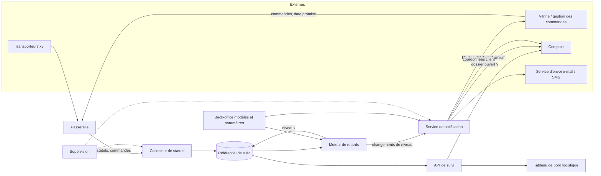
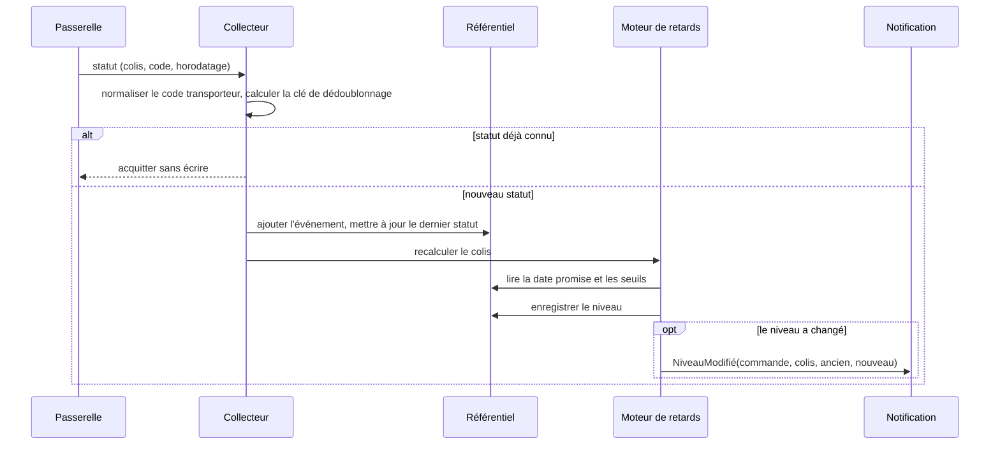
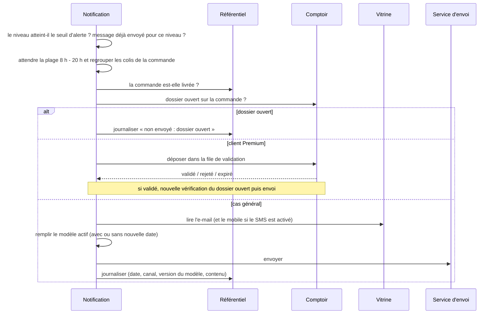

# Conception : détection des retards de livraison, information du client et pilotage

## Vue d'ensemble

La solution repose sur un **référentiel de suivi des colis**, alimenté par les statuts transporteurs déjà reçus par Passerelle. Un **moteur de retards** calcule le niveau de chaque colis non livré. Trois usages lisent ce référentiel :

- le **tableau de bord** de la logistique (lot 1) ;
- les **intégrations Comptoir** du service client : suivi dans la fiche commande, liste quotidienne, file de validation (lot 2) ;
- le **service de notification**, qui envoie les messages de retard aux clients selon des règles paramétrables (lot 2).

Choix structurants :

| Choix | Raison | Alternative écartée |
|---|---|---|
| Un référentiel unique pour les quatre usages | Le tableau de bord, Comptoir et les messages affichent les mêmes informations au client et en interne | Un outil par direction : les chiffres divergeraient, ce que le service client redoute (B02) |
| Seuils, canal et modèles paramétrables | Les conflits C01, C02 et C04 ne sont pas arbitrés ; l'arbitrage ne demandera pas de nouveau développement | Coder une des deux positions |
| Lot 1 sans aucun envoi aux clients | Peut être mis en service avant le pic si une dérogation au gel est accordée (Q03) ; risque limité | Tout livrer au T1 |
| Développement interne dans le cloud d'Orvanne | Exigence de la logistique (B01-D9) et préférence générale pour l'existant | Produit d'un éditeur de suivi de colis |
| Lecture des coordonnées du client au moment de l'envoi, sans copie | Minimisation des données personnelles (CT-01) | Copie des e-mails et mobiles dans le référentiel |

Les technologies citées ci-dessous sont des **propositions** : les sources n'en imposent aucune.

## Architecture

## Composants et interfaces

| Composant | Responsabilité | Interfaces | Exigences | Lot |
|---|---|---|---|---|
| Collecteur de statuts | Consomme les statuts et les commandes publiés par Passerelle ; normalise les codes des 3 transporteurs ; dédoublonne | Entrée : flux Passerelle (format à confirmer, Q06). Sortie : écriture dans le référentiel | 1 | 1 |
| Référentiel de suivi | Stocke les colis, leur historique et leur niveau de retard | Base relationnelle (proposition : PostgreSQL), index par commande, transporteur, entrepôt, région et niveau | 1, 2, 9 | 1 |
| Moteur de retards | Calcule le niveau de retard à chaque nouveau statut, et pour tous les colis non livrés lors du passage quotidien de 5 h 30 ; publie les changements de niveau | Lit les seuils dans le back-office ; publie un événement `NiveauModifié` | 2 | 1 |
| API de suivi | Sert les agrégats, les listes et le détail d'un colis | REST en lecture seule, authentification par le SSO interne, rôles | 3, 4, 5 | 1 (tableau de bord), 2 (Comptoir) |
| Tableau de bord | Ventilations, filtres, descente jusqu'au colis, code couleur, export CSV | Application web interne | 3 | 1 |
| Intégration Comptoir | Encart de suivi dans la fiche commande, liste quotidienne, file de validation Premium, historique des messages | Selon les capacités d'extension de Comptoir (Q09) : composant intégré ou lien contextuel | 4, 5, 6.8, 7 | 2 |
| Service de notification | Applique les règles d'envoi, construit le message, l'envoie, le journalise | Consomme `NiveauModifié` ; appelle Comptoir (dossier ouvert, statut Premium si Comptoir le porte) et Vitrine (coordonnées) ; appelle le service d'envoi (Q07) | 6, 7 | 2 |
| Back-office | Modèles de message versionnés, seuils, canal, plages horaires, délai de validation, durée de conservation | Application web, rôles `admin-metier` et `service-client` | 2.5, 8, 9.3, 9.4 | 1 (seuils), 2 (le reste) |
| Supervision | Fraîcheur des flux par transporteur, files en attente, erreurs d'envoi, indicateurs quotidiens | Tableaux techniques et alertes de la DSI | 1.6, 9.6 | 1 |

## Flux principaux

### Réception d'un statut et détection du retard

### Envoi d'un message de retard

## Modèle de données

| Entité | Attributs principaux | Donnée personnelle | Durée de conservation |
|---|---|---|---|
| Colis | id colis, n° de suivi, id commande, transporteur, entrepôt, département de livraison, date promise, dernier statut, nouvelle date estimée, niveau, date du changement de niveau, livré le | non (aucune identité ; département seulement) | paramétrable (H10) |
| ÉvénementStatut | id colis, code normalisé, code d'origine, horodatage transporteur, horodatage de réception, clé de dédoublonnage | non | paramétrable (H10) |
| Message | id commande, niveau, canal, version du modèle, contenu envoyé, statut (programmé, en validation, envoyé, non envoyé, rejeté, expiré, annulé), motif, horodatages, conseiller valideur | oui (contenu nominatif) | paramétrable, fixée avec la DPO (H10) |
| ModèleMessage | canal, cas (avec / sans date), version, texte, auteur, date d'activation, actif | non | conservé (traçabilité) |
| Paramètre | clé, valeur, auteur, date de modification | non | conservé |
| Journal | utilisateur, action, objet, horodatage | oui (identifiant de l'employé) | 1 an proposé, à confirmer avec la DPO |

Les e-mails et les numéros de mobile ne sont **pas** stockés dans le référentiel. Ils sont lus dans Vitrine au moment de l'envoi.

## Gestion des erreurs

| Situation | Comportement | Exigence |
|---|---|---|
| Statut reçu en double | Ignoré grâce à la clé de dédoublonnage (colis, code, horodatage transporteur) | 1.5 |
| Code de statut transporteur inconnu | Événement stocké avec le code d'origine et le code normalisé `inconnu`, alerte à la supervision ; le niveau n'est pas modifié | 1.1 |
| Aucun statut d'un transporteur depuis plus de 4 h | Bandeau sur le tableau de bord et alerte à la supervision | 1.6 |
| Date promise absente pour un colis | Colis exclu du calcul et compté à part (« date promise inconnue ») sur le tableau de bord | 2.1 |
| Comptoir indisponible lors de la vérification du dossier ouvert | Envoi reporté (3 nouvelles tentatives sur 1 h) ; jamais d'envoi sans vérification | 7.1, 7.2 |
| Service d'envoi en erreur | 3 nouvelles tentatives avec délai croissant, puis statut « non envoyé : erreur technique » visible dans la liste quotidienne | 6.1, 5.2 |
| E-mail du client absent ou invalide | Statut « non envoyé : coordonnées » ; commande signalée dans la liste quotidienne | 6.2, 5.2 |
| API de suivi trop lente pour Comptoir | Délai maximal de 1,5 s côté Comptoir, puis fiche affichée sans suivi avec un message | 4.4 |
| Commande livrée entre la programmation et l'envoi | Message annulé | 7.6 |

## Sécurité et RGPD

- **Avant le développement :** l'analyse du traitement est soumise à la DPO (CT-01). Points à faire valider :
  - la base légale du message de service ;
  - la durée de conservation (H10) ;
  - l'usage éventuel du mobile (CT-02).
- **Usage du mobile :** l'activation du canal SMS est techniquement bloquée tant que l'avis de la DPO n'est pas enregistré dans le back-office (critère 9.3).
- **Contenu des messages :** les modèles sont contrôlés à l'activation. Seules les variables de service sont autorisées, et une liste de termes interdits (« code », « promo », « remise », « offre », « % »…) est appliquée (CT-03). La liste est maintenue par le service client et la DPO.
- **Minimisation :** le référentiel ne contient ni nom, ni adresse complète, ni coordonnées.
- **Accès :** les accès passent par le SSO interne, avec les rôles `logistique`, `entrepot`, `service-client`, `admin-metier` et `dsi`. Les accès et les actions sensibles sont journalisés (critère 9.5).
- **Hébergement :** la solution est hébergée dans le cloud d'Orvanne, dans l'Union européenne (CT-08).
- **Données de test :** les tests et les démonstrations utilisent des jeux de données synthétiques ou anonymisés (CT-04).

## Volumétrie et performance

| Grandeur | Normal | Pic | Base |
|---|---|---|---|
| Colis expédiés par jour | 35 000 | 70 000 | B01-N1, B01-N2 |
| Colis en cours de suivi (estimation : 3 jours de transit) | ≈ 105 000 | ≈ 210 000 | estimation à confirmer |
| Statuts reçus par jour (estimation : 6 par colis) | ≈ 210 000 | ≈ 420 000 | estimation à confirmer |
| Débit moyen et pointe (estimation : ×10 sur la pointe) | ≈ 2,5 / s | ≈ 5 / s, pointe 50 / s | estimation |
| Ouvertures de fiche dans Comptoir (estimation : 2 par contact) | ≈ 5 200 / jour | ≈ 10 000 / jour | B02 : 2 600 et 5 000 contacts / jour |

Ces volumes sont modestes pour une base relationnelle indexée. L'exigence de 2 s dans Comptoir est tenue en lisant le référentiel, sans jamais appeler les transporteurs en direct. Le test de charge vise 2 fois la pointe estimée du pic, soit 100 statuts / s.

## Stratégie de test

| Niveau | Contenu | Exigences |
|---|---|---|
| Unitaire | Calcul des niveaux aux bornes (veille, jour J, J+1, J+2, livré) ; dédoublonnage ; règles d'envoi (dossier ouvert, Premium, plage horaire, un message par niveau) ; contrôle anti-commercial des modèles | 1.5, 2, 6.6, 6.7, 7, 8.3 |
| Intégration | Flux Passerelle réel en recette pour chacun des 3 transporteurs ; appels à Comptoir et au service d'envoi avec des bouchons, puis en recette | 1.1, 1.3, 4.3, 6 |
| Performance | Injection de 100 statuts / s pendant 1 h ; 95e centile de l'API de suivi inférieur à 2 s avec 210 000 colis en base | 1.4, 4.2, 9.1 |
| Résilience | Coupure de Comptoir et du service d'envoi ; arrêt du flux d'un transporteur | 1.6, 4.4, tableau des erreurs |
| Recette métier | Logistique : lecture du tableau de bord sur une journée rejouée. Service client : liste quotidienne et file Premium. Le texte des modèles est validé par le service client et relu par la DPO | 3, 5, 7, 8 |
| Données | Jeux synthétiques uniquement, aucune donnée de production (CT-04) | 9 |
