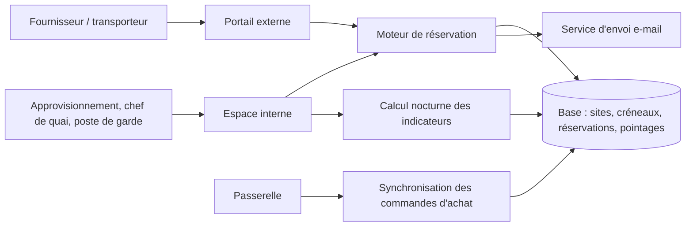
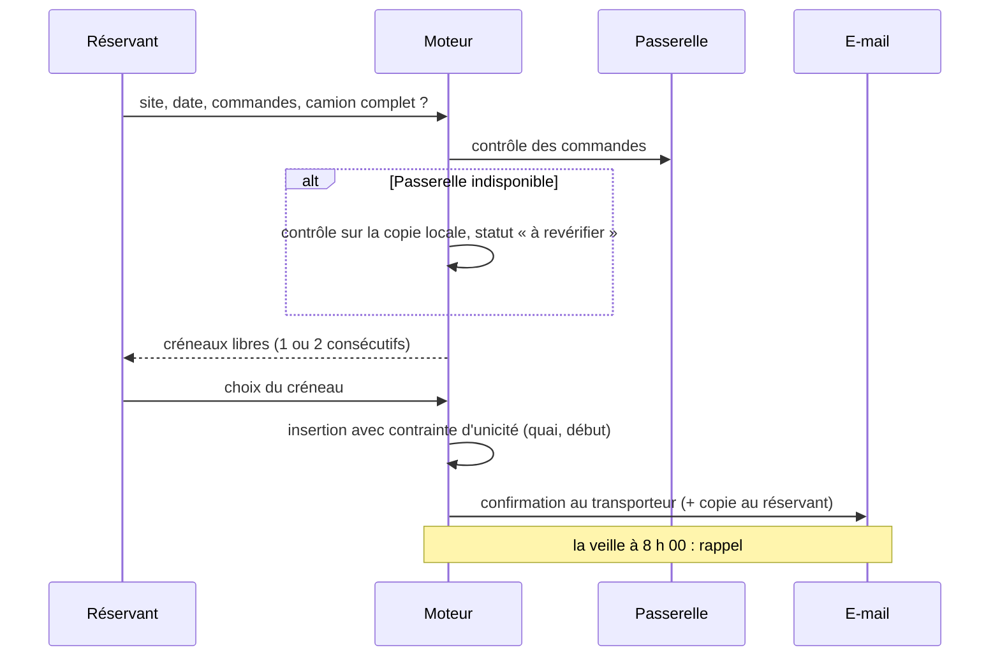

# Conception : prise de rendez-vous des livraisons fournisseurs

## Vue d'ensemble

Une application web unique sert deux publics. Le **portail externe** est destiné aux fournisseurs et aux transporteurs. L'**espace interne** sert à l'approvisionnement, aux chefs de quai, au bureau de réception et au poste de garde. Le moteur de réservation s'appuie sur le paramétrage de chaque site et vérifie les commandes d'achat dans Passerelle.

| Choix | Raison | Alternative écartée |
|---|---|---|
| Durée des créneaux, quais, bornes et heure du rappel paramétrables par site | Les conflits C01, C02 et C06 ne sont pas arbitrés | Coder 30 minutes et 6 quais |
| Créneaux réservés stockés avec une contrainte d'unicité (quai, début) | Garantit l'absence de double réservation, même en cas d'accès simultanés (critère 3.6) | Verrou applicatif seul |
| Copie locale des commandes d'achat, rafraîchie depuis Passerelle | Le portail reste utilisable pendant une panne de Passerelle (H16) | Appel synchrone seul |
| Pointage dans l'espace interne, sur poste ou tablette | Pas d'application dédiée en V1 (l'application chauffeur relève de la V2) | Application mobile pour le poste de garde |

Les technologies sont des **propositions** : application web avec authentification des tiers par comptes locaux et double facteur, SSO interne pour les employés, base relationnelle (PostgreSQL).

## Architecture

## Composants et interfaces

| Composant | Responsabilité | Interfaces | Exigences |
|---|---|---|---|
| Portail externe | Comptes, rattachement des transporteurs, recherche, réservation, modification, annulation, en français et en anglais | HTTPS, authentification par compte individuel | 1, 3, 5 |
| Espace interne | Paramétrage des sites, planning, actions du chef de quai, pointage, saisie du déchargement, indicateurs | SSO interne, rôles `appro`, `chef-quai`, `reception`, `garde` | 2, 7, 8, 9, 10 |
| Moteur de réservation | Calcul des créneaux libres, règles R1 à R7, statuts des réservations | Interne | 2, 3, 4, 5, 7, 9 |
| Synchronisation des commandes d'achat | Copie des commandes (numéro, fournisseur, site, statut) depuis Passerelle ; contrôle unitaire à la saisie | Passerelle (contrat à établir, Q06) | 4 |
| Notifications | Confirmation, rappel et e-mails liés aux actions du chef de quai, multilingues | Service d'envoi (Q17) | 6 |
| Indicateurs | Calcul nocturne et export CSV | Interne | 10 |

## Flux principaux

Le jour J, le poste de garde pointe le camion. Si le camion arrive plus de 20 minutes après le début du créneau, la réservation passe au statut « perdue » et ses créneaux sont libérés. Le chef de quai peut alors forcer le camion sur un créneau libre.

## Modèle de données

| Entité | Attributs principaux | Donnée personnelle | Durée de conservation |
|---|---|---|---|
| Site | quais ouverts, horaires, jours fermés, durée de créneau, bornes, heure du rappel | non | conservé |
| Compte | type (fournisseur, transporteur, interne), société, nom et e-mail du contact, langue, statut | oui (contact professionnel) | durée de vie du compte, puis à fixer avec la DPO (Q13) |
| CommandeAchat (copie) | numéro, fournisseur, site, statut, date de synchronisation | non | tant que la commande est active |
| Réservation | site, quai, créneaux, commandes, camion complet, e-mail du transporteur, statut, auteur | oui (e-mail professionnel) | au moins 13 mois (H04), à fixer avec la DPO |
| Pointage | réservation ou fournisseur déclaré, catégorie, heure d'arrivée, début et fin du déchargement | non (aucune donnée sur le chauffeur, H19) | au moins 13 mois (H04) |
| Blocage | quai, créneaux, récurrence, motif, auteur | oui (identifiant de l'employé) | 13 mois |
| Journal | auteur, action, objet, motif, horodatage | oui (identifiant) | 1 an proposé, à confirmer avec la DPO |

## Gestion des erreurs

| Situation | Comportement | Exigence |
|---|---|---|
| Deux réservants valident le même créneau au même moment | La seconde insertion est rejetée par la contrainte d'unicité ; d'autres créneaux sont proposés | 3.6 |
| Passerelle indisponible | Contrôle sur la copie locale, réservation marquée « à revérifier », nouveau contrôle au retour du service | 4.4 |
| Commande soldée après la réservation | Alerte au chef de quai et au réservant, sans annulation automatique | 4.5 |
| Service d'envoi en erreur | 3 nouvelles tentatives avec délai croissant, puis alerte dans l'espace interne | 6.1 |
| Modification de paramétrage incompatible avec des réservations | Refus, avec la liste des réservations concernées | 2.5 |
| Camion arrivé après la tolérance | Réservation perdue, créneaux libérés, camion signalé au chef de quai | 9.2, 9.4 |

## Sécurité et RGPD

- **Avant le développement :** l'analyse du traitement est soumise à la DPO (CT-01). Elle porte sur la base légale, les durées de conservation (Q13) et l'ouverture du portail à des tiers.
- **Minimisation :** les données personnelles se limitent aux contacts professionnels des fournisseurs et des transporteurs. Aucune donnée n'est collectée sur les chauffeurs (H19).
- **Comptes externes :** chaque compte est individuel, avec double facteur proposé. Un transporteur n'accède qu'aux commandes des fournisseurs qui l'ont rattaché (critère 1.3).
- **Contenu des e-mails :** uniquement des informations de service, sans contenu commercial (CT-03).
- **Hébergement :** cloud d'Orvanne, dans l'Union européenne (CT-08).
- **Données de test :** jeux de données synthétiques (CT-04).

## Volumétrie et performance

| Grandeur | Actuel | Dimensionnement | Base |
|---|---|---|---|
| Camions par jour | E1 ≈ 70, E2 ≈ 40 | ≈ 220 (×2) | B08-N1, B08-N3 ; H17 |
| Réservations ouvertes simultanément (fenêtre de J-10) | ≈ 1 100 | ≈ 2 200 | estimation |
| Fournisseurs pilotes | ≈ 20 | tous les fournisseurs à terme | B08-N8 |

Ces volumes sont faibles. La difficulté vient des accès simultanés lors de l'ouverture des créneaux et de la disponibilité 7 jours sur 7, pas du débit.

## Stratégie de test

| Niveau | Contenu | Exigences |
|---|---|---|
| Unitaire | Calcul des créneaux, camion complet, bornes J-10 et J-1 midi, tolérance de 20 minutes, définitions des indicateurs | 2, 3, 5, 9.2, 10 |
| Concurrence | 50 réservations simultanées sur le même créneau : une seule doit aboutir | 3.6 |
| Intégration | Passerelle en recette, y compris en panne ; service d'envoi | 4, 6 |
| Performance | Recherche de créneaux, 95e centile inférieur à 2 s avec 2 200 réservations | 11.1 |
| Recette métier | Pilote E1 : une semaine rejouée avec le chef de quai et le poste de garde | 7, 8, 9 |
